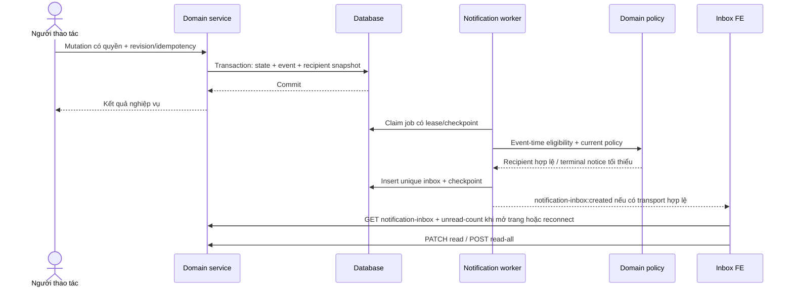

# Phase 8–15 — Flow notification nghiệp vụ

Ngày: **20/11/2026**. **R0 CONTRACT READY — business runtime chưa implement**.
[Plan](../implement_phase/BUSINESS_NOTIFICATIONS_ROADMAP.md) ·
[API proposal](BUSINESS_NOTIFICATIONS_flow-api-breakdown.md) ·
[Progress](../progress/BUSINESS_NOTIFICATIONS_PROGRESS.md) ·
[Catalog](../implement_phase/phase%208/EVENT_CATALOG.md) ·
[Writers](../implement_phase/phase%208/WRITER_INVENTORY.md) ·
[Policy](../implement_phase/phase%208/RECIPIENT_POLICY.md)

## 1. Luồng chung

Commit event thất bại làm rollback mutation. Sau commit, socket/worker lỗi được
retry riêng. Socket không phải nguồn bảo đảm delivery; offline vẫn có durable inbox.
Read-all snapshot không đánh read late fanout. GET không tự đánh read.

## 2. Các luồng ưu tiên

| Luồng | Sau commit | Khi click |
| --- | --- | --- |
| Đổi lịch/mentor | Snapshot Student + mentor thực sự bị ảnh hưởng, loại actor/no-op | Refetch session hiện tại; không tin lịch cũ trong event |
| Hủy lớp | Một notice/user/cause, tránh cascade spam theo từng buổi | Generic notice; resource có thể unavailable |
| Publish bài / đổi hạn | Student được truy cập bài tại event và hiện tại | Chi tiết bài theo quyền hiện tại |
| ZIP release hoặc re-release điểm | Chỉ chủ submission, không gửi grade trong payload | Chi tiết kết quả released |
| Payment thành công | Chủ order nhận một xác nhận canonical | Order/payment result theo owner |
| Sắp hết hạn / hết hạn | Worker recheck PENDING/expiry; bỏ reminder stale | Trạng thái order mới nhất |
| Mentor xin nghỉ | Người có quyền duyệt nhận request | Leave detail theo scope |
| Duyệt/từ chối | Mentor gửi request nhận kết quả; Student nhận lịch qua cause | Request hoặc lịch theo role |
| Xếp/hủy placement | Đúng Student và mentor đích, không broadcast peers | Lịch bù hiện tại nếu còn quyền |
| Material APPROVE auto-publish/PUBLISH | Snapshot tại publication; notBefore theo availableAt rồi kiểm Student-visible | Read material/file theo policy |

## 3. Thu hồi quyền và terminal notice

Active notice bị ẩn khi nguồn policy từ chối; list/count/read/socket cùng kết quả.
Cancellation/removal/expiry dùng event-time relation snapshot để người bị ảnh hưởng
nhận generic notice dù entitlement đã kết thúc. Target unavailable khi không còn
quyền mở resource; không cấp lại quyền qua notification. Account bị khóa hoặc
session bị revoke phải chặn REST/socket ngay theo Auth.

## 4. Offline, flags và handoff

Business inbox/worker tách CHAT_ENABLED; giữ adapter và flags chat cũ.
Mentor/Student có thể nhận realtime trên transport hiện tại khi chat bật.
Manager/Admin dùng REST refresh; không tham gia namespace /chat.
Unified dùng /api/v1/notification-inbox và notification-inbox:*; legacy
/notifications + notification:created/notifications:read chỉ chat, giữ nguyên.
Duyệt leave tạo cancellation nguồn + makeup successor, chung cause; class cancel
suppress child session notices. Payment capture canonical tại markPaid.
Producer activation có epoch bền trong DB, capture không bị tắt bởi delivery flags.
FE refetch khi mở inbox/focus/reconnect; khi inbox đang mở mà không có socket,
poll tối thiểu mỗi 30 giây, dừng khi tab hidden và backoff khi lỗi.
Mốc payload bị lỡ không được coi là notification đã đọc.
Route FE đã đối chiếu read-only trong [mapping R0](../implement_phase/phase%208/FE_TARGET_MAPPING.md);
Admin leave detail/session-material focus còn gap Phase 15, chưa có browser evidence.
