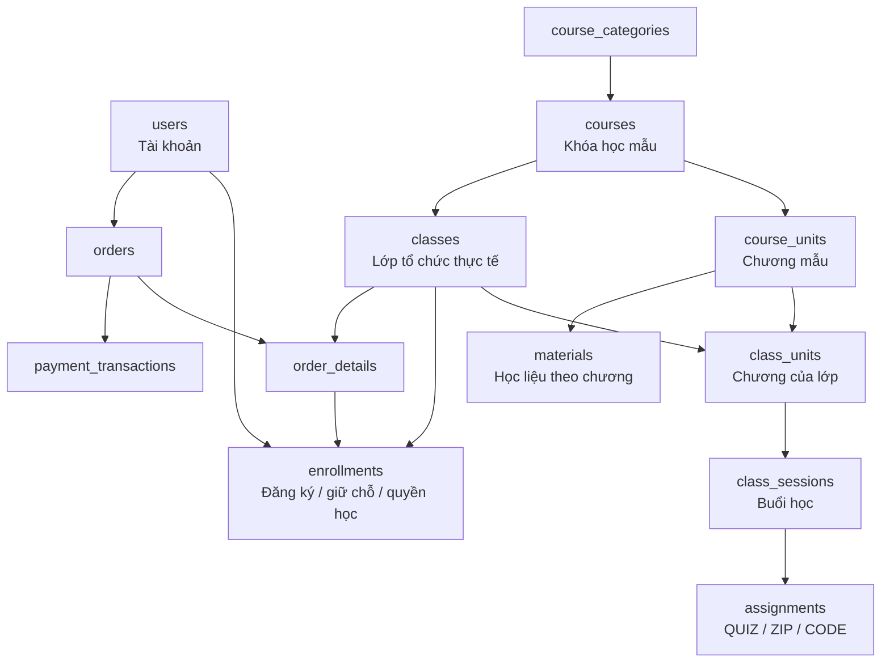
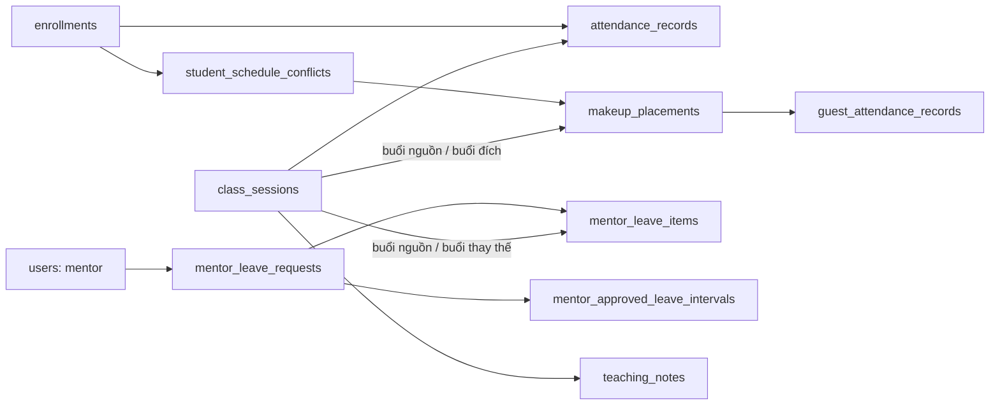
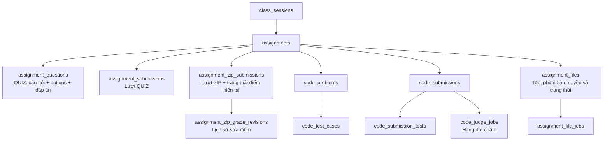
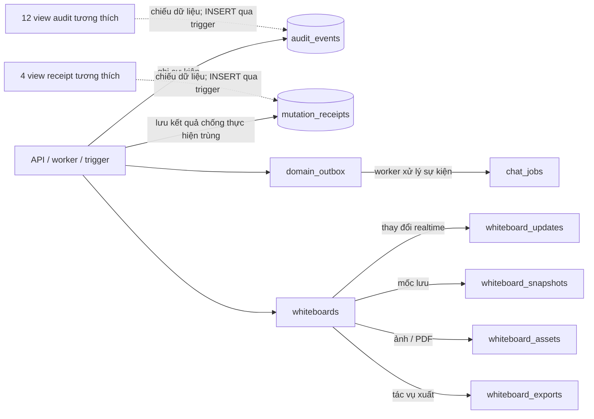

# Bản đồ database Mindy

Ngày đối chiếu: 19/11/2026. Nguồn: 42 migration trong `src/database/migrations/`, đọc nhánh `up()` theo thứ tự và đối chiếu các migration gộp cùng service đang sử dụng. Đây là cấu trúc dự kiến sau khi áp dụng đủ migration của checkout này, **chưa phải kiểm kê PostgreSQL/VPS đang chạy**. Không chạy migration, không đọc dữ liệu tài khoản và không sửa DB trong lượt này.

## 1. Đọc bản đồ

| Nhóm | Số lượng | Ý nghĩa |
| --- | ---: | --- |
| Bảng nghiệp vụ / cấu hình nghiệp vụ | 48 | Mô tả người dùng, lớp, học tập, giao dịch, nội dung và kết quả |
| Bảng kỹ thuật / vận hành / bằng chứng | 32 | Phiên đăng nhập, lưu tệp, jobs, realtime, audit, receipt và lịch sử vận hành |
| View tương thích | 16 | Giữ tên/schema truy cập cũ; dữ liệu thực nằm ở audit_events hoặc mutation_receipts |
| Tổng bảng lưu trữ ứng dụng | 80 | Không tính view và bảng quản lý migration do TypeORM tạo |

Phân nhóm theo trách nhiệm chính để dễ đọc, không phải kết luận bảng nào có thể xóa. Bảng kỹ thuật vẫn có thể chứa dữ liệu không thể tái tạo hoặc cần cho tính đúng đắn. Ví dụ whiteboard_updates giữ thay đổi bảng; class_opening_enrollment_events giữ lịch sử để tính sĩ số tại đúng mốc khai giảng.

Sơ đồ dưới chỉ chọn quan hệ quan trọng; không vẽ mọi FK, trường dữ liệu, optionality hoặc cardinality. Mũi tên liền trong sơ đồ nghiệp vụ đi từ đối tượng cha sang đối tượng tham chiếu nó; sơ đồ vận hành có nhãn chức năng, không được hiểu là mọi cạnh đều có FK.

## 2. Xương sống nghiệp vụ



- Course và Class không trùng trách nhiệm: một bên là chương trình/sản phẩm, một bên là lần tổ chức có lịch, giảng viên và sĩ số.
- CourseUnit và ClassUnit tương tự: chương mẫu và chương được triển khai tại lớp.
- OrderDetail và Enrollment không trùng: dòng đơn ghi nhận giao dịch/snapshot; enrollment quản lý giữ chỗ, đăng ký và quyền học.
- Material thuộc CourseUnit và có thể gắn Session; Assignment thuộc Session. Không gộp hai loại nội dung chỉ vì đều hiển thị trong buổi học.

## 3. Điểm danh, học bù, nghỉ dạy



Điểm danh đăng ký gốc và điểm danh học bù khác scope. Ghép thành một bảng có thể làm được về mặt thiết kế, nhưng cần thiết kế lại định danh, ràng buộc chống ghi trùng, credit học bù và API; chưa có cơ sở để coi đó là thao tác xóa bảng đơn giản.

## 4. Bài tập



Sơ đồ rút gọn; inventory phía dưới liệt kê thêm draft, ngôn ngữ, đề đính kèm và snapshot. Bảng ít không đồng nghĩa logic ít: migration gộp assignment đã chuyển options/đáp án vào assignment_questions, chuyển trạng thái điểm hiện tại vào assignment_zip_submissions và gộp audit/receipt vào kho chung.

## 5. Vận hành và dữ liệu tương thích



View tương thích không lưu thêm một bản dữ liệu độc lập. Xóa view có thể làm danh sách object ngắn hơn nhưng không giúp giảm đáng kể dung lượng dữ liệu. Một số service còn INSERT/SELECT qua các view này, nên cần chuyển caller trước khi DROP VIEW.

## 6. Inventory đầy đủ theo trách nhiệm chính

Tên trong hai cột sau là bảng lưu trữ, không bao gồm 16 view. Phân loại là lựa chọn diễn giải phục vụ audit, không phải namespace vật lý của PostgreSQL.

| Module | Nghiệp vụ / cấu hình | Kỹ thuật / vận hành / bằng chứng |
| --- | --- | --- |
| Danh tính (6) | `users`, `user_identities` | `auth_sessions`, `refresh_tokens`, `registration_intents`, `email_verification_tokens` |
| Danh mục (3) | `course_categories`, `courses`, `course_units` | — |
| Lớp và tiến độ (7) | `classes`, `class_units`, `class_sessions`, `class_weekly_schedules`, `class_unit_progress` | `class_opening_decisions`, `class_opening_enrollment_events` |
| Mua và thanh toán (9) | `carts`, `cart_details`, `orders`, `order_details`, `enrollments`, `payment_transactions`, `payos_payment_details` | `payment_webhook_events`, `payment_confirmation_emails` |
| Học liệu và tệp chung (6) | `materials`, `material_file_references` | `file_objects`, `file_metadata`, `file_processing_jobs`, `material_file_cleanup_jobs` |
| Điểm danh / nghỉ / bù / ghi chú (10) | `attendance_records`, `guest_attendance_records`, `student_schedule_conflicts`, `makeup_placements`, `mentor_leave_requests`, `mentor_leave_items`, `mentor_approved_leave_intervals`, `teaching_notes` | `attendance_recovery_audits`, `attendance_recovery_audit_items` |
| Bài tập chung / QUIZ / ZIP (10) | `assignments`, `assignment_questions`, `assignment_submissions`, `assignment_zip_submissions`, `assignment_instruction_files`, `assignment_zip_instruction_snapshots`, `assignment_zip_grade_revisions` | `assignment_files`, `assignment_file_jobs`, `assignment_finalization_jobs` |
| Bài tập CODE (10) | `code_languages`, `code_problems`, `code_problem_languages`, `code_test_cases`, `code_reference_solutions`, `code_drafts`, `code_submissions`, `code_submission_tests` | `code_judge_jobs`, `code_runs` |
| Chat và thông báo (10) | `chat_conversations`, `chat_members`, `chat_messages`, `notifications` | `chat_events`, `domain_outbox`, `chat_jobs`, `chat_key_usage`, `chat_file_objects`, `chat_file_copies` |
| Bảng vẽ (6) | `whiteboards` | `whiteboard_updates`, `whiteboard_receipts`, `whiteboard_snapshots`, `whiteboard_assets`, `whiteboard_exports` |
| Hệ thống (3) | `system_rules` | `audit_events`, `mutation_receipts` |

### Các view hiện tại

| Đích lưu trữ | View tương thích |
| --- | --- |
| `audit_events` (12) | `material_audit_events`, `teaching_assignment_audits`, `session_lifecycle_audits`, `session_schedule_audits`, `attendance_audits`, `guest_attendance_audits`, `makeup_placement_audits`, `mentor_leave_audits`, `teaching_note_audits`, `class_unit_release_audit`, `session_meeting_audits`, `system_rule_audits` |
| `mutation_receipts` (4) | `teaching_mutation_receipts`, `attendance_mutation_receipts`, `makeup_mutation_receipts`, `teaching_note_receipts` |

### Tên bảng cũ không còn là bảng sau migration gộp

`assignment_answer_keys`, `assignment_question_options`, `assignment_receipts`, `assignment_zip_receipts`, `assignment_zip_submission_files`, `assignment_audits`, `assignment_zip_audits`, `assignment_zip_grades`, `assignment_file_copies` đã bị DROP trong migration `1793836800002-consolidate-assignments.ts` sau khi chuyển dữ liệu/ràng buộc. Đây không phải danh sách bảng mới cần xóa. Các tên nguồn audit assignment vẫn xuất hiện dưới dạng giá trị `source` trong audit_events.

## 7. Có thể bỏ bảng nào?

**Chưa xác nhận được bảng lưu trữ nào có thể DROP ngay mà giữ nguyên toàn bộ hành vi hiện tại.** Số API Admin ít không chứng minh bảng thừa: caller còn là Student/Mentor/Manager, websocket, worker, trigger và tác vụ bảo trì. Bảng đang rỗng cũng không chứng minh không cần: jobs/receipt có thể chỉ phát sinh lúc xử lý lỗi hoặc đồng thời.

| Hạng mục | Đề xuất | Điều kiện và giới hạn |
| --- | --- | --- |
| 16 view tương thích | Ứng viên dọn object trước | Chuyển toàn bộ caller/entity sang audit_events/mutation_receipts; giữ transaction, scope, constraint và lịch sử. DROP VIEW sau khi xác nhận không còn phụ thuộc. Giảm object, không giảm 16 bảng lưu trữ. |
| `whiteboard_receipts` | Ứng viên gộp 1 bảng | Chuyển sang namespace riêng trong mutation_receipts, bảo toàn key/route/hash/response và hành vi replay/conflict. Hiện WhiteboardsService còn đọc/ghi trực tiếp nên chưa được xóa. |
| `registration_intents`, `user_identities` | Có thể bỏ tối đa 2 bảng nếu bỏ hẳn Google OIDC | BE đang triển khai Google registration/context/completion và dùng entity. FE ẩn nút Google không đồng nghĩa luồng BE đã bị bỏ. Cần kiểm dữ liệu liên kết, endpoint, cấu hình và quyết định ngừng tính năng trước; chưa đề nghị xóa trong phạm vi giữ nguyên sản phẩm. |
| `class_units.status`, `class_units.unlock_at` | Ứng viên dọn trường legacy | Source đã ghi rõ đây là trường release cũ không quyết định quyền. Rà DTO/query/audit và caller trước khi bỏ; không xóa cả class_units. |
| `class_unit_release_audit` | Có thể dọn view/entity legacy sau kiểm phụ thuộc | Đã là view, lịch sử còn nằm ở audit_events. Tracking vẫn biết source legacy; phải giữ khả năng xem lịch sử đã có. |
| `class_unit_progress` | Giữ | StoredProgressService còn đọc summary và units. Muốn bỏ cần quyết định lại nguồn tiến độ và sửa contract; chưa có bằng chứng là bảng chết. |
| `class_opening_decisions`, `class_opening_enrollment_events` | Giữ | ClassOpeningService dùng quyết định và trạng thái enrollment tại cutoff; dashboard đọc lớp bị chặn khai giảng. Không thay bằng count hiện tại mà vẫn giữ cùng nghiệp vụ được. |
| `notifications`, `chat_key_usage`, `domain_outbox`, các jobs | Giữ | Có controller/service/worker/maintenance và crypto usage đang dùng; không suy từ màn Admin. |
| Audit, điểm đã trả, snapshot đề nộp, webhook/receipt thanh toán | Giữ theo chính sách dữ liệu | Đây là bằng chứng và tính đúng đắn, không chỉ log trang trí. Rà retention/archive riêng nếu mục tiêu là dung lượng. |

Ưu tiên thực tế: (1) làm sạch cách nhìn bằng bản đồ và nhóm bảng; (2) thay caller legacy, dọn view; (3) thiết kế gộp whiteboard_receipts; (4) chỉ bỏ module nếu chủ sản phẩm quyết định không dùng; (5) đo số dòng/dung lượng/index trước khi lập retention. Không sửa migration đã triển khai; thay đổi sau này cần forward migration và kiểm dữ liệu trước/sau.

## 8. Đối chiếu DB đang chạy, chỉ đọc

Các câu SQL sau chỉ phục vụ xác minh khi có phiên DB được phép. Chưa chạy trong lượt lập bản đồ này. Dung lượng dưới đây là heap + TOAST + index theo từng bảng; không bao gồm file thật trong MinIO, WAL hoặc backup.

```sql
-- Object ứng dụng trong public; phân biệt bảng và view.
SELECT c.relname AS name,
       CASE c.relkind WHEN 'r' THEN 'table' WHEN 'p' THEN 'partitioned table'
                      WHEN 'v' THEN 'view' WHEN 'm' THEN 'materialized view' END AS kind
FROM pg_class c JOIN pg_namespace n ON n.oid = c.relnamespace
WHERE n.nspname = 'public' AND c.relkind IN ('r', 'p', 'v', 'm')
ORDER BY kind, name;

-- Ước lượng dòng và dung lượng; n_live_tup là thống kê, không phải COUNT chính xác.
SELECT s.relname, s.n_live_tup AS estimated_rows,
       pg_size_pretty(pg_total_relation_size(s.relid)) AS total_size,
       pg_size_pretty(pg_indexes_size(s.relid)) AS index_size
FROM pg_stat_user_tables s
ORDER BY pg_total_relation_size(s.relid) DESC;

-- Xem body các view trước khi dọn lớp tương thích.
SELECT schemaname, viewname, definition
FROM pg_views WHERE schemaname = 'public'
ORDER BY viewname;
```

Đối chiếu thêm danh sách migration đã áp dụng trên môi trường với 42 file source. Không dùng số lượng object trong sidebar của DB client để suy ra 80 bảng đã thực sự deploy.

## 9. Nguồn và kiểm chứng

- [Danh mục migration](../../src/database/migrations/): inventory lấy CREATE/DROP từ `up()`, xử lý DROP nhiều bảng và hai migration tạo view động/tĩnh.
- [Gộp tracking](../../src/database/migrations/1792627200002-consolidate-tracking.ts): 11 view audit + 4 view receipt, INSTEAD OF trigger, audit_events và mutation_receipts.
- [Gộp assignment](../../src/database/migrations/1793836800002-consolidate-assignments.ts): bỏ 9 bảng sau chuyển dữ liệu; audit/receipt đi thẳng kho chung, không tạo view assignment tương thích.
- [Gộp system-rule audit](../../src/database/migrations/1794182400001-consolidate-system-rule-audits.ts): view audit thứ 12.
- [Bỏ release thủ công](../../src/database/migrations/1792627200001-remove-class-unit-release.ts): giữ trường legacy, quyền theo enrollment.
- Caller đã đối chiếu: WhiteboardsService, StoredProgressService, ClassOpeningService, TrackingService, RegistrationService, ChatNotificationsService, ChatCryptoService, ChatWorkerService và SQL receipt của Attendance/TeachingNotes/WeeklySchedule.
- Kiểm chứng local: kiểm kê source và đối chiếu tên/loại object, quan hệ đại diện và caller. Không kiểm dữ liệu thật, không đo hiệu năng, không kiểm deploy. Không thay runtime/API hoặc thực hiện refactor/drop.
