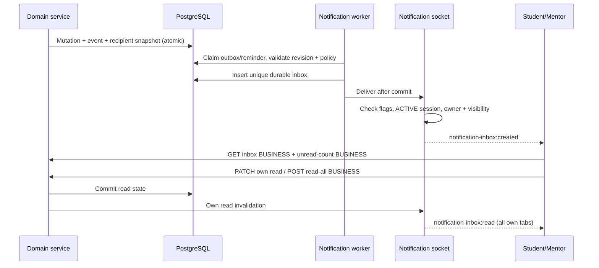

# Phase 16 — Flow chuông notification Mentor/Student

20/11/2026 — Merge origin/dev cc8489d vào nhánh notification: xử lý modify/delete
và content conflict do dev revert tài liệu R0. Giữ bộ Phase8–15 cùng cập nhật
Phase16 và các file contract/review được liên kết, tránh dangling references.
Không đổi API/runtime; kiểm merge markers, relative links và diff, không chạy lại BE tests.

20/11/2026 — **BE implemented local; FE/browser/deploy chưa nghiệm thu**.

[Plan](../implement_phase/phase%2016/PHASE_16_BELL_NOTIFICATIONS_WEBSOCKET.md) ·
[API/WS](PHASE_16_flow-api-breakdown.md) ·
[Progress](../progress/phase%2016/PHASE_16_PROGRESS.md).

Khi mở app: lấy list/count BUSINESS, kết nối namespace `/notifications` qua
`/ws/notifications`, refetch sau connect để khép khoảng trống giữa GET và connect.
Packet chỉ cập nhật/dedupe rồi refetch count; không cộng badge mù. Focus/reconnect
luôn refetch, không tự mark read. Khi socket không khả dụng, poll 30s lúc đang mở
inbox, dừng hidden và backoff lỗi. Offline giữ nguyên durable inbox.

Các nhóm: lịch/phân công/hủy/buổi bù; bài tập/hạn/ZIP released grade; order; kết quả
nghỉ dạy; placement; tài liệu; ZIP chờ chấm cho mentor; kết quả review cho tác giả;
nhắc buổi 30 phút và nhắc deadline bài 24h. Chi tiết recipient/trigger/stale trong plan.

Click: đánh đọc theo thao tác người dùng rồi mở target theo role; resource API
authorize lại. Target unavailable thì hiển thị notice generic, không cố mở private
resource. Không dùng notification để cấp lại quyền. Read failure không được coi đã
lưu; refetch lại trạng thái, target access vẫn do resource API quyết định.

## Ghi nhận 20/11/2026

Live local demo theo yêu cầu: manager login → activate SCHEDULE → PATCH audited
schedule (200) → event DONE → 9 unread inbox rows. Buổi JS-101-FE-DEMO-20261120
ngày 24/11 đổi 09:30–11:00 thành 10:00–11:30 (+07); mentor.frontend và
student.an/s01–s07 là recipients. Chưa kiểm UI user/không mark read.

Bổ sung bước login vào Postman Phase16: Login Student hoặc Login Mentor →
GET /auth/me → BUSINESS inbox/count/read hoặc realtime-ticket → socket.
Cookie HttpOnly theo host dùng actor đăng nhập gần nhất. API/WS đã yêu cầu Auth
trong runtime; lượt bổ sung này chỉ sửa collection/handoff, kiểm JSON/scripts/diff,
không thay guard hoặc chạy lại backend tests. Contract login chi tiết ở API breakdown.

Implementation: đã có NotificationsModule, migration/outbox/snapshots, bốn REST
routes, ticket channel notifications, Socket.IO riêng và producers/reminders.
Các nhóm nghiệp vụ được capture từ persistence boundary; chi tiết quyết định và
giới hạn tại plan mục 8. Socket emit sau inbox commit; API count batch theo nhóm
tài nguyên, cùng policy list/read; legacy chat read state không bị copy.
Kiểm chứng và số đo hiện hành xem progress. Đoạn planning sau giữ lịch sử lượt soạn.

Đã lập 6 slices/12 AC và đề xuất transport độc lập CHAT_ENABLED. BUSINESS scope
cho list/count/read-all là extension cần implement Phase 9/16, chưa tồn tại trong
runtime. Đã đọc Flow.txt, plan Phase 8–15 và đối chiếu chat/whiteboard socket,
ticket auth, ZIP submit/material review. Chỉ kiểm diff/link tài liệu; không chạy
BE tests, migration hoặc deploy; FE bàn giao riêng.
