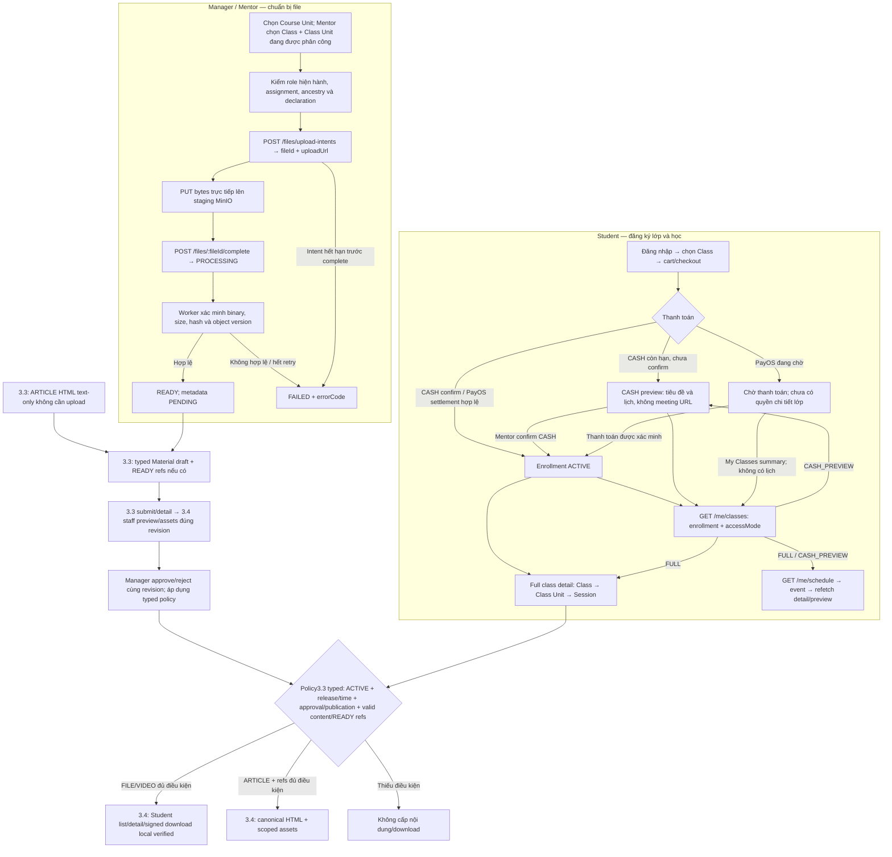
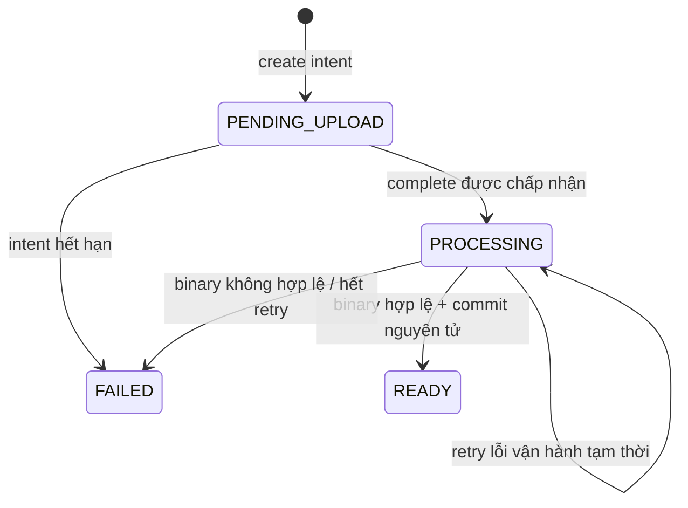

# Flow Phase 2.3 → 3.1 → 3.2

2026-10-16 planning: [Phase2.4 Manager HR + kế toán](PHASE_2_4_FLOW.md) bổ sung
góc nhìn class/course/contact/mentor/student và order/payment toàn trung tâm.
Kế thừa API manager đã có của2.2/3/4, không mở blanket admin hoặc đổi Student
flow. [API proposal](PHASE_2_4_flow-api-breakdown.md); chưa implement/test/deploy2.4.

2026-10-16 implementation4.4c: lịch2.3 giữ range/access/envelope, thêm effective
mentor nullable, own physical/credited attendance và SESSION_MAKEUP union trước
page. Own terminal history/summary không mở lại nội dung lớp; guest không cấp
materials/CASH lớp nhận. Shared SQL credit/source owner dùng cả Student/Staff.
[API implemented4.4c](PHASE_4_4_flow-api-breakdown.md#13-44c--quy-ước-và-contract-chung)
và [Progress4.4](../progress/phase%204/PHASE_4_4_PROGRESS.md) ghi local evidence;
planning note bên dưới là trước implementation. Không sửa FE/deploy/Phase3 access.

2026-10-16 — Quan hệ mới với Phase4:4.4b hoàn tất theo user; lịch2.3 vẫn là
baseline current entitlement/CASH preview. Extension mentor/attendance/guest
và own history/summary **đang planning4.4c**, xem
[flow4.4](PHASE_4_4_FLOW.md) / [API dự kiến mục13–18](PHASE_4_4_flow-api-breakdown.md#13-44c--quy-ước-và-contract-chung).
Giữ range31 ngày/envelope2.3, không mở lại materials khi chỉ đọc historical
attendance. Guest chỉ đúng Session context, không nhận quyền tài liệu/CASH
của lớp nhận. Lượt này chỉ tài liệu, không API runtime/FE/deploy mới. Baseline
và log ngày cũ bên dưới không đại diện trạng thái triển khai4.4 hiện hành.

Đối chiếu source và progress; cập nhật plan/baseline ngày 2026-10-13.
Đối chiếu source và progress; cập nhật tích hợp ngày 2026-10-15; lịch sử planning13/10 được ghi riêng.
“Đã code” bên dưới chỉ nói về repo; không khẳng định đã deploy hoặc bật trên VPS.

FE tích hợp upload: [Flow 3.2](PHASE_3_2_FLOW.md) và
[API breakdown 3.2](PHASE_3_2_flow-api-breakdown.md).
FE tích hợp My Classes/lịch: [Flow 2.3](PHASE_2_3_FLOW.md) và
[API breakdown 2.3](PHASE_2_3_flow-api-breakdown.md).

Điều phối2026-10-13: người khác triển khai3.3–3.6, user nhận deploy/server
acceptance; FE do nhóm riêng làm, repo FE local chỉ đọc.
[Plan3.4 phối hợp3.3](../implement_phase/phase%203/PHASE_3_4_MATERIAL_ACCESS_PREVIEW.md)
đưa staff preview/assets cùng review3.3.3, Student typed consumer sau contract3.3.1.
Ghi chú điều phối13/10 chỉ là lịch sử planning; kết quả tích hợp15/10 ghi ở cuối tài liệu.

## 1. Mỗi phase cung cấp gì?

Phase4 bắt đầu song song theo user2026-10-13; enrollment/lịch2.3 + MANAGER là
prerequisites, attendance không đợi Material CRUD. [Flow4](PHASE_4_FLOW.md) /
[API4 dự kiến](PHASE_4_flow-api-breakdown.md) bổ sung mentor availability/dạy
thay theo buổi, mở điểm danh trong ngày (không overnight), roster/chốt/hạn hết
ngày học kế tiếp, recovery legacy,
nghỉ trước hai ngày lịch có duyệt, bù buổi/ngày và học bù lớp khác cùng Course Unit.
Phase4.1–4.2 đã implementation/test local, chưa deploy; xem contract4 mục14–15.
4.3 implemented/focused verified;4.4–4.5 vẫn planned; substitute không tự có quyền material
authoring/review/release hoặc cash confirm theo Order snapshot. Shared
Classes/StudentLearning/providers và migrations phối hợp trước merge.

| Phase | Mục tiêu | Đã có trong checkout này | Phần còn thiếu |
|---|---|---|---|
| 2.3 | Student tìm lớp đã đăng ký, xem detail và lịch cá nhân | StudentLearningModule, collection My Classes, lịch nhiều lớp, DTO access context, full detail/CASH preview; suite local pass | Query-plan review trên fixture lớn, coverage PayOS settlement → list/lịch và staging/VPS smoke |
| 3.1 | Quy định ai được tạo, sửa, duyệt và đọc tài liệu | Role MANAGER + migration; MaterialsModule/MaterialPolicyService; context providers; domain review/revision/access và test | Material entity, DB persistence, HTTP CRUD/review và Student download thuộc các slice sau |
| 3.2 | Upload file private và xác minh nội dung thực | Files API, private/versioned MinIO adapter, file/job/metadata tables, worker/locks/tests; nghiệm thu VPS theo user2026-10-12 | Material CRUD/review ở3.3; đọc/tải3.4; metadata/cleanup3.5; full integration3.6 |
| 3.3 | Typed Material CRUD/review và Class Unit release | Manager/Mentor authoring/context/submission, review/publication/release và acceptance/handoff implemented local13–14/10 | VPS/user sign-off pending; [flow](PHASE_3_3_FLOW.md)/[breakdown](PHASE_3_3_flow-api-breakdown.md) |
| 3.4 | Student access + staff preview phối hợp3.3 | ARTICLE/FILE/VIDEO list/detail/download, scoped file access và staff preview đã implement local2026-10-14 | Giữ canPreview riêng với canRead; VPS/browser/FE còn pending; [flow](PHASE_3_4_FLOW.md)/[breakdown](PHASE_3_4_flow-api-breakdown.md) |

Hai nhánh Student và Manager/Mentor làm việc độc lập, sau này gặp nhau ở Material.

Phase4 có [plan riêng4.1](../implement_phase/phase%204/PHASE_4_1_MENTOR_SUBSTITUTION.md)
và [plan riêng4.2](../implement_phase/phase%204/PHASE_4_2_SESSION_ATTENDANCE.md):
available mentor/assignment → lifecycle/roster có core source/local evidence lịch
sử. Correction/recovery/audit4.3 → leave/cancel/replacement4.4a → guest/conflicts4.4b
→ Student/operations4.4c → release4.5 còn planned;4.3 đã có implementation/local evidence. Coverage/dependencies4.1–4.2
còn mở theo [Progress4.1](../progress/phase%204/PHASE_4_1_PROGRESS.md) và
[Progress4.2](../progress/phase%204/PHASE_4_2_PROGRESS.md); review này chỉ Markdown.

2026-10-13: tiếp [planning riêng4.3](../implement_phase/phase%204/PHASE_4_3_ATTENDANCE_CORRECTIONS_HISTORY.md)
cho correction/audit/legacy evidence recovery, đóng GAP42-01–03 sau implementation.
[Flow4.3](PHASE_4_3_FLOW.md) / [API4.3](PHASE_4_3_flow-api-breakdown.md) /
[Progress4.3](../progress/phase%204/PHASE_4_3_PROGRESS.md) có22 AC/16 test scenarios,
matrix source/gaps, payment evidence và HTTP limits. Chỉ tài liệu/source review;
không runtime/FE/deploy mới, Student projections tiếp tục4.4c.

Cập nhật scope 2026-10-11: Material ARTICLE lưu HTML đã sanitize để FE render;
FILE và VIDEO MP4 dùng private MinIO, URL có thời hạn (HLS sau). ARTICLE chỉ có
text không cần upload file; ảnh/attachments tham chiếu fileId READY từ 3.2.
Plan/flow/API 3.3 đã bổ sung, source vẫn file-only cho tới implementation.
User xác nhận3.2 đã nghiệm thu VPS ngày2026-10-12; PDF/MP4 READY/private objects
ghi ở [progress3.2](../progress/phase%203/PHASE_3_2_PROGRESS.md).
Plan3.3 thống nhất typed content, local/server gate từng slice, không chờ3.6 mới deploy.
2.3 cung cấp classId/classUnitId/sessionId để điều hướng; 3.1 kiểm quyền nội dung;
3.2 cung cấp fileId đã xác minh. Một file READY chưa trở thành Material được phép đọc.

## 2. Flow tổng thể

Diagram mô tả flow đã implement local qua3.4; không thay evidence deploy/browser.
Policy3.1 đã được gắn vào Material persistence/HTTP3.3–3.4.

## 3. API hiện có và dự kiến

Tất cả backend routes dưới prefix `/api/v1`. PUT uploadUrl là request tới MinIO,
không phải API upload multipart của NestJS.

| Method + route | Actor | Đầu ra / mục đích | Trạng thái |
|---|---|---|---|
| `POST /me/cart/items` | Student | Thêm Class vào cart | Có, nền tảng Phase 2 |
| `POST /me/cart/checkout` | Student | Tạo order, hold và enrollment pending | Có, nền tảng Phase 2 |
| `POST /me/orders/:orderId/payments/payos` | Student | Tạo/tái dùng payment link theo policy hiện hành | Có, nền tảng 2.2 |
| `POST /payment-callbacks/payos` | Provider callback | Xác minh callback và xử lý settlement; redirect FE không tự cấp quyền | Có, nền tảng 2.2 |
| `POST /manager/cash-orders/:orderId/confirm` | Manager bất kỳ, không cần phân công | Xác nhận CASH và kích hoạt enrollment | Có, nền tảng 2.2 |
| `GET /me/classes/:classId` | Student ACTIVE | Full detail, units/sessions/timetable, meeting URL và context enrollment/FULL | Đã code; context bổ sung 2.3 |
| `GET /me/classes/:classId/preview` | Student CASH pending còn hạn | Title/timetable/room + context hold/order/CASH_PREVIEW; không meeting URL | Đã code; context bổ sung 2.3 |
| `GET /me/classes` | Student | Danh sách enrollment, current/history/all, access hints | Đã code 2.3, local DB/HTTP verified |
| `GET /me/schedule?from=…&to=…` | Student | Lịch tổng hợp Session của các lớp có quyền; không meeting URL | Đã code 2.3, local DB/HTTP verified |
| `POST /files/upload-intents` | Manager / Mentor được phân công | Tạo intent; trả fileId, URL PUT và requiredHeaders | Đã code 3.2 |
| `POST /files/:fileId/complete` | Manager / Mentor đủ quyền hiện hành | Enqueue VALIDATE một lần; 202 khi PROCESSING, 200 khi READY | Đã code 3.2 |
| `GET /files/:fileId` | Manager / Mentor đủ quyền hiện hành | Status, errorCode và metadataStatus; không trả download URL | Đã code 3.2 |

**3.1 không thêm một bộ HTTP Material API.** Các hàm createDraft/applyCommand/canRead
đã có ở service/domain từ3.1; persistence/authoring/review/release3.3 và typed
Student/access/staff preview3.4 hiện đã implement local. Xem breakdown3.3/3.4 cho routes.

## 4. Flow Student của 2.3

1. Student chọn Class và checkout. Order phản ánh giao dịch; Enrollment là nguồn
   quyết định quyền học.
2. CASH pending còn hạn được dùng preview; PayOS pending chưa được full detail.
   Hết hạn/hủy hold không còn quyền preview, dù timer chưa persist expiry.
3. Khi payment được xác minh/confirm đúng, Enrollment chuyển ACTIVE. Student có
   thể gọi full detail nếu Class không CANCELLED.
4. FE gọi My Classes để lấy enrollment và accessMode. FULL mở
   detail; CASH_PREVIEW mở preview; NONE chỉ hiển thị summary/trạng thái phù hợp.
5. Lịch cá nhân chỉ gồm các lớp FULL hoặc CASH_PREVIEW; pending PayOS,
   expired/cancelled, COMPLETED enrollment và Class CANCELLED không được cấp lịch
   private theo contract hiện hành. Collection/list history khác quyền nội dung.
6. Khi bấm buổi học, FE dùng classId để refetch detail/preview và định vị sessionId
   trong units/sessions. Calendar không trả meeting URL.

Các API/DTO ở bước 4–6 **đã implement**. List mặc định pageSize 20, calendar 100,
tối đa 100; lịch yêu cầu range có timezone, `[from, to)` ≤31 ngày. Sau PAID/CASH
confirm, refetch list/lịch; hint tại `asOf` không thay việc kiểm quyền lại ở detail.
FULL không tự mở Material. Xem breakdown 2.3 để tích hợp từng endpoint/lỗi.

## 5. Những rule đã code ở 3.1

- Material thuộc **Course Unit**, có thể gắn Session nếu ancestry khớp. Nội dung
  được chia sẻ giữa các lớp dùng cùng Course Unit; release được kiểm theo lớp đang đọc.
- MANAGER là role riêng. ADMIN không tự có quyền upload/quản lý Materials.
- Mentor được phân công có thể tạo/sửa draft của mình trước lần duyệt đầu tiên,
  submit để Manager duyệt. Mentor không tự approve/publish hoặc sửa nội dung đã
  từng được duyệt; Manager quản lý nội dung chung.
- Domain có CREATE/EDIT/SUBMIT/APPROVE/REJECT/PUBLISH/UNPUBLISH/DELETE, revision
  và audit output. 3.1 định nghĩa transition;3.3 đã persist Material/refs/audit trong transaction.
- APPROVE ghi approval đúng revision và publishedAt hiện tại; availableAt/release
  vẫn có thể trì hoãn quyền đọc. REJECT ghi lý do. EDIT tăng revision, chuyển về
  DRAFT và thu hồi approval/publication cũ.
- Student đọc cần đủ: user active, Enrollment ACTIVE, Class không CANCELLED,
  Class Unit OPEN hoặc COMPLETED và đã tới unlockAt, Material chưa xóa, approval
  đúng revision, đã publish/đến thời điểm cho phép và file READY đúng Course Unit.
- Enrollment COMPLETED không tự có quyền đọc. Session CANCELLED không tự thu hồi
  tài liệu chính thuộc Course Unit.

Ví dụ: cùng một Course Unit có tài liệu chung cho lớp A/B. A đã mở unit, B còn
LOCKED: Student A có thể đạt policy đọc; Student B vẫn bị chặn dù file là READY.

## 6. Flow upload 3.2 có thể gọi ngay khi storage được cấu hình

1. Manager/Mentor gửi `POST /api/v1/files/upload-intents` với `courseUnitId`,
   `originalFilename`, `declaredMimeType`, `declaredSizeBytes`. Mentor bắt buộc gửi
   cả `classId` và `classUnitId`; Manager có thể bỏ cả hai, nhưng nếu gửi phải khớp.
2. Backend kiểm role active/assignment/ancestry, filename/MIME/size và quota;
   tạo file PENDING_UPLOAD. Response gồm fileId, uploadUrl, requiredHeaders,
   uploadUrlExpiresAt và intentExpiresAt.
3. FE PUT bytes trực tiếp tới uploadUrl, dùng đúng requiredHeaders. Không gửi
   cookie đăng nhập của API tới MinIO.
4. FE gọi `POST /api/v1/files/:fileId/complete` với `{}`. Backend kiểm quyền lại,
   chuyển PROCESSING và tạo VALIDATE job bền vững trong PostgreSQL.
5. Worker khóa version staging, đọc bytes, kiểm kích thước/binary/hash, copy tới
   final private object và commit READY nguyên tử cùng metadata PENDING/EXTRACT job.
   EXTRACT chưa được thực thi trong 3.2.
6. FE poll `GET /api/v1/files/:fileId`: READY có thể bàn giao fileId cho flow
   Material ở 3.3; FAILED hiển thị errorCode và tạo intent mới nếu upload lại.
   PROCESSING tiếp tục chờ; lỗi storage tạm thời retry hữu hạn.

Worker có lease/heartbeat/fencing để instance cũ không ghi đè kết quả; complete
concurrent không tạo job trùng. Overwrite staging sau complete không đổi phiên bản
đã pin. READY reference cần transaction/lock khi phase sau gắn file vào Material.

Formats: PDF/PNG/JPG/DOCX/PPTX/XLSX/MP3/MP4 và các text/source được allowlist.
Giới hạn thường 25 MiB; MP4 200 MiB. Không chỉ tin extension/MIME client khai báo.

## 7. Điều kiện chạy local, CI và VPS

- API Files cần `MINIO_ENABLED=true`, endpoint/credentials/bucket private có versioning.
- Worker tự chạy cần cả `MINIO_ENABLED=true` và `FILE_JOB_ENABLED=true`.
  Tắt worker không tự xử lý file PROCESSING.
- Linux validator dùng `/usr/bin/ffprobe`; Docker runtime đã cài `ffmpeg`.
  Workflow Check có bước cài dependency tương ứng trên runner.
- Redis không bắt buộc cho jobs của 3.2; job truth nằm trong PostgreSQL.
- 3.2 đã nghiệm thu VPS theo xác nhận user2026-10-12. Khi môi trường tắt
  `MINIO_ENABLED=false`, Files trả503 FILE_STORAGE_DISABLED; đây là hành vi
  cấu hình, không phải mô tả VPS hiện đang tắt storage.
- CI dùng MinIO fixture riêng; không phụ thuộc flag/MinIO của VPS.
- Student ARTICLE/FILE/VIDEO và staff/scoped access3.4 đã implement local cùng3.3
  authoring/review/release; server rollout và FE/browser acceptance vẫn pending.

## 8. Nhật ký đối chiếu

- 2026-10-12: Theo yêu cầu làm ba API trước, [Student FILE/VIDEO read3.4](PHASE_3_4_FLOW.md)
  đã implement/test local list/detail/download + materials read schema + signed
  pinned GET. Authoring/review/release/ARTICLE3.3 vẫn planned; READY riêng lẻ
  chưa tạo Material. [FE contract](PHASE_3_4_flow-api-breakdown.md) và
  [FE gaps audit](PHASE_3_4_FE_API_GAPS.md). Chưa deploy/VPS/browser acceptance.

- 2026-10-12: Cập nhật baseline3.2 đã nghiệm thu và flow ARTICLE text-only không
  qua upload; plan3.3 typed Manager→Mentor→review→release→acceptance, local/server
  gates từng slice. APIs3.3/3.4 vẫn planned; chỉ kiểm tài liệu/diff/link/JSON.

- 2026-10-11: Bổ sung liên kết plan/flow/API3.3, workflow context/draft/review/
  release sau READY; trạng thái vẫn chưa implement. Preview binary cùng Student
  download triển khai3.4. Chỉ lập tài liệu/kiểm links/diff/JSON, chưa runtime
  checks, migration hoặc deploy mới.

- 2026-10-10: Cập nhật phần 2.3 từ “kế hoạch/chưa triển khai” thành API đã code,
  sửa diagram/route table/Student flow và liên kết flow/breakdown riêng.
  Progress đã có evidence local: full check 243/243, HTTP 20/20 sau ghép dev;
  riêng DB 2.3 6/6. Đây là evidence lượt trước, không chạy lại runtime tests trong
  lượt tài liệu; chưa xác minh release/VPS hoặc thanh toán thật.

## 9. Nguồn đối chiếu

- [Flow 2.3](PHASE_2_3_FLOW.md)
- [API breakdown 2.3](PHASE_2_3_flow-api-breakdown.md)
- [Contract FE 2.3](../PHASE_2_3_FE_CONTRACT.md)
- [Progress 2.3](../progress/phase%202/PHASE_2_3_PROGRESS.md)
- [Plan 2.3](../implement_phase/phase2/PHASE_2_3_MY_CLASSES_SCHEDULE.md)
- [Progress 3.1](../progress/phase%203/PHASE_3_1_PROGRESS.md)
- [Progress 3.2](../progress/phase%203/PHASE_3_2_PROGRESS.md)
- [Runbook Files](../PHASE_3_2_FILES_RUNBOOK.md)
- [Student full detail controller](../../src/modules/classes/controllers/student-classes.controller.ts)
- [CASH preview/confirm controller](../../src/modules/payments/controllers/cash-payments.controller.ts)
- [Files controller](../../src/modules/files/controllers/files.controller.ts)
- [Material policy facade](../../src/modules/materials/services/material-policy.service.ts)
- [Material read policy](../../src/modules/materials/domain/material-access.ts)
- [Material review transitions](../../src/modules/materials/domain/material-review.ts)
- [Upload authorization](../../src/modules/files/services/file-upload-policy.service.ts)
- [File worker](../../src/modules/files/services/file-processing.worker.ts)

2026-10-13 implementation4.3: correction sau chốt,Staff audit GET và historical
evidence recovery đã có migration1791849600003 và runtime assertions. Handoff
[Flow4.3](PHASE_4_3_FLOW.md)/[API4.3](PHASE_4_3_flow-api-breakdown.md);
full local gates tại [Progress4.3](../progress/phase%204/PHASE_4_3_PROGRESS.md).
GAP42-01–03 thuộc implementation này;Student4.4c/guest4.4b/cancel-leave4.4a và
release4.5 vẫn mở. Chưa deploy/VPS/browser/live-payment hoặc sửa FE.

## Tích hợp với dev/Phase4 — 2026-10-15

Giữ implementation3.3/3.4 ngày13–14/10 và kế hoạch hiện hành15/10, cùng teaching/
attendance4.1–4.3 từ dev e0c9174. Planning GET preview/assets13/10 không thay contract
POST files/access đã implement14/10. ClassesModule giữ controllers/providers của
cả hai nhánh; Class completion guard Phase4 được giữ, fixture release3.3.4 được
điều chỉnh theo prerequisite Session terminal. Không mở quyền Materials cho substitute.
Hai migration compatibility mới đưa catalog thành22 mà không sửa migration cũ;
clean22, upgrade16→22 và17→22/data/FK/down-up có3/3 cases pass. Chi tiết quyết định
thứ tự/schema tại [progress3.3](../progress/phase%203/PHASE_3_3_PROGRESS.md).
Không đổi API3.3/3.4; không FE/development/VPS migration hoặc server/browser acceptance.

Kiểm chứng tích hợp15/10: pnpm check513/513 (48 suites), HTTP60/60 (5 suites)
qua cấu hình mặc định; lint/type-check/build pass. Migration compatibility3/3
đã chạy lại sau guard tên DB test. Không VPS/browser/FE hoặc live payment evidence.
