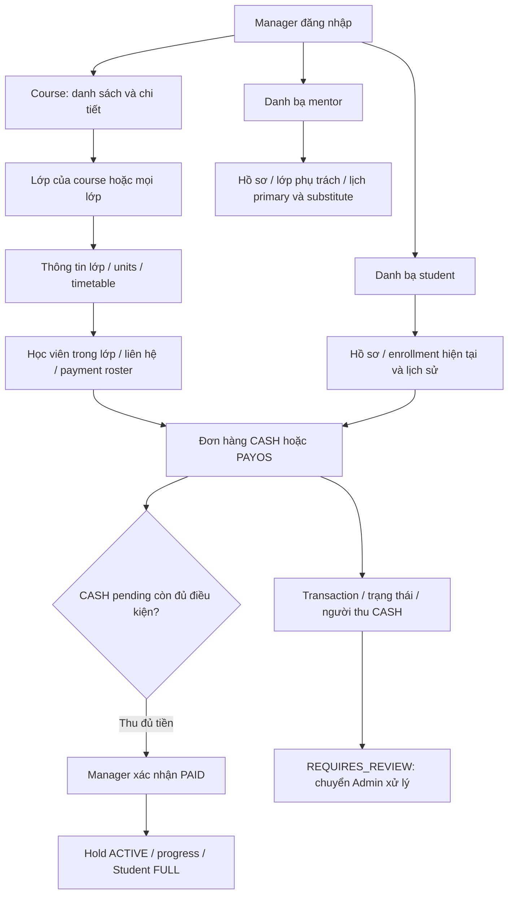

# Phase 2.4 — Flow Manager HR + kế toán

2026-10-16: **A–C đã implement source**, local verified theo progress; chưa deploy/VPS/browser acceptance.
[Plan](../implement_phase/phase2/PHASE_2_4_MANAGER_OPERATIONS.md) ·
[API breakdown](PHASE_2_4_flow-api-breakdown.md) ·
[Progress](../progress/phase%202/PHASE_2_4_PROGRESS.md).

## Luồng vận hành mục tiêu

Mọi lớp đều đọc được cho manager active, không cần assignment. Các màn hình mới
chủ yếu GET; không nhập studentId vào Student self API hoặc giả danh mentor.
Nhánh HR từ hồ sơ → classId → lịch dùng cùng nguồn effective mentor của Phase4.
Nhánh student giữ từng enrollment để phân biệt các lần đăng ký; xem history không
cấp lại quyền học. Nhánh tiền đi theo orderId/paymentId, không theo tổng mỗi dòng
lớp vì một order có thể bao gồm nhiều lớp.

## Đã có và kế hoạch bổ sung

- Đã có trong source: manager course list/detail, management class list/detail/
  timetable, teaching assignment/attendance reports/operations, materials, CASH
  list/confirm và manager payment roster. Xem bảng inventory trong plan.
- 2.4A implemented: class detail/units metadata, filter lớp, contact trong manager
  roster và class/student detail. Không thay response /management để làm portal.
- 2.4B implemented: mentor/student directory/profile, mentor classes/schedule, student
  enrollment history. Chỉ target MENTOR/STUDENT; không mở hồ sơ staff quản trị.
- 2.4C implemented: toàn bộ orders/transactions CASH/PAYOS và collector provenance.
  Đọc REQUIRES_REVIEW không có nghĩa được gọi reconcile.
- 2.4D backlog đề xuất: tổng hợp tiền đã thu theo paidAt và chờ thu hiện tại có
  nhãn riêng; chưa bao gồm payroll/refund/ledger/export.

## Quyền và tương thích

Manager giữ quyền ghi hiện có theo từng API/reason/version/audit. Plan không thêm
MANAGER vào toàn bộ admin controllers, không thay đổi user-management mutations,
không mở command reconcile. Student flow và Materials/Attendance gates giữ nguyên.
Roster manager có contact riêng; DTO mentor/public không nhận fields mới đó.
GET không gọi PayOS/SMTP, không ghi payment/enrollment hoặc thay state.

## Thứ tự nghiệm thu

A: course → lớp → units/lịch → học viên/contact/thu tiền.
B: mentor → lịch; student → lịch sử ghi danh → lớp.
C: student/class → order → transaction → collector; kiểm soát role và state.
Cuối mỗi slice có source/tests/Swagger/Postman/contract cùng revision, rồi gate
tích hợp local và server/browser acceptance riêng. Trạng thái triển khai được cập
nhật ở progress, không đánh dấu API dự kiến là FE gọi được.

## Nhật ký 2026-10-16

Đối chiếu controllers/DTO/services hiện hành; lập ma trận quyền, khoảng trống,
route proposal, thứ tự A–C và backlog D. Chỉ sửa tài liệu; kiểm diff/link.
Không chạy BE tests, migration, build hay deploy mới trong lượt planning.

## Triển khai A–C — 2026-10-16

ManagerOperationsModule bổ sung class detail/units, directory/detail/relationships
MENTOR/STUDENT và global order/payment reads. Manager roster có contact riêng,
mentor response giữ allowlist cũ. Query filter trước pagination, dedup bằng
subquery/EXISTS; compose trong REPEATABLE READ. Canceled sessions chưa bắt đầu
hiện theo allocation hiện tại, không sửa teaching/attendance credit.
Class Unit → courseUnitId nối màn hình manager với Materials theo yêu cầu ảnh
ngày16/10; chi tiết hai thao tác soạn/upload tại breakdown3.3 mục cuối.
Auth/session recheck dùng guard hiện hành; admin mutations/reconcile vẫn chặn.
Kết quả test cuối lượt được ghi progress; chưa sửa FE hoặc deploy.

Kiểm chứng cuối16/10: pnpm check615/615 tests (61 suites), lint/type/build pass;
HTTP77/77 (8 suites), gồm Word DOCX real MinIO full review/access/withdraw pass.
Source/API local verified; chưa sửa FE hoặc deploy. Không có file Word bàn giao:
Word .docx là định dạng tài liệu FILE/DOCUMENT theo yêu cầu user đã làm rõ.

## Rà soát sẵn sàng VPS ngày 2026-10-16

Đối chiếu Dockerfile, compose.production.yaml và workflow Deploy: image build từ
source và compiled migration catalog; push dev chạy check trước self-hosted deploy.
Increment2.4/contentText/DOCX approval không thêm migration/env/dependency. Local
check615 và HTTP77 đã pass. Working tree còn modified/untracked, cần commit đầy đủ
file mới trước push; không coi source local là đã có trên remote/VPS. Upload cần
MinIO/FILE_JOB hiện hữu đang hoạt động. Chưa agent deploy hoặc smoke test trên VPS;
sau rollout kiểm readiness, manager class list và DOCX upload/approve thực tế.
Đây là review cấu hình/readiness, không chạy lại BE tests trong lượt review này.
