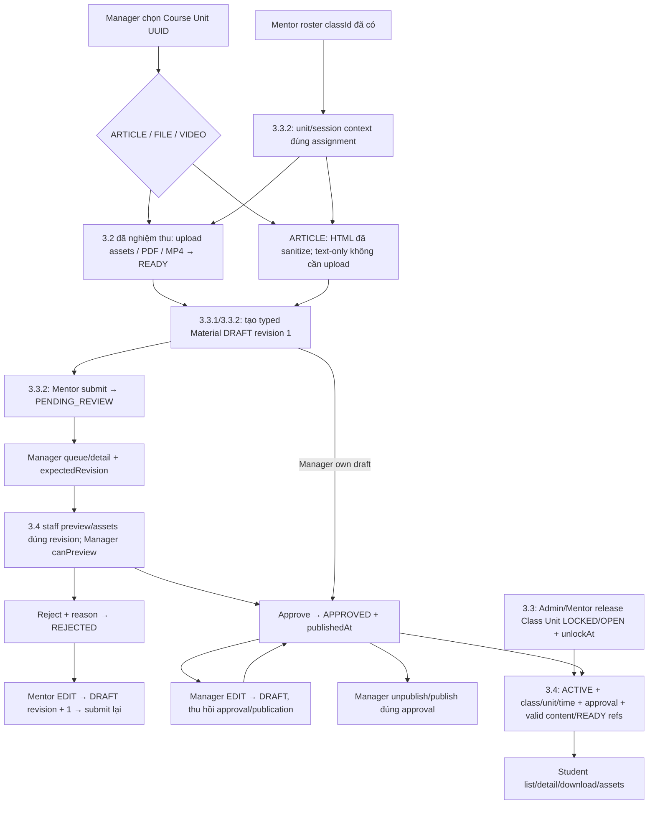

# Phase 3.3 — Flow Material management và release

## 2026-10-16 — Kiểm chứng migration sau đồng bộ dev

Đã fetch origin; Feat/Phase4 chứa toàn bộ origin/dev (ahead5/behind0), không cần
merge thêm. Bộ migration hiện hành24 gồm lõi3.3 từ dev và Phase4.4; hai migration
local1792108800000/1 đã loại khỏi source, không đưa lại vào DB.
Focused migration suites39/39; compatibility mở rộng5/5 gồm empty24, dev22→24,
giữ nguyên ARTICLE HTML và unique/FK indexes, no pending và down/up Phase4.4.
Chạy production compiled DataSource trên DB test riêng phát hiện dist giữ
migration cũ. Sửa pnpm build dọn dist trước compile; chạy lại source24=compiled24,
applied24, pending=false, rerun0. Build/lint/type-check pass.
Không đổi API/DTO/flow FE; không merge/commit/push/deploy hoặc migrate DB
development/production. [API breakdown](PHASE_3_3_flow-api-breakdown.md).

## 2026-10-16 — Hợp nhất stash với dev

Giữ lõi Materials/review/release và hai constraint bridges của dev. Ghép Manager
catalogue + Admin/Manager sửa metadata Course Unit, Mentor unit detail và các GET
preview/assets có expectedRevision từ local. POST files/access hiện có vẫn hoạt
động; mọi GET mới dùng chung kiểm quyền, READY refs, disposition và signing recheck.
Không đăng ký lại các route unit/release đã có. Hai migration local1792108800000/1
tạo lại schema đã được lưu ở tmp/conflict-backup-20261016 và loại khỏi catalog;
không sửa migration đã deploy. Stash gốc còn nguyên; kiểm chứng tích hợp mới ở
[Progress](../progress/Progress.md). API chi tiết ở [breakdown](PHASE_3_3_flow-api-breakdown.md#bổ-sung-local-sau-hợp-nhất-stash--2026-10-16).

## 2026-10-16 — Sửa CI sau merge Phase4

Flow/API giữ nguyên. Fixture release chạy đủ compatibility bridges để hai
constraint attendance/release cùng tồn tại; test rollback3.3.1/3.3.4 nhắm đúng
migration theo tên. [Evidence local](../progress/Progress.md#2026-10-16--sửa-ci-constraint-sau-merge-phase4materials);
không sửa migration lịch sử hoặc chạy migration development/VPS.

Cập nhật: **2026-10-15**. **Manager CRUD3.3.1, Mentor context/submission3.3.2 và review/publication3.3.3 và Class Unit release3.3.4 đã implement local; chưa deploy.**
Plan: [3.3](../implement_phase/phase%203/PHASE_3_3_MATERIAL_MANAGEMENT.md).
API chi tiết: [breakdown](PHASE_3_3_flow-api-breakdown.md).
Progress: [3.3](../progress/phase%203/PHASE_3_3_PROGRESS.md).
Baseline: [upload 3.2](PHASE_3_2_FLOW.md), [flow tổng hợp](PHASE_2_3_TO_3_2_FLOW.md).

Điều phối2026-10-13: [plan3.4 phối hợp](../implement_phase/phase%203/PHASE_3_4_MATERIAL_ACCESS_PREVIEW.md)
đưa staff preview/assets vào cùng mốc review3.3.3. Người khác triển khai3.3–3.6,
user nhận deploy/server acceptance; FE là nhóm riêng, repo FE local chỉ để đọc.

2026-10-12: Theo yêu cầu làm ba Student GET trước, có
[read slice FILE/VIDEO3.4](PHASE_3_4_FLOW.md) + bảng materials tối thiểu và signed GET.
Manager CRUD/ARTICLE/refs/audit3.3.1 đã có migration additive mới.
Mentor context/submission3.3.2 và Manager review/publication3.3.3 và release3.3.4 đã có; không sửa migration read đã chạy.

## 1. Kết quả sản phẩm

Diễn giải UX2026-10-12: Course Unit là chương/nhóm học; Material ARTICLE là từng
bài đọc HTML soạn bằng CKEditor. Chọn Unit → danh sách bài theo sortOrder → mở
Material detail để đọc; metadata/mục tiêu Unit dùng description hiện có, không
thêm bảng course_unit_details lưu trùng contentHtml. Đây là hướng thiết kế,
Manager authoring/ARTICLE API đã có3.3.1, Student ARTICLE/asset access còn3.4. PDF là Material FILE hoặc attachment ARTICLE
theo typed plan; upload READY chỉ lưu file, không tự tạo/publish bài học hoặc
chuyển PDF thành HTML. Seed local lớp/lịch/course unit đã được chạy lại và query
xác minh 5 course/class unit, 10 buổi; không seed ARTICLE vì schema chưa hỗ trợ.

Scope mới user chốt2026-10-11: **ARTICLE lưu HTML / FILE / VIDEO MP4 private**;
HLS làm sau. Plan3.3/breakdown đã hợp nhất typed content, thay baseline file-only.
ARTICLE có thể không file; ảnh/file tham chiếu MinIO bằng fileId, không base64 hoặc
signed URL lưu trong HTML. Nội dung sanitize và reference checks ởBE, FE render/
resolve images ở3.4. Cùng review/revision/release gates cho cảba loại.
Mỗi slice phải có server evidence, không trì hoãn mọi deployment tới3.6.

File READY trở thành Material draft của Course Unit; Mentor gửi duyệt,
Manager quyết định trên đúng revision. Approve đồng thời publish; availableAt
và release của từng lớp vẫn quyết định khi Student đọc ở 3.4. Được duyệt không
đồng nghĩa mọi Student/lớp được mở ngay. Session link không giấu Material chung.

## 2. Flow đã implement local

Diagram mô tả APIs đã implement local, không thay evidence VPS/browser.
Upload3.2 đã nghiệm thu VPS theo user2026-10-12;3.3/3.4 vẫn chờ server acceptance.

## 3. Mentor tạo và gửi duyệt

1. `GET /mentor/classes` lấy classId. Routes context3.3 đã implement trả
   classUnitId/courseUnitId; optional session picker trả sessionId đúng unit.
   Không đoán mapping theo title/position hoặc gọi Admin API.
2. ARTICLE text-only: soạn HTML; nếu có inline images/attachments hoặc FILE/VIDEO,
   theo [upload breakdown 3.2](PHASE_3_2_flow-api-breakdown.md): intent đúng
   classId/classUnitId/courseUnitId, raw PUT storage, complete, poll đến READY.
3. POST unit materials với contentType/title và HTML hoặc primary fileId;
   response detail canonical HTML/safe refs, DRAFT/revision=1.
   READY metadata PENDING/FAILED không cản Material nếu binary đã READY.
4. PATCH draft với expectedRevision; cập nhật revision từ response. Submit
   expectedRevision → pending, khóa editor của Mentor, dừng retry sau 403/409.
5. GET item/list để theo dõi. Rejected: hiện reason cho chủ draft, EDIT rồi submit
   lại. Mentor khác không thấy submission/reason trong items hoặc total.
6. Assignment bị thu hồi/lớp CANCELLED: dừng thao tác/refetch roster, Manager vẫn
   review được submission. Không tự đổi createdInClassId để lấy lại quyền.

## 4. Manager quản lý và review

1. Chọn Course Unit UUID hợp lệ (public detail chỉ có active Course; inactive
   toàn catalogue picker chưa có, xem integration gap trong plan).
2. GET materials/queue (mặc định queue filter FE PENDING_REVIEW); chọn item GET
   detail để lấy current revision. List không chứa download URL.
3. ARTICLE detail trả HTML đã sanitize. Gọi POST files/access3.4 với materialId/fileId
   lấy từ detail để xem PDF/MP4/ảnh/attachments; response có revision để đối chiếu
   với detail trước review, không gửi expectedRevision trong access query.
   Text-only ARTICLE không cần primary URL. Approve/reject gửi expectedRevision
   đúng bản đã xem; approve publish cùng commit, reject cần reason. API preview
   đã có local; human/browser review và server acceptance vẫn cần evidence riêng.
4. 409: refetch item/queue, hiển thị bản hiện tại, không tự approve revision mới.
   Response mất: refetch, retry cùng revision khi state còn đúng; no-op không tạo audit.
5. Manager EDIT HTML/primary/inline/attachment refs/sortOrder/availableAt/sessionId tăng revision và
   thu hồi approval/publication ngay. File mới phải upload READY trước PATCH.
6. Unpublish giữ approval; publish lại cần approval current. Approve retry không
   tự publish lại bản đã unpublish. DELETE soft-delete, refetch item/list/queue.

## 5. Release và liên hệ Student 2.3/3.4

Admin hoặc Mentor đúng lớp gửi PATCH release `{status, unlockAt?}`; omitted giữ
lịch cũ, null xóa lịch. COMPLETED Unit/CANCELLED Class trả 409. OPEN với giờ tương
lai chỉ mở khi đến server time, không cần worker chuyển trạng thái.

Release không phê duyệt Material, không kích hoạt enrollment/progress/payment.
Student My Classes/detail FULL từ 2.3 chỉ cấp navigation, vẫn phải qua policy 3.4.
Hai lớp cùng Course Unit dùng chung Material, release độc lập theo từng lớp.

## 6. UI state/cache và prerequisites

- Context/list/detail: loading → empty/success; 401 login, 403 dừng/refresh quyền,
  404 đóng item không còn visible; không retry 422/409 vô hạn.
- Editor: giữ draft form khi 422; save/submit/review disable nút khi pending HTTP;
  409 giữ form nhưng refetch server state để người dùng đối chiếu.
- Mutations sync; không polling Material worker. Có thể refresh pending queue
  theo thao tác người dùng; upload polling chỉ dùng flow 3.2.
- Manager3.3.1 metadata responses `no-store`; invalidate unit list/item/queue theo
  mutation, release refetch unit context và Student views khi 3.4 tích hợp.
- Cần migration/code 3.3/auth role; upload mới cần MinIO/worker 3.2. Existing
  metadata/read/review không cần gọi storage network. Student FILE/VIDEO download
  và ARTICLE/refs, staff preview/assets đã có local theo3.4; server/browser còn pending.

## 7. Nhật ký — 2026-10-11

User muốn hoàn thành full flow Phase3 với bàiHTML và MP4 private/URL expiry;
bổ sung ARTICLE/ref/HTML/API body changes và handoff Student article/asset/video.
Source policy hiện tại vẫn file-only; chưa sửa domain/schema/controllers trong lượt này.

Lập plan theo baseline 3.1/3.2 đã xong; bổ sung context/detail/release/audit và
breakdown dự kiến. API/source runtime hiện tại không đổi. Kiểm link/diff/JSON
trong tài liệu; chưa chạy runtime tests, migrate, deploy hoặc human binary review.

## 8. Plan sau nghiệm thu 3.2 — 2026-10-12

User xác nhận3.2 đã nghiệm thu xong. Hợp nhất plan/schema/DTO cho ARTICLE/FILE/VIDEO,
ARTICLE-only không file, sanitizer và mọi references; bỏ flow luôn bắt buộc upload.
Giữ thứ tự3.3.1 typed Manager draft →3.3.2 Mentor submission →3.3.3 review/publication
→3.3.4 release →3.3.5 acceptance/handoff. Mỗi bước có local gate và server cases
trong plan, ghi evidence riêng; signed GET/Student access/video runtime thuộc3.4.
Estimate BE provisional7–10 ngày, chốt sau sanitizer/batch-lock spike.
Kiểm diff/link/JSON tài liệu; không sửa API runtime, chạy BE tests, migrate hoặc deploy.

## Điều phối 3.3/3.4 — 2026-10-13 (lịch sử planning)

3.3.1 sở hữu additive schema/refs/typed policy;3.4 làm consumer sau contract,
staff preview cùng3.3.3 và Student server journey sau publication/release3.3.4.
Sửa diagram để staff preview dùng canPreview riêng trước review, không đi qua
Student release/enrollment gates. Đồng bộ plan/breakdown/progress và handoff user
deploy; chỉ tài liệu BE, không source/FE/migration/runtime test/deploy.

Các mốc triển khai dưới đây cập nhật trạng thái sau lượt planning; contract access hiện hành ở breakdown3.4.

## 9. Triển khai 3.3.1 — 2026-10-13

Manager chọn Course Unit UUID → soạn ARTICLE (text-only không upload) hoặc upload
primary/inline/attachment3.2 READY → POST Manager Unit materials → DRAFT revision1
+ refs/audit atomic → GET list summary/detail canonical HTML → PATCH expectedRevision
(tăng revision, reset review/publication) hoặc DELETE query expectedRevision (soft).
Các bước trên đã có API local; Mentor submit/Manager decision/Class Unit release
vẫn planned. Student FILE/VIDEO reads giữ baseline; chưa thêm Student ARTICLE API.

Chốt sanitizer48 KiB HTML/64 KiB JSON/depth32/nodes5.000/images50. Refs khóa union
old/new files trước Class context, actor FOR SHARE; DB bảo vệ file state/ancestry.
List không HTML, detail không URL/storage secrets. Origin mutation bắt buộc;
canEdit=true chỉ Manager hint, BE kiểm lại. Postman Phase33/Swagger/DBML đã cập nhật.
Local: check332/332 (30 suites), HTTP32/32 (2 suites), Files42/42 (1 suite), 0 skip.
Evidence local/rollout và server cases xem progress3.3; chưa deploy/VPS acceptance.

## 10. Triển khai 3.3.2 — 2026-10-13

Luồng đã có local: Mentor login → roster classId → GET units lấy Class Unit id và
courseUnitId → GET sessions optional → soạn ARTICLE hoặc upload own assets3.2 READY
→ POST Mentor Unit materials DRAFT/revision1/provenance Class → GET list/detail →
PATCH own DRAFT/REJECTED với expectedRevision → POST submit PENDING_REVIEW.
Pending không sửa/xóa; gửi lại đúng revision giữ state/timestamps/audit. Rejected
phải EDIT trước resubmit; Mentor từng approved không được sửa/xóa/submit lại.
Manager decision/release tiếp tục planned3.3.3/3.3.4; DB fixtures chỉ kiểm rule.

Visibility lọc trước count/page: shared published APPROVED + own never-approved
đúng provenance Class. Session không filter shared content; Unit LOCKED/availableAt
future không chặn Mentor metadata. Assignment revoke/cancel/disabled/role change
chặn current access, kể cả tombstone retry; draft Mentor khác detail404/không lộ total.
Mutations Origin allowlist, metadata no-store, batch summaries không storage secrets.

Khóa Material→union files→actor FOR SHARE→union Classes UUID tăng dần trước recheck
file scopes/submission/session, ARTICLE-only cũng khóa Class. Không migration3.3.2;
reuse schema3.3.1. Swagger/Postman22 requests và [breakdown](PHASE_3_3_flow-api-breakdown.md)
đồng bộ. Local Node22.20.0: check348/348 (31 suites), HTTP36/36 (2 suites), Files42/42
(1 suite), 0 skip; gồm upload PDF/MP4 thật→READY→Mentor draft→submit và revoke/locks.
Server cases tại [progress](../progress/phase%203/PHASE_3_3_PROGRESS.md); chưa deploy/VPS acceptance.

## Triển khai 3.3.3 — 2026-10-13

Manager chọn queue GET /manager/materials?reviewStatus=PENDING_REVIEW, lọc thêm
courseUnitId/contentType và phân trang; mở detail để đọc canonical ARTICLE/revision.
POST approve/reject/publish/unpublish đều đã implement local, cookie MANAGER,
Origin allowlist, expectedRevision integer bắt buộc; trả200 detail/no-store.
Reject cần reason nonempty, trim khi lưu, input tối đa2.000 ký tự. Không có worker.

Flow reject→Mentor EDIT revision+1→SUBMIT→approve đồng thời publish; Manager own
DRAFT được approve trực tiếp, Mentor DRAFT chưa submit409. Sau từng approved,
Manager EDIT về DRAFT giữ firstApprovedAt; Mentor không lấy lại quyền sửa. Unpublish
giữ approval; approve retry sau unpublish không publish lại, cần command publish.
No-op giữ timestamp/updatedAt/audit; quyết định revision cũ409 và FE phải refetch,
không tự approve revision mới. File refs nguyên vẹn; response không storage secrets/URL.

Additive migration1791853200000 chỉ cho bỏ publication/soft-delete mà không đổi
content/identity/revision/review khi file không khả dụng; insert, EDIT, APPROVE và
PUBLISH giữ READY/ancestry guards. Staff detail có thể đọc metadata đã xác minh của
file không còn READY để xử lý; Student read/signing vẫn chỉ nhận READY.
Xem [API breakdown](PHASE_3_3_flow-api-breakdown.md) và
[local/server evidence](../progress/phase%203/PHASE_3_3_PROGRESS.md).
Release3.3.4, ARTICLE assets và human binary preview3.4 vẫn planned; chưa deploy VPS.

## Triển khai 3.3.4 — 2026-10-13

Admin class detail hoặc Mentor Unit picker → chọn Class Unit → PATCH release
OPEN/LOCKED + optional unlockAt → nhận safe Unit context → refetch Unit/Student list.
Hai route Admin/Mentor đã implement local, cookie/role/Origin/no-store;
Manager không có quyền release. Lịch omitted giữ/null xóa; OPEN+future chờ serverNow,
LOCKED luôn chặn Student. Release độc lập theo lớp, không đổi shared Material,
enrollment/progress/payment. Unit COMPLETED/Class CANCELLED409; assignment/role
revoke403. Actor/Class/Unit locks + audit atomic, no-op không audit/timestamp mới.
FE mất response hoặc409 phải refetch, không auto replay trạng thái cũ.

Xem [API §9](PHASE_3_3_flow-api-breakdown.md#9-release-apis-classes-implemented-local334).
Local gates ghi trong [progress](../progress/phase%203/PHASE_3_3_PROGRESS.md).
Chưa deploy/VPS acceptance3.3.1–3.3.4;3.3.5 và binary preview/Student ARTICLE/assets3.4 còn pending.

## Migration development — 2026-10-14

Đã chạy hai migration1791853200000/1791856800000 trên development local
mindy_center (localhost:5433), COMMIT thành công; postflight16/16 applied,
không pending, audit table/constraints/indexes và Material triggers đã xác minh.
Flow/API contract không đổi; development schema hỗ trợ implementation3.3.4.
Chưa deploy/VPS acceptance hoặc thực hiện3.3.5. Không chạy lại API tests trong
lượt migration; xem [progress](../progress/phase%203/PHASE_3_3_PROGRESS.md).

## Phase 3.3.5 — 2026-10-14

Hoàn thiện local acceptance/handoff: ba workflow HTTP ARTICLE (ảnh inline/PDF
attachment), FILE PDF, VIDEO MP4 với MinIO thật; upload→submit→reject→edit→resubmit
→approve→release→unpublish→approve retry không republish→publish→edit revoke.
Release không đổi Material/enrollment; stale publish409 và refs giữ qua decisions.
Startup kiểm toàn bộ source migrations; Postman Phase33 đối chiếu Swagger.
Không thêm API/schema; DBML giữ đúng refs/audit hiện hành. Quy trình VPS, bảng
PENDING evidence và providers/fixtures3.4 ở [§10 breakdown](PHASE_3_3_flow-api-breakdown.md#10-phase-335--acceptance-và-handoff-34-2026-10-14).
Kết quả gate cuối ghi [progress3.3](../progress/phase%203/PHASE_3_3_PROGRESS.md).
Chưa deploy/VPS acceptance/user sign-off; Student ARTICLE/assets, staff binary
preview và video runtime thuộc3.4. Local pass không đánh dấu toàn3.3 complete.

## Tích hợp với dev/Phase4 — 2026-10-15

Giữ implementation3.3/3.4 ngày13–14/10 và kế hoạch hiện hành15/10, cùng teaching/
attendance4.1–4.3 từ dev e0c9174. Planning GET preview/assets13/10 không thay contract
POST files/access đã implement14/10. ClassesModule giữ controllers/providers của
cả hai nhánh; Class completion guard Phase4 được giữ, fixture release3.3.4 được
điều chỉnh theo prerequisite Session terminal. Không mở quyền Materials cho substitute.
Hai migration compatibility mới đưa catalog thành22 mà không sửa migration cũ;
clean22, upgrade16→22 và17→22/data/FK/down-up có3/3 cases pass. Chi tiết quyết định
thứ tự/schema tại [progress3.3](../progress/phase%203/PHASE_3_3_PROGRESS.md).
Không đổi API3.3/3.4; không FE/development/VPS migration hoặc server/browser acceptance.

Kiểm chứng tích hợp15/10: pnpm check513/513 (48 suites), HTTP60/60 (5 suites)
qua cấu hình mặc định; lint/type-check/build pass. Migration compatibility3/3
đã chạy lại sau guard tên DB test. Không VPS/browser/FE hoặc live payment evidence.

## Migration gate CI/deploy — 2026-10-15

Check YAML kiểm riêng clean22, Materials16→22 và Phase417→22 trước full tests;
thiếu TEST_DATABASE_URL thì fail, không skip. Deploy dùng lại Check, backup rồi
chạy toàn bộ compiled migrations; postflight yêu cầu catalog khác rỗng và không
còn pending trước khi thay API. API/flow nghiệp vụ3.3/3.4 giữ nguyên.
Local: actionlint/YAML parse pass, compatibility3/3 pass trên PostgreSQL17 Docker;
script postflight từ YAML xác nhận22 migration và chặn đúng DB test còn pending.
Chưa chạy workflow GitHub hoặc deploy VPS cho thay đổi này; full gates phía trên
là evidence lượt tích hợp trước. Xem [progress](../progress/phase%203/PHASE_3_3_PROGRESS.md).

## Review PR/deploy readiness — 2026-10-15

HEAD2e7e876 đã chứa dev e0c9174; không đổi flow/API. Chạy lại đúng Node22.20.0/
pnpm12.6.0: check513/513, HTTP60/60, compatibility3/3, actionlint và production
image build pass. Compose production tách biệt xác minh backup, migrate22,
postflight chặn pending/catalog rỗng, rerun no-op và API ready200.
GitHub chưa có PR/check cho HEAD; dev chưa required checks. Đủ để mở PR, cần
PR Check xanh trước merge và nên bật branch protection. Merge/push dev mới gọi
Check→backup→migrate→postflight→API; mở PR không tự deploy server.
Deploy dev e0c9174 đã success trên runner mindycode theo GitHub run38570656351;
chưa deploy/VPS acceptance cho branch này. Chi tiết/giới hạn tại
[progress3.3](../progress/phase%203/PHASE_3_3_PROGRESS.md).
