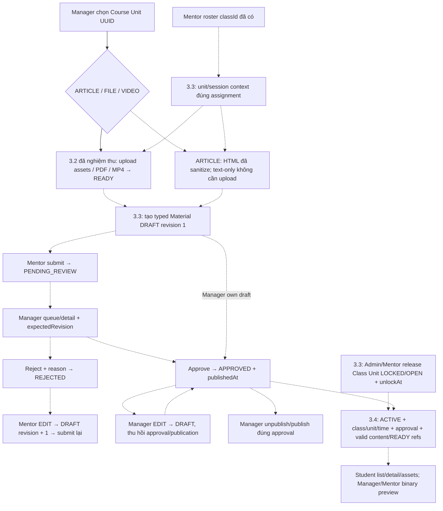

# Phase 3.3 — Flow Material management và release

Cập nhật: **2026-10-12**. **Kế hoạch; các API 3.3 chưa implement/deploy.**
Plan: [3.3](../implement_phase/phase%203/PHASE_3_3_MATERIAL_MANAGEMENT.md).
API chi tiết: [breakdown](PHASE_3_3_flow-api-breakdown.md).
Progress: [3.3](../progress/phase%203/PHASE_3_3_PROGRESS.md).
Baseline: [upload 3.2](PHASE_3_2_FLOW.md), [flow tổng hợp](PHASE_2_3_TO_3_2_FLOW.md).

2026-10-12: Theo yêu cầu làm ba Student GET trước, có
[read slice FILE/VIDEO3.4](PHASE_3_4_FLOW.md) + bảng materials tối thiểu và signed GET.
CRUD/review/audit/release/ARTICLE3.3 vẫn planned. Schema typed dưới đây cần migration
mở rộng additive; không tạo lại materials hoặc sửa migration read đã chạy.

## 1. Kết quả sản phẩm

Diễn giải UX2026-10-12: Course Unit là chương/nhóm học; Material ARTICLE là từng
bài đọc HTML soạn bằng CKEditor. Chọn Unit → danh sách bài theo sortOrder → mở
Material detail để đọc; metadata/mục tiêu Unit dùng description hiện có, không
thêm bảng course_unit_details lưu trùng contentHtml. Đây là hướng thiết kế,
chưa có authoring/ARTICLE API. PDF là Material FILE hoặc attachment ARTICLE
theo typed plan; upload READY chỉ lưu file, không tự tạo/publish bài học hoặc
chuyển PDF thành HTML. Seed local lớp/lịch/course unit đã được chạy lại và query
xác minh 5 course/class unit, 10 buổi; không seed ARTICLE vì schema chưa hỗ trợ.

Scope mới user chốt2026-10-11: **ARTICLE lưu HTML / FILE / VIDEO MP4 private**;
HLS làm sau. Plan3.3/breakdown đã hợp nhất typed content, thay baseline file-only.
ARTICLE có thể không file; ảnh/file tham chiếu MinIO bằng fileId, không base64 hoặc
signed URL lưu trong HTML. Nội dung sanitize và reference checks ởBE, FE render/
resolve images ở3.4. Cùng review/revision/release gates cho cảba loại.
Mỗi slice phải có server evidence, không trì hoãn mọi deployment tới3.6.

File READY trở thành Material draft của Course Unit; Mentor gửi duyệt,
Manager quyết định trên đúng revision. Approve đồng thời publish; availableAt
và release của từng lớp vẫn quyết định khi Student đọc ở 3.4. Được duyệt không
đồng nghĩa mọi Student/lớp được mở ngay. Session link không giấu Material chung.

## 2. Flow dự kiến

Nét đứt là việc chưa implement. Upload 3.2 đã nghiệm thu VPS theo xác nhận user
2026-10-12; ảnh PDF/MP4 READY/private objects ghi ở progress3.2.
Diagram không công bố endpoint3.3/3.4 mới là dùng được.

## 3. Mentor tạo và gửi duyệt

1. `GET /mentor/classes` đã có lấy classId. Routes context dự kiến 3.3 trả
   classUnitId/courseUnitId; optional session picker trả sessionId đúng unit.
   Không đoán mapping theo title/position hoặc gọi Admin API.
2. ARTICLE text-only: soạn HTML; nếu có inline images/attachments hoặc FILE/VIDEO,
   theo [upload breakdown 3.2](PHASE_3_2_flow-api-breakdown.md): intent đúng
   classId/classUnitId/courseUnitId, raw PUT storage, complete, poll đến READY.
3. POST unit materials với contentType/title và HTML hoặc primary fileId;
   response detail canonical HTML/safe refs, DRAFT/revision=1.
   READY metadata PENDING/FAILED không cản Material nếu binary đã READY.
4. PATCH draft với expectedRevision; cập nhật revision từ response. Submit
   expectedRevision → pending, khóa editor của Mentor, dừng retry sau 403/409.
5. GET item/list để theo dõi. Rejected: hiện reason cho chủ draft, EDIT rồi submit
   lại. Mentor khác không thấy submission/reason trong items hoặc total.
6. Assignment bị thu hồi/lớp CANCELLED: dừng thao tác/refetch roster, Manager vẫn
   review được submission. Không tự đổi createdInClassId để lấy lại quyền.

## 4. Manager quản lý và review

1. Chọn Course Unit UUID hợp lệ (public detail chỉ có active Course; inactive
   toàn catalogue picker chưa có, xem integration gap trong plan).
2. GET materials/queue (mặc định queue filter FE PENDING_REVIEW); chọn item GET
   detail để lấy current revision. List không chứa download URL.
3. Approve/reject dùng expectedRevision; approve publish cùng commit, reject cần
   reason. ARTICLE detail trả HTML đã sanitize để đọc ngay3.3.
   Binary preview thuộc 3.4; không giả định 3.3 đã đủ màn hình đọc file.
4. 409: refetch item/queue, hiển thị bản hiện tại, không tự approve revision mới.
   Response mất: refetch, retry cùng revision khi state còn đúng; no-op không tạo audit.
5. Manager EDIT HTML/primary/inline/attachment refs/sortOrder/availableAt/sessionId tăng revision và
   thu hồi approval/publication ngay. File mới phải upload READY trước PATCH.
6. Unpublish giữ approval; publish lại cần approval current. Approve retry không
   tự publish lại bản đã unpublish. DELETE soft-delete, refetch item/list/queue.

## 5. Release và liên hệ Student 2.3/3.4

Admin hoặc Mentor đúng lớp gửi PATCH release `{status, unlockAt?}`; omitted giữ
lịch cũ, null xóa lịch. COMPLETED Unit/CANCELLED Class trả 409. OPEN với giờ tương
lai chỉ mở khi đến server time, không cần worker chuyển trạng thái.

Release không phê duyệt Material, không kích hoạt enrollment/progress/payment.
Student My Classes/detail FULL từ 2.3 chỉ cấp navigation, vẫn phải qua policy 3.4.
Hai lớp cùng Course Unit dùng chung Material, release độc lập theo từng lớp.

## 6. UI state/cache và prerequisites

- Context/list/detail: loading → empty/success; 401 login, 403 dừng/refresh quyền,
  404 đóng item không còn visible; không retry 422/409 vô hạn.
- Editor: giữ draft form khi 422; save/submit/review disable nút khi pending HTTP;
  409 giữ form nhưng refetch server state để người dùng đối chiếu.
- Mutations sync; không polling Material worker. Có thể refresh pending queue
  theo thao tác người dùng; upload polling chỉ dùng flow 3.2.
- Metadata responses `private, no-store`; invalidate unit list/item/queue theo
  mutation, release refetch unit context và Student views khi 3.4 tích hợp.
- Cần migration/code 3.3/auth role; upload mới cần MinIO/worker 3.2. Existing
  metadata/read/review không cần gọi storage network. Download cần triển khai 3.4.

## 7. Nhật ký — 2026-10-11

User muốn hoàn thành full flow Phase3 với bàiHTML và MP4 private/URL expiry;
bổ sung ARTICLE/ref/HTML/API body changes và handoff Student article/asset/video.
Source policy hiện tại vẫn file-only; chưa sửa domain/schema/controllers trong lượt này.

Lập plan theo baseline 3.1/3.2 đã xong; bổ sung context/detail/release/audit và
breakdown dự kiến. API/source runtime hiện tại không đổi. Kiểm link/diff/JSON
trong tài liệu; chưa chạy runtime tests, migrate, deploy hoặc human binary review.

## 8. Plan sau nghiệm thu 3.2 — 2026-10-12

User xác nhận3.2 đã nghiệm thu xong. Hợp nhất plan/schema/DTO cho ARTICLE/FILE/VIDEO,
ARTICLE-only không file, sanitizer và mọi references; bỏ flow luôn bắt buộc upload.
Giữ thứ tự3.3.1 typed Manager draft →3.3.2 Mentor submission →3.3.3 review/publication
→3.3.4 release →3.3.5 acceptance/handoff. Mỗi bước có local gate và server cases
trong plan, ghi evidence riêng; signed GET/Student access/video runtime thuộc3.4.
Estimate BE provisional7–10 ngày, chốt sau sanitizer/batch-lock spike.
Kiểm diff/link/JSON tài liệu; không sửa API runtime, chạy BE tests, migrate hoặc deploy.
