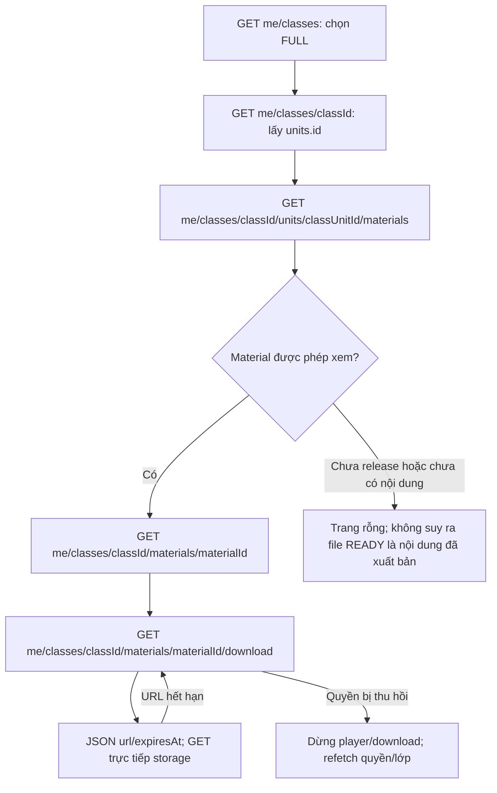
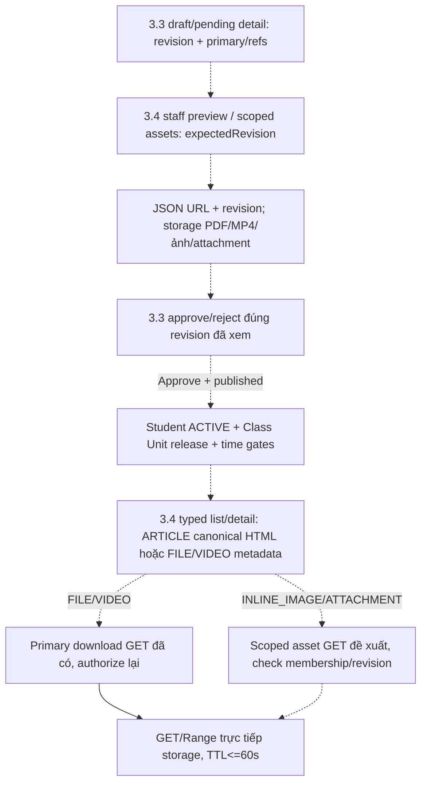

# Phase 3.4 — Student Material access và staff preview

Cập nhật **2026-10-13**. Ba GET đã implement và kiểm chứng local cho **FILE/VIDEO**.
Chưa deploy/nghiệm thu VPS; chưa tích hợp UI/browser FE.
[API breakdown](PHASE_3_4_flow-api-breakdown.md) ·
[Progress](../progress/phase%203/PHASE_3_4_PROGRESS.md) ·
[Rà soát FE](PHASE_3_4_FE_API_GAPS.md).

[Plan3.4 phối hợp3.3](../implement_phase/phase%203/PHASE_3_4_MATERIAL_ACCESS_PREVIEW.md).
Phân công user2026-10-13: người khác triển khai3.3–3.6; user nhận deploy/server
acceptance; FE do nhóm riêng làm, repo FE local chỉ để đọc. Lượt này sửa tài liệu BE.

## Phạm vi và quyết định thứ tự triển khai

User yêu cầu làm ba Student GET trước rồi rà API dưới góc nhìn FE. Baseline chỉ
có policy3.1 và Files3.2; vì thế bổ sung migration additive
`1791763200000-student-material-reads.ts` + MaterialEntity cho file-backed material.
Course Unit vẫn là owner; nhiều lớp dùng cùng tài liệu, release riêng từng Class Unit.
Không sửa migration đã deploy hoặc nới enrollment COMPLETED thành quyền học.

Đây là slice đọc triển khai trước authoring3.3, **không hoàn thành toàn bộ3.3/3.4**.
ARTICLE/sanitizer/inline images/attachments, Manager CRUD/review/audit, Mentor
submission/context, HTTP release và binary preview cho staff vẫn planned.
Migration mới chỉ có contentType FILE/VIDEO và primary file bắt buộc; khi làm3.3
phải mở rộng bằng **migration mới**, không thay migration này nếu đã chạy.
Tests tạo bản ghi APPROVED bằng fixture trong DB test; production chưa có workflow
tạo bản ghi đó qua API. Bucket có file READY riêng lẻ vẫn chưa có Material cho FE.

## Hành trình học viên

Các API kiểm active account/role từ DB, enrollment ACTIVE, lớp chưa CANCELLED;
unit OPEN/COMPLETED, unlockAt đã đến; Material không deleted, current approval,
reviewedAt/publishedAt/availableAt đã đến; file READY không deleted, đúng Course
Unit và kind FILE/VIDEO. Session linkage không filter tài liệu shared theo lớp.
Class COMPLETED với ACTIVE enrollment vẫn dùng cùng gates; enrollment COMPLETED bị chặn.

List dùng read-only REPEATABLE READ; filter trước count/page, sort sortOrder/id.
Materials chỉ đọc repositories của mình; FilesService cung cấp READY SQL projection
và batch summaries, Classes/Catalog/Users/Enrollments cung cấp context/policy.
Detail dùng cùng predicates; hidden/foreign Material trả404, không trả review secrets.

Download kiểm detail → Files ký verified objectVersionId → kiểm detail lần nữa
trước trả URL, không giữ transaction khi ký. TTL mặc định60s, cấu hình1..60s.
URL đã phát hành vẫn có thể dùng đến hết hạn sau revoke; endpoint refresh kiểm
lại quyền. GET storage hỗ trợ Range206 và inline UTF-8 filename/no-store.
Không redirect/stream bytes qua BE; không generic Student `/files/:fileId/download`.

## Nhật ký và kiểm chứng

- 2026-10-12: Implement ba routes/Swagger/DTO/pagination, schema read slice,
  Files signed GET đúng version, cấu hình TTL và Postman handoff.
- PostgreSQL/MinIO thật: 15 integration tests cho đọc/tải, hidden count/page,
  shared classes, pending/outsider/wrong scope/revoke, READY metadata FAILED,
  storage disabled/signing failure, pinned version/Range/expiry/refresh;
  migration clean/up/down/up trong dedicated DB.
- Built-app HTTP Files+Materials: 16 tests pass, gồm CASH confirm → release →
  list/detail/download PDF/MP4, roles/validation/Swagger/no-store.
- Full `pnpm check`: 291 tests/27 suites pass, lint/type-check/build pass trên
  workspace hiện hành (gồm cả thay đổi schedule đang có trong workspace).
- Full `pnpm test:http` run cuối:23/23tests,2/2suites pass, không skip.
- VPS/live payment/browser CORS chưa kiểm chứng ở lượt này. Xem progress để biết
  kết quả full HTTP cuối cùng và phụ thuộc authoring/release trước nghiệm thu sản phẩm.

## Phối hợp 3.3/3.4 — kế hoạch 2026-10-13

3.3.1 bàn giao typed schema/policy/refs/Manager draft;3.3.2 bàn giao Mentor context/
submission. 3.4.1 staff preview và3.4.3 staff assets cùng mốc review3.3.3 để
Manager xem PDF/MP4 hoặc ảnh/attachments ARTICLE trước approve/reject.
Manager preview không qua Student ACTIVE/release/time gates; Mentor phải còn
assignment và chỉ xem own eligible submission hoặc current approved/published.
Không ghép staff preview vào nhánh Student canRead.

Nét đứt là phần phối hợp chưa implement; Student FILE/VIDEO download đã có nhưng
workflow production tạo/duyệt/release vẫn chờ3.3. ARTICLE text-only không có
primary file và không cần ký URL. HTML chỉ lưu data-file-id, client resolve URL
trong memory; asset cùng Course Unit nhưng không reference bởi Material bị chặn.
Staff/Student metadata không chứa signed URL; access endpoint recheck quyền,
revision/ref/READY verified version sau ký, không giữ transaction khi gọi storage.

PDF dùng FILE để xem/tải hoặc attachment của ARTICLE. MP4 dùng VIDEO để phát
trong trang; backend cấp metadata/signed GET, nhóm FE làm viewer/player riêng.
Contract mới đề xuất GET preview/assets với required expectedRevision; full routes,
DTO/examples/errors và xử lý revision conflict nằm ở breakdown3.4.

Các slice3.4.1–3.4.4 và local/server gates nằm ở plan. Người triển khai giao user
release SHA/migrations/config/check results/Postman/smoke/rollback để deploy.
Backend/API storage evidence và browser evidence nhóm FE phải ghi riêng.
Lượt2026-10-13 không thêm source/API runtime, migration, BE tests hoặc deploy.
Kiểm tài liệu: git diff --check pass; 14 docs, 152 local links/1 anchor và
14 JSON examples hợp lệ, code fences cân bằng; không thay evidence runtime.
