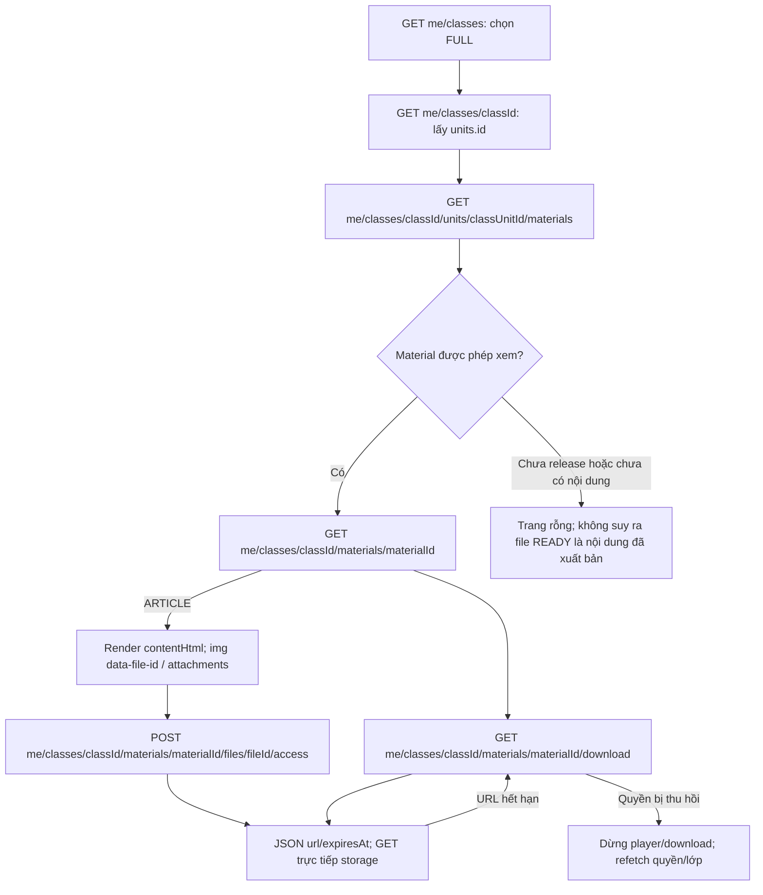

# Phase 3.4 — Student Material list/detail/download

Cập nhật **2026-10-14**. Student list/detail/download + file access (ARTICLE/FILE/VIDEO,
inline images, attachments) và staff preview Manager/Mentor đã implement, local verified.
Chưa deploy/nghiệm thu VPS; chưa tích hợp UI/browser FE.
[API breakdown](PHASE_3_4_flow-api-breakdown.md) ·
[Progress](../progress/phase%203/PHASE_3_4_PROGRESS.md) ·
[Rà soát FE](PHASE_3_4_FE_API_GAPS.md).

## Phạm vi và quyết định thứ tự triển khai

User yêu cầu làm ba Student GET trước rồi rà API dưới góc nhìn FE. Baseline chỉ
có policy3.1 và Files3.2; vì thế bổ sung migration additive
`1791763200000-student-material-reads.ts` + MaterialEntity cho file-backed material.
Course Unit vẫn là owner; nhiều lớp dùng cùng tài liệu, release riêng từng Class Unit.
Không sửa migration đã deploy hoặc nới enrollment COMPLETED thành quyền học.

Đây là slice đọc triển khai trước authoring3.3, **không hoàn thành toàn bộ3.3/3.4**.
ARTICLE/sanitizer/inline images/attachments, Manager CRUD/review/audit, Mentor
submission/context, HTTP release và binary preview cho staff vẫn planned.
Migration mới chỉ có contentType FILE/VIDEO và primary file bắt buộc; khi làm3.3
phải mở rộng bằng **migration mới**, không thay migration này nếu đã chạy.
Tests tạo bản ghi APPROVED bằng fixture trong DB test; production chưa có workflow
tạo bản ghi đó qua API. Bucket có file READY riêng lẻ vẫn chưa có Material cho FE.

## Hành trình học viên

Các API kiểm active account/role từ DB, enrollment ACTIVE, lớp chưa CANCELLED;
unit OPEN/COMPLETED, unlockAt đã đến; Material không deleted, current approval,
reviewedAt/publishedAt/availableAt đã đến; file READY không deleted, đúng Course
Unit và kind FILE/VIDEO. Session linkage không filter tài liệu shared theo lớp.
Class COMPLETED với ACTIVE enrollment vẫn dùng cùng gates; enrollment COMPLETED bị chặn.

List dùng read-only REPEATABLE READ; filter trước count/page, sort sortOrder/id.
Materials chỉ đọc repositories của mình; FilesService cung cấp READY SQL projection
và batch summaries, Classes/Catalog/Users/Enrollments cung cấp context/policy.
Detail dùng cùng predicates; hidden/foreign Material trả404, không trả review secrets.

Download kiểm detail → Files ký verified objectVersionId → kiểm detail lần nữa
trước trả URL, không giữ transaction khi ký. TTL mặc định60s, cấu hình1..60s.
URL đã phát hành vẫn có thể dùng đến hết hạn sau revoke; endpoint refresh kiểm
lại quyền. GET storage hỗ trợ Range206 và inline UTF-8 filename/no-store.
Không redirect/stream bytes qua BE; không generic Student `/files/:fileId/download`.

## Nhật ký và kiểm chứng

- 2026-10-12: Implement ba routes/Swagger/DTO/pagination, schema read slice,
  Files signed GET đúng version, cấu hình TTL và Postman handoff.
- PostgreSQL/MinIO thật: 15 integration tests cho đọc/tải, hidden count/page,
  shared classes, pending/outsider/wrong scope/revoke, READY metadata FAILED,
  storage disabled/signing failure, pinned version/Range/expiry/refresh;
  migration clean/up/down/up trong dedicated DB.
- Built-app HTTP Files+Materials: 16 tests pass, gồm CASH confirm → release →
  list/detail/download PDF/MP4, roles/validation/Swagger/no-store.
- Full `pnpm check`: 291 tests/27 suites pass, lint/type-check/build pass trên
  workspace hiện hành (gồm cả thay đổi schedule đang có trong workspace).
- Full `pnpm test:http` run cuối:23/23tests,2/2suites pass, không skip.
- VPS/live payment/browser CORS chưa kiểm chứng ở lượt này. Xem progress để biết
  kết quả full HTTP cuối cùng và phụ thuộc authoring/release trước nghiệm thu sản phẩm.

- 2026-10-14: Hoàn thiện phần còn lại của 3.4 theo bàn giao §10 3.3: Student list/detail
  hiện ARTICLE (file null, attachmentCount; detail thêm contentHtml/contentSchemaVersion/
  inlineImages/attachments), visibility query loại Material có reference không READY
  trước total/page; route mới POST `.../files/:fileId/access` (Student) và staff preview
  POST `/manager/materials/:id/files/:fileId/access`,
  `/mentor/classes/:classId/materials/:id/files/:fileId/access`. fileId phải thuộc
  Material (PRIMARY/INLINE_IMAGE/ATTACHMENT do server resolve); attachment ký
  disposition attachment; ký ngoài transaction và recheck revision/role. Download
  primary giữ contract (ARTICLE →404). Không migration/env mới. Xem
  [API breakdown §4–5](PHASE_3_4_flow-api-breakdown.md).
- Kiểm chứng local 2026-10-14: `pnpm check` 411/411 (35 suites), `pnpm test:http`
  48/48 (2 suites), PostgreSQL `_test` + MinIO local; chưa VPS/browser.
