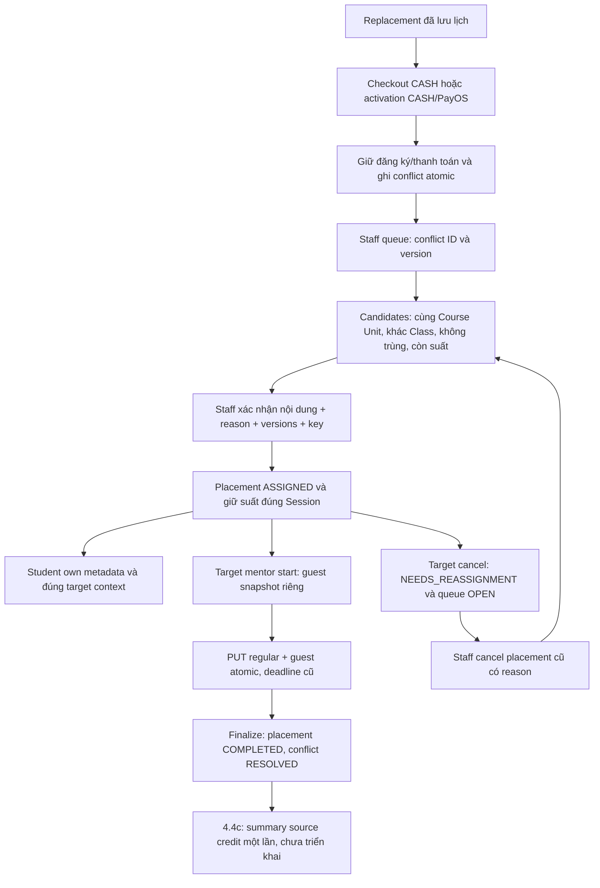
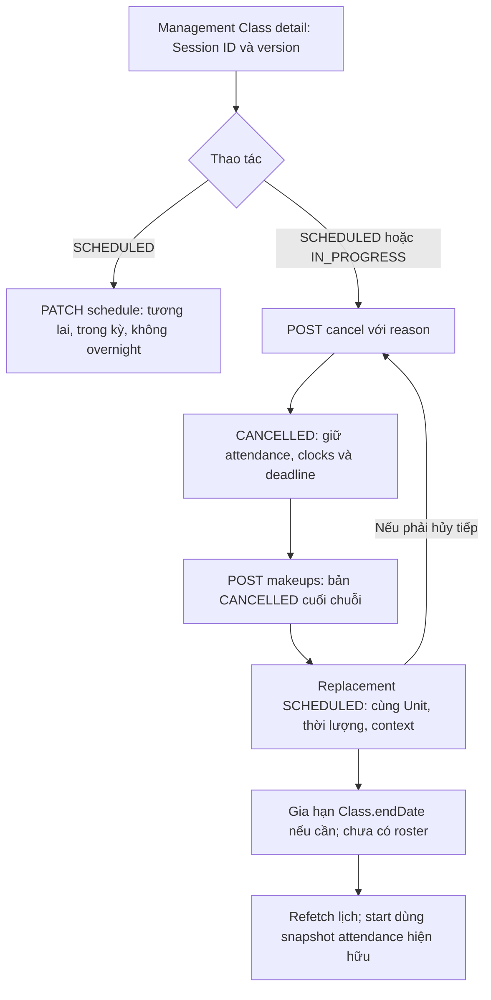

# Phase 4.4 — Flow triển khai

Ngày cập nhật: **2026-10-15**. **IN PROGRESS**, chưa hoàn tất 4.4a–c.
[Plan](../implement_phase/phase%204/PHASE_4_4_LEAVE_MAKEUP_STUDENT_OPERATIONS.md) ·
[API breakdown](PHASE_4_4_flow-api-breakdown.md) ·
[Progress](../progress/phase%204/PHASE_4_4_PROGRESS.md) · [Flow tổng](PHASE_4_FLOW.md).

## 1. Phần đã code trong lượt bắt đầu

Vertical slice đầu của 4.4a: management reschedule → cancel → tạo replacement,
và hủy Class hủy các Session SCHEDULED/IN_PROGRESS cùng transaction.
Classes sở hữu lịch và audit; controller mới chỉ cho ADMIN/MANAGER hiện hành.
Không cấp thêm quyền Manager trên các route `/admin`.

Cập nhật tiếp 15/10 theo yêu cầu làm **4.4b**: queue/candidates/create/cancel/own
placement, capacity chung với checkout, guest attendance/audits và session context
đã có source. User xác nhận 4.4a xong trong chat; đối chiếu checkout hiện tại vẫn
chỉ thấy schedule operations, chưa thấy leave/approved intervals. Không đánh dấu
leave đã code hoặc candidates đã kiểm approved leave khi thiếu provider này.

Attendance sở hữu placements/guest qua application services và SQL schema có FK/
triggers; không dùng attendance_records thường cho enrollment ngoại lớp. Module
ScheduleReservations chỉ đọc projection/khóa student, không import Classes,
Attendance hoặc Payments. Classes/checkout/enrollment gọi public provider này.
Target cancellation projection đặt trong trigger do migration attendance sở hữu,
đảm bảo Class/Session cancel atomic mà không tạo vòng module. Actor cancellation
được gắn transaction-local, không giữ sau commit.

Writes khóa Class UUID → Session UUID → student; schedule checker lấy mentor
trước student. Session dùng NO KEY UPDATE để vẫn serialize writers nhưng tương
thích FK KEY SHARE của conflict insert khi checkout đang giữ khóa student; không
lấy thêm Class locks sau student. Không đổi lock order cart/Class/order/payment
của thanh toán. Source/target IDs bất biến và DB bảo vệ ancestry/Unit. Receipt,
audit và version rollback cùng reservation; GET không giữ chỗ.

Placement không cấp quyền classmates/materials/CASH ở lớp nhận. Target cancel
không tự ABSENT; source completion chặn unresolved placement. Staff physical
correction không phục hồi credit của placement hủy. Lịch Student/summary/tỷ lệ
và leave approval còn thiếu; local/server evidence theo Progress, không suy ra VPS.

Mọi mutation mới khóa Class → Session; kiểm actor hiện hành trước replay,
expectedVersion, lịch Class và effective mentor bằng checker chung. Receipt,
audit, version, replacement và endDate commit hoặc rollback cùng nhau. PENDING
leave/approved leave chưa có trong source của slice này; không ghi là checker
đã tính khoảng nghỉ.

## 2. Schema và lịch sử

Migration `1792022400000-session-schedule-operations` thêm hai ancestry columns,
composite FKs cùng Class Unit, unique successor và unique replacement hiệu lực
theo root, trigger bất biến ancestry/chống vòng/không hồi sinh source đã thay.
Audit lưu old/new schedule, actor, reason, version và endDate trước/sau.

Quyết định kỹ thuật: chuỗi tuyến tính. Nếu replacement bị hủy, client dùng ID
và version của replacement đó để tạo buổi tiếp theo. Gọi source cũ đã có child
trả `MAKEUP_ALREADY_EXISTS`, kể cả child đã hủy. Không tạo nhánh lịch sử mới.
Buổi mới không sao chép attendance, actual clocks, teaching snapshot hoặc hạn sửa.
Không backfill dữ liệu legacy. Down từ chối nếu đã có makeup/audit; rollback
application tương thích và giữ schema, không xóa lịch sử để ép down.

Hủy Class qua API Admin giữ contract cũ, thêm Session cancellation/audit atomic
với actor từ cookie. COMPLETED/CANCELLED Session giữ nguyên. Không giải phóng
hold, refund hoặc thay settlement. API Admin đổi giờ giữ ngày giữ semantics cũ,
dùng chung kiểm overlap Class/effective mentor với API reschedule mới.

## 3. Kiểm chứng và phạm vi còn mở

Chi tiết kết quả gate hiện tại ghi ở [progress](../progress/phase%204/PHASE_4_4_PROGRESS.md).
Test mới bao gồm PG transaction/constraints/replay/races/fault rollback, migration
clean/up-down-up/refusal và built-app HTTP cookies/validation/authorization/Swagger.
Các rehearsal migration cũ chọn đúng migration cần thử thay vì giả định nó là
migration mới nhất; riêng rollback 4.1 tháo/reapply migration 4.4 phụ thuộc enum.

**Chưa triển khai:** workflow preview/slot/request/approve/reject/withdraw/expire,
approved leave provider và tích hợp mọi schedule writer/approval; 4.4c Student
projections/history/summary/queues/credit. Không có worker/mail/notification mới.
Không sửa FE, không migrate dev/VPS, chưa có deployment hoặc nghiệm thu 4.4/4.5.

### Gate cuối của lượt4.4b

Local2026-10-15: pnpm check PASS lint/type-check/436 tests/44 suites/build;
pnpm test:http45/45 tests/7 suites,0 skip. Migrations chỉ DB _test; HTTP compiled
Nest app với cookie/guards thật, fake PayOS và local private MinIO. Trigger alias
trùng biến đã sửa sau regression; migration rehearsals tháo/reapply đúng dependency,
không sửa migrations cũ. Docs/Postman/diff kiểm tra tĩnh, không bằng deployment.
