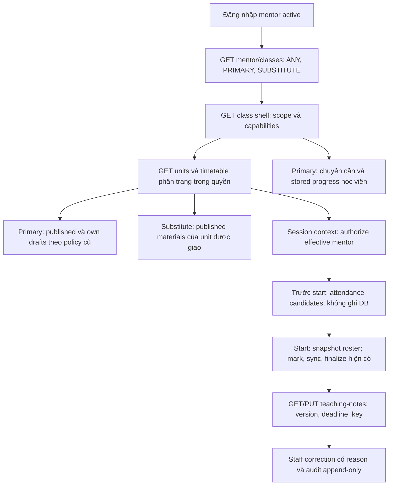

# Phase 4.6 — Luồng mentor vào lớp và theo dõi giảng dạy

2026-10-22 · **Đã implement BE và kiểm chứng local; chưa deploy VPS**.
[Plan](../implement_phase/phase%204/PHASE_4_6_MENTOR_TEACHING_WORKSPACE.md) ·
[API contract](PHASE_4_6_flow-api-breakdown.md) ·
[Progress](../progress/phase%204/PHASE_4_6_PROGRESS.md).

## Quyền và thay đổi so với proposal

Classes export MentorWorkspaceService typed scope. Primary hiện tại xem toàn
class; substitute chỉ shell, unit có assignment và session của chính mình.
SCHEDULED lấy override/primary; các trạng thái khác lấy teachingMentorId đã lưu,
legacy null không suy thành người đã dạy. Kiểm lại actor active/role mỗi request;
quyền start/context/note theo từng session, không suy từ quyền đọc cả lớp.

Class detail chỉ counts + shell, không nested units không giới hạn. Units và
sessions dùng endpoints phân trang riêng. Mentor unit detail trả sessions rỗng;
không lộ meeting URL qua nested sessions. Meeting URL vẫn chỉ qua context đã
kiểm quyền. Discovery default ANY; filter PRIMARY giữ lựa chọn theo behavior cũ.
Primary roster/payment không mở cho substitute; chỉ roster tối thiểu buổi.

Mở quyền đọc material không mở thêm quyền authoring: substitute không đọc draft
của người khác hoặc draft cũ của mình khi đã mất primary. Preview/file access
kiểm lại scope sau sign. Giữ publication/ready/revision và mã lỗi material cũ;
entitlement student theo policy hiện hành của Materials.

GET attendance-candidates mới chỉ preview tên/id học viên ACTIVE và eligible
guest trước start, không ghi UNMARKED/ABSENT. Start vẫn kiểm lại entitlement;
actual roster/mark/sync/finalize dùng flow4.2/4.4. Guest không được full class access.

Mentor reports dùng chung AttendanceProjectionService và ATTENDANCE_CREDIT_CTE;
makeup root counted once. Class summary tách enrollment; student summary khai báo
aggregationScope STUDENT_CLASS_HISTORY giống Student projection. Rate denominator0
là null. Primary đọc history cancelled/completed với readonly flag.
Stored progress tách khỏi attendance, thiếu row UNTRACKED/null, stored zero giữ
chuỗi decimal; invalid stored percent có dataQuality riêng. Không có completion
policy/command hoặc overall percent; assignment counts vẫn NOT_IMPLEMENTED/null.

## Teaching notes và transaction

Một current note/session, version compare dưới Class → Session → note lock.
Active actor share lock chống role/suspend revoke; effective assignment kiểm sau
Class lock. Mentor chỉ ghi IN_PROGRESS/COMPLETED trong editableUntil. Primary bị
override không sửa note thay người thực dạy. Staff correction route riêng, reason
bắt buộc; chưa started không tạo note đã dạy. Class cancellation chặn writes.

Migration additive1792627200000 tạo teaching_notes, teaching_note_audits và
teaching_note_receipts. TeachingOperations sở hữu SQL persistence giống leave;
audit có trigger chặn UPDATE/DELETE. Note/audit/receipt cùng commit, UUIDv4 key,
same payload replay không tăng version; key reuse/version mismatch409.
Actor/assignment/state/window đều kiểm lại trước receipt replay. Không external
network trong transaction, không raw content trong application logs, student403.

## Kiểm chứng và giới hạn

Có PostgreSQL integration mới cho discovery/scope/legacy/revocation/progress,
notes concurrency/replay/window/staff correction/audit/migration up-down-up.
Regression material kiểm published-only, primary authoring không đổi, signed URL
revocation. Shared credit tests đối chiếu mentor với student cho các ca makeup,
legacy, unmarked và denominator; compiled HTTP kiểm cookie/role/Origin/validation
và OpenAPI. Gates thực chạy và giới hạn được cập nhật trong progress.

Lượt full check đầu bị Docker/PostgreSQL dừng giữa chừng (ECONNREFUSED/startup),
đã khởi động lại stack test và chạy lại; không ghi lỗi hạ tầng là evidence pass.
Không sửa FE; không migration production, deploy, browser hay live payment mới.
Phase4.5 release vẫn độc lập; Phase5 assignments/compiler/completion policy ngoài
scope4.6. Postman collection4.6 và API breakdown là handoff FE hiện hành.

Final local acceptance 2026-10-22: pnpm check PASS (64 files/613 tests, lint/type-check/build); pnpm test:http PASS (10 files/79 tests). Database test riêng, PostgreSQL/MinIO local, không skip; source hiện tại đã gồm các thay đổi release/bulk song song. Docs4/links16/JSON examples4/Postman25 và diff checks pass. Không deploy VPS hoặc chạy migration production.
