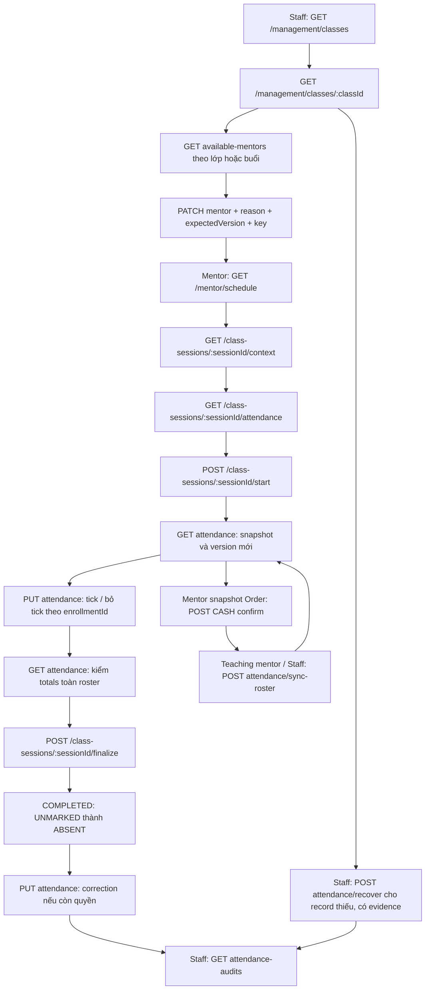

# Phase 4 — Tổng hợp API và flow liên kết

## 2026-10-16 — Implementation4.4c

Schedule extension và4 GET mới đã có source/DTO/Swagger/Postman,20 focused PG
và3 compiled HTTP4.4c pass; guest HTTP4.4b thêm source/receiving summary assertions.
Contract hiện hành tại [API4.4 mục13–18](PHASE_4_4_flow-api-breakdown.md#13-44c--quy-ước-và-contract-chung),
full gates tại Progress4.4. Chưa deploy/FE/browser4.5; chỉ leave/approved
intervals giữ source gap riêng. Ghi chú planning/baseline dưới đây là lịch sử.

| Method | Route mới4.4c | Actor | Mục đích |
|---|---|---|---|
| GET | `/api/v1/me/classes/:classId/attendance` | STUDENT own | Physical history/ancestry/source credit link, terminal metadata |
| GET | `/api/v1/me/classes/:classId/attendance-summary` | STUDENT own | Credit chung một lần, denominator/rate nullable, optional range93 ngày |
| GET | `/api/v1/management/classes/:classId/attendance-summary` | ADMIN/MANAGER | Paginated enrollment history, cùng credit policy |
| GET | `/api/v1/management/class-sessions/incomplete` | ADMIN/MANAGER | Hai overdue issues, toàn backlog mặc định, deadlineExpired nullable |

## 2026-10-16 — Trạng thái hiện hành4.4b và plan4.4c

User xác nhận4.4b hoàn tất. Lịch Student hiện chỉ có baseline2.3; projection
mentor/attendance/guest4.4c và4 GET mới (own history, own summary, management
summary, incomplete) vẫn PLANNED. Xem [contract dự kiến mục13–18](PHASE_4_4_flow-api-breakdown.md#13-44c--quy-ước-và-contract-chung)
và [plan22 AC/20 scenarios/C1–C5](../implement_phase/phase%204/PHASE_4_4_LEAVE_MAKEUP_STUDENT_OPERATIONS.md#4-44c--lịch-student-tổng-hợp-và-hàng-chờ-vận-hành).
Local436/45 là gates15/10, chưa chạy lại; lượt này chỉ tài liệu/source review.
Workflow leave/approved intervals vẫn gap riêng; server/Postman4.3 xong theo
user15/10, không suy deploy4.4/FE acceptance4.5. Log/baseline phía dưới giữ ngày gốc.

## 2026-10-15 — Tiếp 4.4b: học bù lớp khác

Đã triển khai migration1792022400001, Staff queue/candidates/create/cancel placement,
Student own placements, capacity với checkout, guest roster/mark/finalize/audits,
Student context đúng target và requeue/completion guards. Late CASH/PayOS activation
không bị từ chối vì trùng replacement; ghi queue atomic. Flow/API/Postman cùng revision.
User xác nhận a xong; source hiện tại vẫn thiếu workflow leave/approved intervals,
không đánh dấu candidates đã kiểm approved leave. 4.4c/4.5 vẫn pending. Không sửa FE,
không migrate dev/VPS hoặc giao dịch thật. Gate cuối local: **pnpm check436/436 tests/44 suites, pnpm test:http45/45 tests/7 suites,0 skip; lint/type-check/build pass**. Chi tiết xem Progress4.4.


Đối chiếu ngày **14/10/2026** trên nhánh `Feat/Phase4`, HEAD `246abf4`.
File này liệt kê toàn bộ API mới trong hai commit Phase 4, các API cũ liên quan và thứ tự FE gọi chúng. Nguồn xác nhận là controller, DTO, service, error filter và assertions trong test; tên commit không được dùng để suy ra tính năng đã triển khai.

| Commit | Ngày commit | Kết quả kiểm tra |
|---|---|---|
| `8a1c7e8` | 13/10/2026 | Chỉ thay đổi 21 file tài liệu, kế hoạch và progress; **không thêm endpoint hoặc runtime code**. |
| `246abf4` | 14/10/2026 | Thêm code/migration/test cho Phase 4.1–4.3, **15 endpoint Phase 4 mới + 2 endpoint Admin xem học viên**, đồng thời sửa một số API lớp đã có. |

**Baseline 14/10:** các API trong bảng 1 đã có source. Progress ghi nhận kiểm thử local trước đó; lần đối chiếu này không chạy lại runtime tests và không xác nhận deploy/VPS.

**Cập nhật 15/10 — bắt đầu 4.4a:** đã code ba API management Session: PATCH
`/api/v1/management/class-sessions/:sessionId/schedule`, POST cùng prefix
`/:sessionId/cancel` và `/:sessionId/makeups`; ADMIN/MANAGER với version/key/reason.
Hủy Class Admin đã hủy batch Session còn mở và giữ attendance/history atomic.
SessionView thêm hai ancestry IDs nullable. Contract hiện hành của slice mới ở
[API4.4](PHASE_4_4_flow-api-breakdown.md), gate ở
[Progress4.4](../progress/phase%204/PHASE_4_4_PROGRESS.md). Leave/approved intervals,
core4.4b được bổ sung theo mục cập nhật trên; leave/Student projections4.4c và4.5 còn pending; chưa deploy4.4.

Tài liệu chi tiết: [Flow tổng](PHASE_4_FLOW.md), [API breakdown tổng](PHASE_4_flow-api-breakdown.md), [API 4.1](PHASE_4_1_flow-api-breakdown.md), [API 4.2](PHASE_4_2_flow-api-breakdown.md), [API 4.3](PHASE_4_3_flow-api-breakdown.md).

## 1. Baseline 17 endpoint mới trong hai commit4.1–4.3

Tất cả route có prefix **`/api/v1`**, cần cookie `access_token`; FE gửi `credentials: 'include'`. Staff = `ADMIN` hoặc `MANAGER`. Mentor phải là người được phân công hiệu lực cho đúng buổi khi đọc context/điểm danh. **Cả 17 endpoint thành công đều trả HTTP 200, JSON trực tiếp, không bọc `{data}`.**

### 1.1. Phase 4.1 — Phân công mentor, dạy thay và lịch dạy

| Method | Endpoint | Quyền | Chức năng / dữ liệu nối bước sau |
|---|---|---|---|
| GET | `/api/v1/management/classes` | Staff | Danh sách lớp; query `page`, `pageSize`, optional `status`. Lấy `items[].id` làm `classId`, kèm `assignmentVersion`. |
| GET | `/api/v1/management/classes/:classId` | Staff | Chi tiết lớp và lịch buổi phân trang; lấy `class.assignmentVersion`, `sessions.items[].sessionId` và `version`. |
| GET | `/api/v1/management/classes/:classId/available-mentors` | Staff | Mentor ACTIVE không trùng các buổi `SCHEDULED` chưa có override sẽ chịu ảnh hưởng. Trả `assignmentVersion`, `affectedSessionCount`, `items[].id`. |
| GET | `/api/v1/management/class-sessions/:sessionId/available-mentors` | Staff | Mentor ACTIVE khả dụng cho một buổi `SCHEDULED`/`IN_PROGRESS`. Trả `sessionVersion`, `checkedFrom`, `checkedTo`, `items[].id`. |
| PATCH | `/api/v1/management/classes/:classId/mentor` | Staff | Đổi mentor chính. Body `{mentorId, reason, expectedVersion}`; version lấy từ `assignmentVersion`. Giữ override và snapshot mentor của buổi đã bắt đầu. |
| PATCH | `/api/v1/management/class-sessions/:sessionId/mentor` | Staff | Gán mentor dạy thay hoặc gỡ override bằng `mentorId: null`. Body `{mentorId, reason, expectedVersion}`; version lấy từ buổi. Đổi giữa buổi giữ giờ bắt đầu/hạn điểm danh. |
| GET | `/api/v1/mentor/schedule` | MENTOR | Lịch dạy của chính mentor, gồm PRIMARY/SUBSTITUTE. Query `page`, `pageSize`, optional `classId`, cặp `from`/`to`; mặc định tuần hiện tại, range tối đa 93 ngày. |
| GET | `/api/v1/class-sessions/:sessionId/context` | Staff / mentor hiệu lực / own Student guest4.4b | Context đúng một buổi: `{session, roomName, meetingUrl, accessScope: "SESSION"}`. Meeting URL null khi lớp/buổi đã hoàn thành hoặc hủy. |

Hai API candidates hỗ trợ `search` trim tối đa 100 ký tự và phân trang. `availabilityBasis` hiện là `TEACHING_SCHEDULE_ONLY`: không trùng lịch dạy; chưa kiểm lịch nghỉ có duyệt. GET không giữ slot, PATCH kiểm lại khi ghi. Lớp DRAFT chưa chiếm lịch mentor, lúc mở lớp phải kiểm lại.

### 1.2. Phase 4.2 — Bắt đầu, điểm danh và chốt buổi

| Method | Endpoint | Quyền | Chức năng / dữ liệu nối bước sau |
|---|---|---|---|
| GET | `/api/v1/class-sessions/:sessionId/attendance` | Staff / mentor hiệu lực | Roster snapshot phân trang; trả `session.version`, `permissions`, `items[].enrollmentId`, `totals` toàn roster và `pendingPaymentCount`. Trước start có thể rỗng. |
| POST | `/api/v1/class-sessions/:sessionId/start` | Staff / mentor hiệu lực | Body `{expectedVersion, reason?, actualStartedAt?}`. `SCHEDULED → IN_PROGRESS`, snapshot học viên đủ điều kiện và mentor dạy; lớp OPEN tự sang IN_PROGRESS. Chỉ Staff được gửi giờ bắt đầu quá khứ. |
| POST | `/api/v1/class-sessions/:sessionId/attendance/sync-roster` | Staff / mentor hiệu lực | Body `{expectedVersion, reason?}`; thêm học viên đủ điều kiện còn thiếu sau khi CASH đã được xác nhận. Không nhận danh sách ID từ client. |
| PUT | `/api/v1/class-sessions/:sessionId/attendance` | Staff / mentor hiệu lực | Body `{expectedVersion, reason?, records:[{enrollmentId,status}], guestRecords?:[{makeupPlacementId,status}]}`. Max100 mỗi array, ít nhất một item tổng; `UNMARKED`/`PRESENT`/`ABSENT` khi đang học. Phase 4.3 mở rộng cùng route để sửa sau chốt. |
| POST | `/api/v1/class-sessions/:sessionId/finalize` | Staff / mentor hiệu lực | Body `{expectedVersion, reason?, actualEndedAt?}`. `IN_PROGRESS → COMPLETED`; mọi `UNMARKED` thành `ABSENT`. Chỉ Staff được gửi giờ kết thúc quá khứ. |

### 1.3. Phase 4.3 — Lịch sử và phục hồi

| Method | Endpoint | Quyền | Chức năng / dữ liệu nối bước sau |
|---|---|---|---|
| GET | `/api/v1/management/class-sessions/:sessionId/attendance-audits` | Staff | Lịch sử ADMIT/MARK/FINALIZE/CORRECT/RECOVER; query `page`, `pageSize`, optional `enrollmentId` regular/guest đúng target, hoặc `makeupPlacementId` của snapshot4.4b. Trả trạng thái cũ/mới, actor, reason, version, thời gian và evidence recovery nếu có. |
| POST | `/api/v1/management/class-sessions/:sessionId/attendance/recover` | Staff | Phục hồi các record **chưa tồn tại** bằng thời gian/kết quả/chứng cứ lịch sử. Body có `expectedVersion`, `reason`, `evidenceNote`, `actualStartedAt`, `actualEndedAt`, `records`. Tối đa 1000 record, JSON body tối đa 256 KiB. |

Sửa record đã tồn tại sau chốt dùng **PUT attendance** ở bảng 1.2; không có endpoint `/correct` riêng. Mentor sửa buổi COMPLETED trong hạn; Staff có thể sửa COMPLETED hoặc CANCELLED đã từng start, không bị giới hạn deadline nhưng phải có reason.

### 1.4. Hai API Admin bổ sung trong cùng commit

| Method | Endpoint | Quyền | Chức năng / dữ liệu nối bước sau |
|---|---|---|---|
| GET | `/api/v1/admin/classes/:classId/students` | ADMIN | Danh sách đăng ký PENDING_PAYMENT/ACTIVE/COMPLETED, phân trang; trả `studentId`, tên, email, phone, `enrollmentId`, trạng thái đăng ký. Không phải roster điểm danh của buổi. |
| GET | `/api/v1/admin/classes/:classId/students/:studentId` | ADMIN | Chi tiết liên hệ/đăng ký trong đúng lớp; bổ sung `classId`, `orderDetailId`, `registeredAt`, `accountCreatedAt`, `lastLoginAt`. Dùng `studentId` từ list. |

## 2. API đã có được sửa hoặc dùng cùng flow

### 2.1. Quản lý lớp — ADMIN

Các route này tồn tại trước hai commit; không tính vào 17 endpoint mới.

| Method | Endpoint | Vai trò trong flow / thay đổi liên quan Phase 4 |
|---|---|---|
| GET | `/api/v1/admin/classes` | Chọn lớp trong màn Admin; response management thêm `assignmentVersion`. Manager dùng `/management/classes`. |
| GET | `/api/v1/admin/classes/:classId` | Đọc lớp/units/lịch đã có; lấy ID cho tạo buổi và xem học viên; response thêm `assignmentVersion`. |
| POST | `/api/v1/admin/classes` | Tạo lớp DRAFT (201); cung cấp `classId` và units để tạo lịch. |
| PATCH | `/api/v1/admin/classes/:classId` | Nếu gửi `mentorId`, body chỉ được chứa `{mentorId,reason,expectedVersion}` cùng Idempotency-Key; dùng command/audit như route đổi mentor chính. Sửa field khác bằng request riêng. |
| POST | `/api/v1/admin/classes/:classId/sessions` | Tạo buổi (201); kiểm không overnight, lịch effective mentor và tăng `assignmentVersion`. |
| PATCH | `/api/v1/admin/classes/:classId/sessions/:sessionId` | Đổi giờ một buổi, giữ ngày; kiểm lịch effective mentor và tăng version liên quan. |
| PATCH | `/api/v1/admin/classes/:classId/sessions/bulk` | Đổi giờ nhiều buổi cùng transaction, giữ ngày; kiểm lịch/version tương tự. |
| POST | `/api/v1/admin/classes/:classId/open` | DRAFT → OPEN; kiểm readiness, lịch và mentor override trước mở đăng ký. |
| POST | `/api/v1/admin/classes/:classId/start` | OPEN → IN_PROGRESS, đóng đăng ký cấp lớp. Khác POST start của **buổi**, không tạo attendance snapshot. |
| POST | `/api/v1/admin/classes/:classId/complete` | IN_PROGRESS → COMPLETED; chặn nếu còn buổi SCHEDULED/IN_PROGRESS (`409 SESSION_STATE_CONFLICT`). |
| POST | `/api/v1/admin/classes/:classId/cancel` | Hủy lớp theo lifecycle; từ slice đầu4.4a hủy batch SCHEDULED/IN_PROGRESS Session cùng transaction, giữ COMPLETED/attendance/clocks và ghi audit với actor Admin. |

### 2.2. Thanh toán CASH và màn học viên — tái sử dụng Phase 2

| Method | Endpoint | Quyền | Vai trò trong flow |
|---|---|---|---|
| GET | `/api/v1/mentor/classes` | MENTOR | Xem lớp mentor phụ trách theo quyền cấp lớp; dạy thay một buổi không tự mở toàn bộ quyền lớp. |
| GET | `/api/v1/mentor/classes/:classId/students` | MENTOR được giao lớp | Roster enrollment/payment; lấy `orderId` theo response payment để xử lý CASH. Khác roster attendance. |
| GET | `/api/v1/mentor/cash-orders` | MENTOR theo snapshot Order | Tìm đơn CASH chờ thu; lấy order ID và tổng tiền. |
| POST | `/api/v1/mentor/cash-orders/:orderId/confirm` | Mentor snapshot của Order | Body `{receivedAmount}` phải bằng toàn bộ tổng đơn. Commit PAID/ACTIVE trước khi teaching mentor gọi sync-roster. Route cũ không yêu cầu Idempotency-Key như mutations Phase 4. |
| GET | `/api/v1/me/classes` | STUDENT | Lớp của mình; dùng `accessMode` để chọn FULL hoặc CASH_PREVIEW. |
| GET | `/api/v1/me/classes/:classId` | STUDENT có enrollment ACTIVE | Chi tiết lớp/full access; không dùng để cấp toàn lớp cho substitute. |
| GET | `/api/v1/me/classes/:classId/preview` | STUDENT sở hữu CASH pending hợp lệ | Preview lịch/title/phòng; chưa có full access hoặc attendance chính thức. |
| GET | `/api/v1/me/schedule` | STUDENT | Range31 ngày/envelope2.3 giữ nguyên;4.4c thêm effective mentor nullable, own physical/credited attendance và SESSION_MAKEUP guest; union/dedup trước count/page. |

## 3. Quy tắc request và dữ liệu nối API

- Các list mới: `page >= 1` mặc định 1; `pageSize` 1–100 mặc định 20. `page`/`pageSize` của management detail phân trang **sessions**. Candidates phân trang **mentors**; attendance phân trang **record**; `totals` vẫn tính toàn roster.
- PATCH assignment và năm attendance mutations (`start`, `sync-roster`, PUT attendance, `finalize`, `recover`) cần header **`Idempotency-Key: UUID v4`** và `expectedVersion` integer ≥ 1. Staff luôn cần `reason` trim 1–1000 ký tự; assignment luôn cần reason.
- Giữ nguyên key/body khi retry lỗi mạng. Ý định hoặc body mới dùng key mới. Replay trả kết quả đã commit, có thể chứa version/permissions/asOf cũ: sau replay gọi GET để cập nhật. No-op mark/sync có thể không tăng version.
- Path ID validate UUID; body UUID v4. Timestamps là ISO có `Z` hoặc offset; hiển thị theo `session.timeZone` từ `APP_TIME_ZONE`, không lấy timezone máy FE để quyết định quyền.

| Dữ liệu | Lấy từ API/field | Truyền đến |
|---|---|---|
| `classId` | management list `items[].id`, hoặc mentor schedule `items[].classId` | management detail/candidates/đổi mentor lớp, Admin students |
| `sessionId` | management detail `sessions.items[].sessionId`, mentor schedule `items[].sessionId` | context, candidates buổi, roster, mọi mutation buổi, audits/recover |
| `mentorId` | available-mentors `items[].id` | PATCH mentor lớp hoặc buổi; buổi cho phép null để gỡ override |
| Version lớp | `class.assignmentVersion` hoặc candidates lớp `assignmentVersion` | `expectedVersion` của PATCH mentor lớp, cả legacy Admin PATCH |
| Version buổi | `session.version`, session item `version`, hoặc candidates buổi `sessionVersion` | PATCH mentor buổi, start/sync/mark/finalize/recover |
| `enrollmentId` | attendance `items[].enrollmentId`; Admin students có ID đăng ký hiện hành | `records[].enrollmentId` khi mark; filter audits; recover phải xác minh ID/chứng cứ lịch sử đúng lớp |
| `studentId` | Admin students `items[].studentId` | Admin student detail; **không dùng thay enrollmentId** khi điểm danh |
| `orderId` | mentor cash-orders/payment roster | CASH confirm; không lấy từ attendance roster |

Attendance GET trả `{session,items,page,pageSize,total,totals,pendingPaymentCount}`. Session có `version`, clocks/deadline, effective mentor và permissions `{canStart,canEditAttendance,canFinalize,canSyncRoster,canRecover,canViewAttendanceAudits}`. Context/schedule dùng TeachingSessionDto, không trả các permissions attendance này.

Attendance mutation trả `{session,totals,changedEnrollmentIds,changedMakeupPlacementIds}`. Từ4.4b item có `entryType: "REGULAR"|"MAKEUP"`, MAKEUP có makeupPlacementId, enrollmentId nguồn; totals/page union regular+guest. `checkedInAt` là giờ server đánh dấu PRESENT gần nhất, không phải giờ học viên đến.

## 4. Flow các API liên kết

### 4.1. Flow tổng đã có source

Sơ đồ dùng route sau prefix `/api/v1`; các bước đổi mentor và CASH là nhánh tùy nhu cầu, không bắt buộc cho mọi buổi.



### 4.2. Manager chọn mentor chính hoặc dạy thay

1. GET management classes → chọn `classId` → GET detail, lấy class version và các buổi.
2. Đổi mentor chính: GET candidates **lớp** → chọn `items[].id` → PATCH `/management/classes/:classId/mentor` với `expectedVersion = assignmentVersion`.
3. Dạy thay: chọn `sessionId` → GET candidates **buổi** → PATCH `/management/class-sessions/:sessionId/mentor` với `expectedVersion = sessionVersion`. Gửi `mentorId: null` để quay lại mentor chính.
4. PATCH trả mentor/version mới → refetch detail/candidates và lịch mentor. Đổi mentor lớp chỉ ảnh hưởng SCHEDULED không override; đổi mentor giữa buổi không reset clocks/deadline.
5. Mentor mới GET schedule → context → roster. Mentor cũ mất quyền context/attendance của buổi bị chuyển, kể cả retry request cũ. Dạy thay không tự cấp quyền thu tiền hoặc quản lý tài liệu.

Ví dụ body dùng cho PATCH dạy thay (mentorId minh họa):

```json
{"mentorId":"22222222-2222-4222-8222-222222222222","reason":"Mentor chính bận đột xuất","expectedVersion":3}
```

### 4.3. Mentor bắt đầu → điểm danh → chốt

1. GET schedule lấy sessionId → GET context để xem phòng/link → GET attendance lấy version và quyền. Roster rỗng trước start là hợp lệ, không suy ra cả lớp vắng.
2. POST start, ví dụ `{"expectedVersion":3}` cùng key mới. Mentor chỉ mở trong ngày lịch buổi; Staff ngoài ngày cần reason và explicit `actualStartedAt <= now`. Class phải OPEN/IN_PROGRESS, buổi SCHEDULED.
3. Start snapshot ACTIVE có hold và activation không sau thời điểm bắt đầu; CASH pending chưa có record. GET attendance lấy enrollmentId/version mới.
4. PUT chỉ các record cần đổi, không gửi lại toàn bộ các page chưa load. `PRESENT` = có mặt, `UNMARKED` = bỏ tick/chưa chốt, `ABSENT` = ghi vắng. Batch 1–100 unique enrollmentId; lỗi một record rollback toàn batch. Nhiều batch gửi tuần tự với version trả về của lần trước.
5. GET kiểm `totals` toàn roster → người dùng xác nhận → POST finalize, ví dụ `{"expectedVersion":5}`. Server chỉ lúc này chuyển UNMARKED thành ABSENT, buổi COMPLETED.
6. Sau mỗi mutation refetch roster/context/lịch/detail liên quan. Không có worker tự chốt/vắng chỉ vì hết giờ lịch.

```json
{"expectedVersion":4,"records":[{"enrollmentId":"33333333-3333-4333-8333-333333333333","status":"PRESENT"}]}
```

**Deadline Mentor:** được mark/sync/finalize và correction COMPLETED khi `now < editableUntil`, tức **00:00 ngày học trên lịch + 2** theo APP_TIME_ZONE. Buổi thứ Ba sửa đến trước 00:00 thứ Năm; không tính 24 giờ từ actualStartedAt. Không overnight. Staff không bị deadline nhưng vẫn kiểm state/version/reason.

### 4.4. CASH chưa thanh toán → xác nhận → thêm roster

1. GET attendance có `pendingPaymentCount`; đây chỉ là số lượng, không trả orderId hoặc thông tin thu tiền.
2. Mentor có quyền **snapshot Order** lấy đơn qua GET cash-orders hoặc payment roster → POST `/mentor/cash-orders/:orderId/confirm` với `receivedAmount` bằng tổng đơn. Một đơn có thể chứa nhiều lớp.
3. Chờ confirm commit PAID/enrollment ACTIVE; **teaching mentor hiệu lực của buổi** lấy version mới → POST sync-roster. Hai actor có thể là hai người khác nhau.
4. Sync chỉ nhận enrollment ACTIVE cùng lớp có hold tạo trước/đúng start, activation trước start hoặc CASH đã trả sau start. Enrollment tạo sau start hoặc PayOS kích hoạt sau start không được thêm qua sync.
5. GET roster → mark → finalize. Mentor sync khi IN_PROGRESS trong hạn; Staff có thể sync cả COMPLETED đã start với reason, record mới thành ABSENT rồi sửa sang PRESENT bằng PUT nếu cần.

### 4.5. Sửa sau chốt → xem lịch sử

1. GET attendance lấy record/version và `canEditAttendance`.
2. PUT cùng route với `PRESENT` hoặc `ABSENT`; sau chốt không nhận `UNMARKED`. Mentor chỉ COMPLETED trong hạn; Staff COMPLETED/CANCELLED đã start và cần reason.
3. Correction không reopen buổi hoặc reset actual clocks/deadline. Nếu kết quả không đổi, không tăng version hoặc tạo audit mới.
4. Refetch roster → Staff GET attendance-audits, optional `?enrollmentId=...`, đọc action `CORRECT`, old/new status, actor, reason và version. Mentor/Student không có quyền API audits này.

### 4.6. Phục hồi điểm danh bị thiếu bằng evidence

1. Staff GET management detail → GET attendance xác định buổi/record thiếu và version. Lấy enrollment lịch sử đúng lớp cùng chứng cứ thanh toán; danh sách ACTIVE hiện tại không đủ chứng minh roster quá khứ.
2. POST recover cho buổi SCHEDULED hoặc COMPLETED, Class không DRAFT (có thể COMPLETED/CANCELLED). Buổi CANCELLED/IN_PROGRESS không dùng recover này.
3. Required `actualStartedAt < actualEndedAt <= now`, không overnight, reason và evidenceNote; record status chỉ PRESENT/ABSENT, unique IDs, 1–1000 record. Clock đã biết phải khớp, không được đổi.
4. `PAID_BEFORE_START`: thanh toán đã xác minh trước/đúng start. `CASH_LATE_ADMISSION`: CASH trả sau start với hold có trước/đúng start. Server kiểm đúng dòng đơn, học viên, lớp và payment lineage; không nhận late PayOS như CASH.
5. Recover chỉ INSERT record thiếu, không ghi đè record có sẵn; nếu có record tồn tại trong batch, cả batch trả 409. Record đã có sửa bằng PUT. Học viên bị bỏ khỏi request giữ no-data, không tự ABSENT.
6. Thành công buổi COMPLETED, giữ Class state và snapshot/actor/clock đã biết; không mở lại enrollment/material access. GET roster và Staff GET audits để kiểm action RECOVER/evidence.

Ví dụ Staff recovery; ID và thời gian chỉ minh họa, phải thay bằng evidence thực tế của buổi:

```json
{
  "expectedVersion":7,
  "reason":"Phục hồi record bị thiếu của buổi đã dạy",
  "evidenceNote":"Đối chiếu danh sách buổi học và thanh toán đã xác minh",
  "actualStartedAt":"2026-10-13T19:00:00+07:00",
  "actualEndedAt":"2026-10-13T21:00:00+07:00",
  "records":[
    {"enrollmentId":"33333333-3333-4333-8333-333333333333","status":"PRESENT","admissionBasis":"PAID_BEFORE_START"}
  ]
}
```

### 4.7. Admin xem học viên và hoàn tất lớp

Admin GET classes/detail → GET `/admin/classes/:classId/students` → lấy **studentId** → GET student detail. `enrollmentId` ở cùng dòng là ID đăng ký khác với studentId; điểm danh theo enrollmentId của roster buổi.

Sau khi mọi buổi được giải quyết, POST `/admin/classes/:classId/complete`. Nếu còn SCHEDULED/IN_PROGRESS trả 409; refetch detail, xử lý buổi còn lại trước. POST complete của lớp khác POST finalize của từng buổi.

### 4.8. Student — đường đi hiện có

GET `/me/classes` → đọc `accessMode` → FULL gọi `/me/classes/:classId`, CASH_PREVIEW gọi `/me/classes/:classId/preview`; GET `/me/schedule` xem lịch. Thanh toán mở quyền theo Phase 2, không dựa vào attendance.

API4.4c đã nối finalize/correction/guest credit vào own history/summary/schedule.
UI Student/FE acceptance còn4.5. Student không gọi roster/audits Staff/Mentor;
guest chỉ own exact Session context, không full receiving Class entitlement.

## 5. Nhánh lỗi và refetch

Error envelope `{statusCode,code,message,details?,requestId?}`. Các mã dưới đây đã đối chiếu source hiện tại.

| HTTP / code | FE xử lý |
|---|---|
| 401 / auth mapping hiện có | Refresh/login theo session adapter. |
| 403 `SESSION_ASSIGNMENT_REQUIRED` hoặc role guard | Dừng ghi/poll, refetch assignment; mentor có thể đã bị chuyển khỏi buổi. |
| 400 `HTTP_ERROR`; 404 `CLASS_NOT_FOUND` / `CLASS_SESSION_NOT_FOUND` / `CLASS_STUDENT_NOT_FOUND` | Kiểm ID/ancestry; thông báo và quay danh sách nếu resource không còn hợp lệ. |
| 409 `SESSION_VERSION_CONFLICT` / `CLASS_ASSIGNMENT_VERSION_CONFLICT` | GET mới, cho người dùng kiểm tra lại rồi gửi ý định/key mới; không tự ghi đè. |
| 409 `CLASS_MENTOR_SCHEDULE_CONFLICT` | Refetch candidates, chọn mentor khác; GET trước đó không giữ slot. |
| 409 `SESSION_STATE_CONFLICT` / `ATTENDANCE_EDIT_WINDOW_EXPIRED` / `ATTENDANCE_START_DAY_CLOSED` | Refetch state/permissions; hết ngày/hạn chuyển Staff xử lý. |
| 409 `IDEMPOTENCY_KEY_REUSED` | Không dùng một key cho body khác. |
| 409 `ATTENDANCE_RECOVERY_RECORD_EXISTS` / `ATTENDANCE_RECOVERY_CLOCK_CONFLICT` | Record có sẵn dùng correction; clock đã biết phải giữ nguyên. |
| 422 `CLASS_MENTOR_NOT_ELIGIBLE` / `ATTENDANCE_ENROLLMENT_NOT_ELIGIBLE` / `ATTENDANCE_RECOVERY_EVIDENCE_INVALID` | Kiểm mentor ACTIVE, đúng enrollment/roster và evidence thanh toán; không retry nguyên payload. |
| 422 `CLASS_SESSION_OVERNIGHT_NOT_ALLOWED` / `HTTP_ERROR` | Sửa clock/body/query/enum/key/reason; không gửi field ngoài DTO. |
| 400 hoặc 413 `INVALID_JSON_BODY` | JSON lỗi hoặc vượt giới hạn; recover 256 KiB, route JSON khác 64 KiB. |

UI cần loading/empty/error/success; disable action đang gửi. Có thể poll roster mỗi 30 giây khi IN_PROGRESS và trang visible; dừng khi rời trang, COMPLETED/CANCELLED, 401/403. Đây là cách tích hợp FE đề xuất, không phải backend tự polling. Retry mạng giữ key/body và giới hạn số lần; sau replay refetch GET.

## 6. Phần còn kế hoạch và điều kiện dùng trên môi trường

**Chưa có source endpoint cho:** mentor leave request/approve và approved intervals.
Student history/summary/schedule projection, management summary/incomplete đã
implement4.4c; placements/guest4.4b có source. Contract4.4 mục6–18 là hiện hành.
Ba route Session operations4.4a có từ15/10, ngoài17 API baseline hai commit.

Các migrations Phase 4 có trong commit `246abf4`, cần chạy theo thứ tự sau prerequisites của dự án trước khi bật API trên môi trường:

1. `1791849600000-session-mentor-assignment` — assignment, snapshot, version/audit/ledger.
2. `1791849600001-session-attendance` — attendance roster và lifecycle.
3. `1791849600002-calendar-attendance-deadline` — deadline theo ngày lịch, sửa version khi cần.
4. `1791849600003-attendance-recovery-evidence` — evidence/audit recovery.

Slice đầu4.4a bổ sung migration `1792022400000-session-schedule-operations`
sau baseline trên; chưa có deploy4.4. [Postman4.4](../../postman/Mindy-Session-Operations-Phase44.postman_collection.json)
và [API4.4](PHASE_4_4_flow-api-breakdown.md) mô tả version/key/ancestry/rollback.

Phase 3/MinIO/material authoring không phải prerequisite của điểm danh. Quyền tài liệu vẫn theo domain tương ứng; substitute không tự có quyền quản lý tài liệu.

Postman: [4.1](../../postman/Mindy-Teaching-Phase41.postman_collection.json), [4.2](../../postman/Mindy-Attendance-Phase42.postman_collection.json), [4.3](../../postman/Mindy-Attendance-Phase43.postman_collection.json). [Progress 4.3](../progress/phase%204/PHASE_4_3_PROGRESS.md) ghi evidence lịch sử `pnpm check` 397/397 và HTTP 39/39 local; đó không phải kết quả chạy lại của lượt tạo tài liệu này hoặc bằng chứng deploy.

## 7. Nguồn đối chiếu và kiểm chứng lượt này

- Controller/DTO/service của `classes`, `attendance`, `payments`, `student-learning`; prefix/parser/validation trong `src/configure-app.ts`, lỗi trong global exception filter.
- Diff `4c6d700..246abf4` để xác định toàn bộ phần thêm bởi hai commit; đối chiếu commit riêng để phân biệt tài liệu với implementation.
- Assertions đã có trong `test/http/phase41-teaching-assignment.spec.ts`, `phase42-attendance.spec.ts`, `phase43-attendance-corrections.spec.ts`, các integration/migration tests Phase 4 và tests Admin student của Phase 2.
- Kiểm tra tĩnh danh sách route mới với controller trước/sau commit, local links, JSON examples, code fences và `git diff --check`; không sửa runtime/FE, không chạy migration hoặc deploy.
