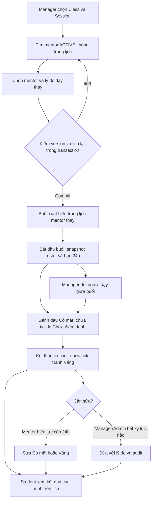

# Phase 4 — Flow điểm danh và phân công dạy thay

**2026-10-13 — PLAN, chưa implement/deploy.**
[Plan](../implement_phase/phase%204/PHASE_4_ATTENDANCE_OPERATIONS.md) ·
[API breakdown](PHASE_4_flow-api-breakdown.md) ·
[Progress](../progress/phase%204/PHASE_4_PROGRESS.md).

## 1. Flow tổng hợp

Toàn bộ nhánh Phase 4 trên là dự kiến. Phase 2.3 lịch/enrollment có source;
Phase 3 materials chạy song song và không là prerequisite của attendance.

## 2. Manager xử lý mentor bận đột xuất

1. GET management Classes/detail để lấy classId/sessionId/version.
2. GET available-mentors theo Session. Khoảng giờ do server lấy từ Session;
   availability kiểm lịch primary + substitute theo effective mentor.
3. PATCH Session mentor với mentorId/reason/expectedVersion. Candidate GET
   không giữ slot; PATCH kiểm lại ACTIVE/role/overlap trong transaction.
4. Nếu 409 stale/conflict: refetch Session/candidates, không tự retry ghi đè.
5. Sau commit mentor mới thấy Session qua `/mentor/schedule` và có quyền buổi;
   mentor cũ mất quyền ghi buổi. Lịch Student hiển thị mentor của buổi.
6. IN_PROGRESS được đổi mentor giữa buổi; deadline/giờ start đầu tiên giữ nguyên.
7. Đổi mentor cả Class là command khác và candidate kiểm tất cả buổi chịu ảnh hưởng;
   không thay override hoặc người đã dạy các buổi bắt đầu/hoàn tất.

## 3. Mentor bắt đầu và điểm danh

1. Lịch dạy → roster Session → kiểm canStart/canEdit, version và deadline.
2. Start chỉ một lần; snapshot ACTIVE roster, set IN_PROGRESS và hạn start +24h.
   Class OPEN có thể atomically chuyển IN_PROGRESS theo nghiệp vụ đóng đăng ký.
3. PUT attendance batch gửi các checkbox thay đổi, không thay toàn bộ roster
   ngầm. Bỏ tick trước chốt = UNMARKED; sau chốt chọn PRESENT/ABSENT rõ ràng.
4. CASH còn pending chỉ ở phần chờ xác nhận; mentor snapshot của cash Order
   confirm qua API Phase 2.2 hiện hữu. Mentor thay không được kế thừa quyền tiền.
   Sync-roster sau activation chỉ admit hold có trước start và ACTIVE hợp lệ.
5. FE preview tổng rồi finalize theo version; server atomically chuyển các
   UNMARKED thành ABSENT, set COMPLETED và actualEndedAt.
6. Mentor sửa trước deadline, Manager sửa không giới hạn thời gian với reason.
   Mọi mutation có audit và optimistic concurrency; hết quyền phải refetch.

## 4. Student và truy vấn vận hành

- `/me/schedule` giữ FULL/CASH_PREVIEW và thêm attendance/applicability/mentor buổi.
- Chưa bắt đầu ≠ chưa điểm danh ≠ vắng. Không thuộc roster trả NOT_ELIGIBLE;
  CASH preview trả PAYMENT_PENDING, không có kết quả chính thức.
- Own history đọc attendance metadata cũ sau completion/withdrawal; không cấp lại
  materials, meeting URL hoặc thông tin học sinh khác.
- Summary: chỉ roster trong Session COMPLETED đã chốt; hủy/legacy/chưa chốt loại
  khỏi mẫu số. Không có mẫu số trả rate=null, không trả 0% để ngụ ý học sinh vắng.
- Manager thấy OVERDUE_NOT_STARTED và STARTED_NOT_FINALIZED. Không auto vắng
  hoặc auto kết thúc do scheduler/time trên lịch.

## 5. Đổi lịch, hủy và bù

Manager reschedule chỉ SCHEDULED, kiểm thời gian/Class period và lịch effective
mentor. Hủy giữ lịch sử. Makeup tạo replacement cùng Class, liên kết original
CANCELLED; chỉ replacement đã chốt tính chuyên cần. Không auto gửi mail/notification
hoặc triển khai request nghỉ có duyệt trong Phase 4.

## 6. Phân quyền và giới hạn tích hợp

MENTOR phải ACTIVE và là effective mentor của Session ở thời điểm commit.
MANAGER/ADMIN quản lý assignment/lịch/attendance; không mở toàn bộ AdminClasses
CRUD cho MANAGER một cách ngầm. STUDENT chỉ own enrollment/history.
Substitute quyền buổi không trở thành quyền material authoring/review/release
hoặc cash confirm. Phase 3 phối hợp material read context bằng public provider.

## 7. Ghi chép công việc

- **2026-10-13:** user duyệt nghiệp vụ và yêu cầu available mentor/dạy thay.
  Lập plan 4.1–4.5, flow này, API breakdown và progress. Ghi rõ assignment buổi
  vs lớp, effective mentor/locks, 24h, roster snapshot/CASH, audit/version,
  historical reads, makeup và denominator. Đối chiếu source/diff/link tài liệu;
  chưa migrate, implement, chạy BE tests, deploy hoặc nghiệm thu VPS Phase 4.
