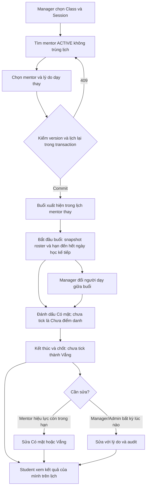
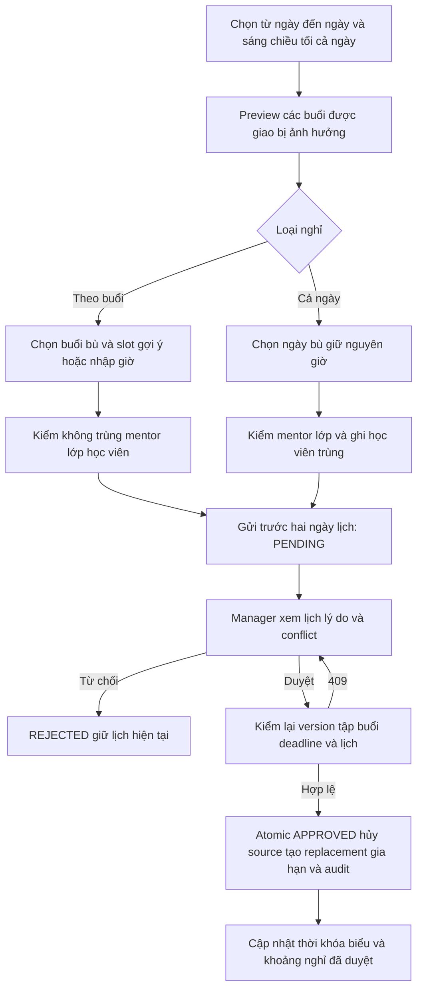

# Phase 4 — Flow điểm danh, nghỉ dạy, học bù và dạy thay

## 2026-10-16 — Implementation4.4c

Đã có lịch Student mentor thực tế/own attendance/guest → own history/summary và
Staff summary/incomplete toàn backlog, dùng chung SQL credit policy/root/owner.
Physical history giữ nguyên, pending/no-data/canceled không vào denominator;
own terminal metadata không mở lại content. [Flow4.4](PHASE_4_4_FLOW.md) /
[API implemented](PHASE_4_4_flow-api-breakdown.md#13-44c--quy-ước-và-contract-chung)
và Swagger/Postman đồng bộ.20 focused PG/3 compiled HTTP4.4c/13 regression lịch
pass; full gates cuối ở Progress4.4. Không migration/FE/deploy mới; leave và4.5
còn riêng. Log planning bên dưới là trước implementation trong cùng ngày.

## 2026-10-16 — 4.4b hoàn tất; planning Student/operations4.4c

User xác nhận4.4b đã xong. Đã đối chiếu progress/source, lưu22 AC/20 scenarios/
5 bước C1–C5 tại [plan4.4 mục4](../implement_phase/phase%204/PHASE_4_4_LEAVE_MAKEUP_STUDENT_OPERATIONS.md#4-44c--lịch-student-tổng-hợp-và-hàng-chờ-vận-hành).
[Flow4.4](PHASE_4_4_FLOW.md) và [API4.4 mục13–18](PHASE_4_4_flow-api-breakdown.md#13-44c--quy-ước-và-contract-chung)
mô tả schedule additive → own history/summary → Staff summary/incomplete toàn
backlog, cùng credit formula/source root. Chưa code/test4.4c; local gates436/45
là evidence15/10. Leave/approved intervals còn gap source riêng. Chỉ tài liệu,
không source/FE/migrations/deploy; server/Postman4.3 đã xong theo user15/10,
không suy thành deployment4.4 hoặc browser4.5. Các log dưới giữ ngày gốc.

## 2026-10-15 — Tiếp 4.4b: học bù lớp khác

Đã triển khai migration1792022400001, Staff queue/candidates/create/cancel placement,
Student own placements, capacity với checkout, guest roster/mark/finalize/audits,
Student context đúng target và requeue/completion guards. Late CASH/PayOS activation
không bị từ chối vì trùng replacement; ghi queue atomic. Flow/API/Postman cùng revision.
User xác nhận a xong; source hiện tại vẫn thiếu workflow leave/approved intervals,
không đánh dấu candidates đã kiểm approved leave. 4.4c/4.5 vẫn pending. Không sửa FE,
không migrate dev/VPS hoặc giao dịch thật. Gate cuối local: **pnpm check436/436 tests/44 suites, pnpm test:http45/45 tests/7 suites,0 skip; lint/type-check/build pass**. Chi tiết xem Progress4.4.

**2026-10-15 — bắt đầu code4.4a:** management Session schedule/cancel/makeups,
ancestry/audit migration và Class cancellation batch đã có source. Chi tiết ở
[flow4.4](PHASE_4_4_FLOW.md), [API4.4](PHASE_4_4_flow-api-breakdown.md) và
[progress4.4](../progress/phase%204/PHASE_4_4_PROGRESS.md).
Workflow nghỉ/duyệt, approved intervals, conflict/guest/Student projection vẫn
chưa triển khai; chưa hoàn tất4.4a–c hoặc deploy4.4/4.5.

**Đối chiếu hai commit ngày 14/10/2026:** `8a1c7e8` chỉ tài liệu;
`246abf4` thêm 15 endpoint Phase4.1–4.3 và 2 endpoint Admin xem học viên.
[File tổng hợp API đã có và flow gọi nối tiếp](PHASE_4_API_SUMMARY.md) chỉ rõ
IDs/version truyền giữa các bước, CASH, correction, evidence recovery và phần
còn planned. Các log planning/baseline dưới đây là lịch sử; trạng thái hiện tại
có correction/recovery/audits4.3, Student/leave/makeup/guest còn4.4, release4.5 mở.

**2026-10-13 — Core4.1–4.2 và core coverage đã kiểm local; dependencies/
release mở; 4.3 implemented/focused verified;4.4–4.5 planned; chưa deploy.**
[Plan](../implement_phase/phase%204/PHASE_4_ATTENDANCE_OPERATIONS.md) ·
[API breakdown](PHASE_4_flow-api-breakdown.md) ·
[Progress](../progress/phase%204/PHASE_4_PROGRESS.md).

Flow riêng [4.1](PHASE_4_1_FLOW.md) / [4.2](PHASE_4_2_FLOW.md) /
[4.3 implemented](PHASE_4_3_FLOW.md),
plan riêng [4.1](../implement_phase/phase%204/PHASE_4_1_MENTOR_SUBSTITUTION.md) /
[4.2](../implement_phase/phase%204/PHASE_4_2_SESSION_ATTENDANCE.md) /
[4.3](../implement_phase/phase%204/PHASE_4_3_ATTENDANCE_CORRECTIONS_HISTORY.md).

2026-10-13: tiếp planning4.3 riêng theo4.1/4.2: completed/Staff canceled
correction → Staff audit reader → legacy/terminal evidence recovery → HTTP/handoff.
22 AC/16 test scenarios và source/gap matrix, giữ calendar deadline; proposed
admissionBasis/evidence schema/parser limit riêng tại
[API4.3](PHASE_4_3_flow-api-breakdown.md). Đây là ghi chép planning lịch sử;
4.3 đã implementation/local tests ở cuối file. Chưa xác nhận FE/deploy4.3.
Diagram/flow dưới đây mô tả nghiệp vụ toàn Phase4; Student/cancel/guest còn
kế hoạch, correction/legacy recovery4.3 đã có source; không coi toàn diagram đã code.

Rule hiện hành sau user sửa2026-10-13: không overnight; deadline Mentor hết ngày
kế tiếp của ngày học trên lịch (thứ Ba →00:00 thứ Năm), không rolling24h.
Log planning/implementation cũ là lịch sử; kiểm thực thi mới ở progress riêng.

## 1. Flow tổng hợp

Discovery/candidates/assignment/Mentor schedule/context có source4.1;
start/roster/sync/mark/finalize và Staff SCHEDULED recovery có source4.2.
Correction/legacy recovery/audit4.3 đã implement;Student/cancel/guest còn planned4.4. Phase2.3 có source;
Phase 3 materials chạy song song và không là prerequisite của attendance.

## 2. Manager xử lý mentor bận đột xuất

1. GET management Classes/detail để lấy classId/sessionId/version.
2. GET available-mentors theo Session. Khoảng giờ do server lấy từ Session;
   kiểm primary/substitute theo effective mentor và khoảng nghỉ APPROVED khi
   4.4a triển khai. Chỉ chiếm khoảng giờ dự kiến, quá endsAt chưa chốt không giữ slot.
3. PATCH Session mentor với mentorId/reason/expectedVersion. Candidate GET
   không giữ slot; PATCH kiểm lại ACTIVE/role/overlap trong transaction.
4. Nếu 409 stale/conflict: refetch Session/candidates, không tự retry ghi đè.
5. Sau commit mentor mới thấy Session qua `/mentor/schedule` và có quyền buổi;
   mentor cũ mất quyền ghi buổi. Yêu cầu lịch Student hiển thị mentor buổi còn
   pending4.4c; MyScheduleService hiện lấy Class mentor.
6. IN_PROGRESS được đổi mentor giữa buổi; deadline/giờ start đầu tiên giữ nguyên.
7. Đổi mentor cả Class là command khác và candidate kiểm tất cả buổi chịu ảnh hưởng;
   không thay override hoặc người đã dạy các buổi bắt đầu/hoàn tất.

## 3. Mentor bắt đầu và điểm danh

1. Lịch dạy → roster Session → kiểm canStart/canEdit, version và deadline.
2. Start chỉ một lần; snapshot ACTIVE roster, set IN_PROGRESS và hạn hết ngày kế tiếp của ngày học trên lịch.
   Class OPEN có thể atomically chuyển IN_PROGRESS theo nghiệp vụ đóng đăng ký.
   Mentor được mở đầu/cuối buổi, bất kỳ giờ trong ngày lịch buổi đi qua theo
   APP_TIME_ZONE; không overnight. Ngoài ngày chỉ Manager/Admin recovery.
3. PUT attendance batch gửi các checkbox thay đổi, không thay toàn bộ roster
   ngầm. Bỏ tick trước chốt = UNMARKED; sau chốt chọn PRESENT/ABSENT rõ ràng.
4. CASH còn pending chỉ ở phần chờ xác nhận; mentor snapshot của cash Order
   confirm qua API Phase 2.2 hiện hữu. Mentor thay không được kế thừa quyền tiền.
   Sync-roster sau activation chỉ admit hold có trước start và ACTIVE hợp lệ.
5. FE preview tổng rồi finalize theo version; server atomically chuyển các
   UNMARKED thành ABSENT, set COMPLETED và actualEndedAt.
6. Mentor sửa trước deadline, Manager sửa không giới hạn thời gian với reason.
   Mọi mutation có audit và optimistic concurrency; hết quyền phải refetch.
7. Manager phục hồi buổi quên thao tác hoặc legacy COMPLETED bằng roster/thời gian/
   kết quả có evidence; không suy ra roster quá khứ từ ACTIVE hôm nay và không
   reopen/reset clock. Thiếu chứng cứ giữ no-data.

## 4. Student và truy vấn vận hành

- `/me/schedule` giữ FULL/CASH_PREVIEW và thêm attendance/applicability/mentor buổi.
- Chưa bắt đầu ≠ chưa điểm danh ≠ vắng. Không thuộc roster trả NOT_ELIGIBLE;
  CASH preview trả PAYMENT_PENDING, không có kết quả chính thức.
- Own history đọc attendance metadata cũ sau completion/withdrawal; không cấp lại
  materials, meeting URL hoặc thông tin học sinh khác.
- Summary: chỉ roster trong Session COMPLETED đã chốt; hủy/legacy/chưa chốt loại
  khỏi mẫu số. Không có mẫu số trả rate=null, không trả 0% để ngụ ý học sinh vắng.
- Manager thấy OVERDUE_NOT_STARTED và STARTED_NOT_FINALIZED. Không auto vắng
  hoặc auto kết thúc do scheduler/time trên lịch.
- Incomplete/conflict/makeup queues mặc định toàn bộ backlog. Class completion
  chặn SCHEDULED/IN_PROGRESS và placement học bù chưa được giải quyết.

## 5. Đổi lịch, hủy và bù

Manager reschedule chỉ SCHEDULED, kiểm thời gian/Class period và lịch effective
mentor. Hủy giữ lịch sử. Makeup tạo replacement cùng Class, liên kết original
CANCELLED, cùng Course Unit; một replacement hiệu lực cho cả root chain.
Replacement vượt endDate tự gia hạn Class cùng transaction. Chỉ replacement
đã chốt tính chuyên cần; không auto gửi mail/notification.

### Mentor đăng ký nghỉ có duyệt

MORNING00–12, AFTERNOON12–18, EVENING18–24, FULL_DAY00–24 theo APP_TIME_ZONE.
Gửi thứ Tư cho buổi thứ Sáu hợp lệ bất kể giờ; không dùng 48h. Multi-day dùng
affected startsAt sớm nhất, deduplicate; không tạo buổi overnight. PENDING không giữ
slot ngày bù; approve trước startsAt sớm nhất, hết hạn EXPIRED.
Nghỉ buổi tránh lịch học viên ở cả gợi ý/nhập tay; FULL_DAY giữ local clock và
lưu student conflicts cho Manager/mentor. Source có guest cần xử lý trước.
Phase 4 chỉ đổi timetable, mentor chủ động nhắn; notification thuộc phase sau.

### Học viên học bù lớp khác cùng Course Unit

1. Manager mở student conflict của lịch đổi ngày.
2. Tìm Session của Class khác cùng Course Unit, future/SCHEDULED, không trùng
   học viên và còn sức chứa; Manager xác nhận nội dung buổi tương đương.
3. Tạo placement từ enrollment ACTIVE lớp gốc; không tạo đơn hoặc enrollment mới.
4. Student thấy đúng event/context nhận bù; target mentor thấy guest roster.
5. Target mentor ghi guest attendance bằng makeupPlacementId, finalize trước deadline hết ngày học kế tiếp.
6. Summary lớp gốc dùng guest result thay source một lần; pending không là vắng.
   Target hủy cần xếp lại, giữ lịch sử và không tự ABSENT.

Attendance thường giữ FK cùng Class; placement/guest attendance là quan hệ riêng.
Materials tiếp tục theo enrollment lớp gốc, không mở entitlement cả lớp nhận.

## 6. Phân quyền và giới hạn tích hợp

MENTOR phải ACTIVE và là effective mentor của Session ở thời điểm commit.
MANAGER/ADMIN quản lý assignment/lịch/attendance; không mở toàn bộ AdminClasses
CRUD cho MANAGER một cách ngầm. STUDENT chỉ own enrollment/history.
Substitute quyền buổi không trở thành quyền material authoring/review/release
hoặc cash confirm. Phase 3 phối hợp material read context bằng public provider.

## 7. Ghi chép công việc

- **2026-10-13:** user duyệt nghiệp vụ và yêu cầu available mentor/dạy thay.
  Lập plan 4.1–4.5, flow này, API breakdown và progress. Ghi rõ assignment buổi
  vs lớp, effective mentor/locks, 24h, roster snapshot/CASH, audit/version,
  historical reads, makeup và denominator. Đối chiếu source/diff/link tài liệu;
  chưa migrate, implement, chạy BE tests, deploy hoặc nghiệm thu VPS Phase 4.
- **2026-10-13 — bổ sung sau review:** chốt mở điểm danh trong ngày/overnight,
  recovery legacy, lịch chỉ chiếm interval dự kiến, nghỉ trước hai ngày lịch có
  duyệt theo range/period, bù buổi hoặc đổi ngày giữ giờ, auto endDate, student
  conflicts và học bù lớp khác cùng Course Unit. Chỉ cập nhật Markdown.

## 12. Evidence implementation4.1

Management classes/detail → candidates → PATCH version + Idempotency-Key →
mentor schedule → Session context đã test PostgreSQL/HTTP. Mentor cũ403 context;
substitute không thêm cash/material rights. GET không giữ slot, cạnh tranh chỉ
một assignment commit. Lịch writer baseline dùng effective mentor checker mới.
Enum/clock groundwork chưa tạo start/attendance API. pnpm check310/310 và HTTP29/29
pass local; migration rehearsal up/down/up/refusal pass; không deploy/browser/VPS.
Xem [contract4.1](PHASE_4_flow-api-breakdown.md#14-implemented41--contract-thực-tế-và-handoff).

## 2026-10-13 — Implementation4.2

Đã có AttendanceModule và migration1791849600001: Session class ancestry/composite
FK, regular roster, audit/lifecycle/idempotency. Mentor GET roster → start trong
ngày học → tick/bỏ tick → xác nhận totals → finalize; chỉ lúc chốt mới chuyển
UNMARKED→ABSENT. Snapshot ACTIVE đã tồn tại/kích hoạt trước start, không suy ra
vắng từ giờ lịch hoặc thêm enrollment sau cutoff. CASH pending cần mentor Order
snapshot xác nhận, rồi teaching mentor sync; role thu tiền giữ nguyên.

Manager/Admin reason + actualStartedAt quá khứ phục hồi buổi SCHEDULED của Class
OPEN/IN_PROGRESS; roster cần enrolledAt<=actualStartedAt, không suy ra lịch sử từ
ACTIVE hôm nay. Finalize với actualEndedAt có kiểm start<end<=now, giữ deadline
gốc. Mentor hết deadline bị chặn; Staff không deadline. Retry/assignment change không
reset clock; writer cùng version và Class→Session locks, rollback cả audit/receipt.
Class complete bị chặn khi còn SCHEDULED/IN_PROGRESS.

Contract thực tế [mục15](PHASE_4_flow-api-breakdown.md#15-implemented42--contract-thực-tế-và-handoff),
Postman4.2 và progress đồng bộ. Correction sau chốt/canceled, legacy recovery,
audit/history APIs, cancel orchestration, Student projections và guest vẫn pending
4.3–4.4. Chưa FE/deploy/VPS; checks/evidence local xem Progress4.

## 2026-10-13 — Plan riêng và đối chiếu code/progress

Tách plan/progress/flow/API4.1–4.2; review source/migration/DTO/controller/services/
test assertions theo AC và ghi gap register. Core đã có; Student mentor vẫn Class
primary, Staff recovery mới SCHEDULED/Class OPEN hoặc IN_PROGRESS, Class cancel
chưa hủy Session batch/audit. Full recovery/correction/leave/guest/Student/release
và mixed-writer/edge/Staff HTTP coverage còn mở ở progress riêng.
Chỉnh các dòng current-state cũ ghi4.2 planned và tất cả Phase4 chưa implement.
Chỉ Markdown/diff/link/source review, không runtime tests/migrations/FE/deploy mới.

## 2026-10-13 — Sửa theo plan và rule deadline mới

Context provider kiểm actor ACTIVE/current role/assignment; start dùng clock
sau mentor lock, không mở sai ngày khi wait qua midnight. Không overnight;
deadline từ ngày startsAt trên lịch đến00:00 ngày học+2. Migration1791849600002
sửa stored deadlines/versions, giữ actual clocks/history. Mixed-writer/edge/Staff
HTTP tests đã thêm; check359/359/36 suites và HTTP33/33/4 suites pass local.
Evidence mới ở Progress4.1/4.2 mục8; chỉ migrate dedicated *_test, chưa dev/VPS/FE.

2026-10-13 implementation4.3: correction sau chốt,Staff audit GET và historical
evidence recovery đã có migration1791849600003 và runtime assertions. Handoff
[Flow4.3](PHASE_4_3_FLOW.md)/[API4.3](PHASE_4_3_flow-api-breakdown.md);
full local gates tại [Progress4.3](../progress/phase%204/PHASE_4_3_PROGRESS.md).
GAP42-01–03 thuộc implementation này;Student4.4c/guest4.4b/cancel-leave4.4a và
release4.5 vẫn mở. Chưa deploy/VPS/browser/live-payment hoặc sửa FE.

## 2026-10-14 — Tổng hợp hai commit và flow API hiện hành

Đối chiếu `8a1c7e8`/`246abf4` với controller/DTO/services/error mapping và test
assertions; tạo [API summary](PHASE_4_API_SUMMARY.md) theo yêu cầu, gồm toàn bộ
17 endpoint mới, các route cũ liên quan, data handoff và flow phân công → lịch
mentor → context/roster → start → mark → finalize → correction/audit, cùng CASH
sync và historical evidence recovery. Sửa các dòng current-state lỗi thời ở
breakdown tổng; giữ log baseline/local evidence lịch sử. Không thay đổi API/runtime.
Kiểm tra tĩnh route coverage/local links/JSON/code fences và diff; không chạy lại
BE tests, migration, FE, deploy hoặc giao dịch thật trong lượt tài liệu này.

## 2026-10-14 — Review log deploy bị chặn trước rollout

Log Actions user cung cấp cho release `e0c9174` ghi Check pass 397 tests/39 HTTP
tests, nhưng VPS checkout có untracked `..env.production.swp`; clean-checkout
guard dừng trước fetch/build/backup/migration/start API. Không đổi flow/API hoặc
workflow. [Runbook](../VPS_DEPLOYMENT.md) bổ sung đóng/recover editor, chuyển swap
sang backup riêng ngoài checkout, kiểm Git sạch và re-run failed jobs.
Lượt này chỉ đọc log/source và cập nhật docs; chưa thao tác VPS hoặc xác nhận
deploy thành công, release4.5 vẫn mở.

## 2026-10-15 — Lưu plan riêng Phase 4.4a–c

Đã lưu [plan 4.4](../implement_phase/phase%204/PHASE_4_4_LEAVE_MAKEUP_STUDENT_OPERATIONS.md)
cho nghỉ có duyệt/replacement, học bù lớp khác và lịch/history/summary Student.
User chọn giữ luồng đăng ký/thanh toán khi phát sinh trùng lịch bù sau duyệt;
ghi conflict để Manager xử lý. Flow dự kiến: nghỉ → duyệt → replacement/gia hạn
→ conflict queue → placement → guest finalize → credit source một lần.
Contract planned tại [API breakdown mục 8–12](PHASE_4_flow-api-breakdown.md).
4.4 chưa implementation; lượt này chỉ Markdown/link/diff checks, không chạy
runtime tests, migration, FE hoặc deploy. Backlog ngày 15/10 ghi nhận server/
Postman 4.3 đã hoàn tất theo user; các log deployment phía trên là lịch sử.
## Tích hợp Materials3.3/3.4 — 2026-10-15

ClassesModule giữ teaching/lifecycle/attendance4.1–4.3 cùng context/release3.3;
không cấp quyền Materials/CASH cho substitute từ teaching assignment. Guard hoàn
thành Class vẫn đòi Sessions terminal; test release3.3.4 đã cập nhật prerequisite.
Hai migration compatibility giải quyết unique constraint trùng mà không sửa
migration lịch sử; source22, clean/upgrades/data/FK/down-up3/3 pass local.
[Quyết định tích hợp](../progress/phase%203/PHASE_3_3_PROGRESS.md).
Không đổi contract Phase4, không migrate development/VPS hoặc nghiệm thu FE.

Kiểm chứng tích hợp15/10: pnpm check513/513 (48 suites), HTTP60/60 (5 suites)
qua cấu hình mặc định; lint/type-check/build pass. Migration compatibility3/3
đã chạy lại sau guard tên DB test. Không VPS/browser/FE hoặc live payment evidence.
