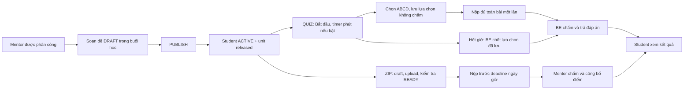

# Phase 5 — Assignment: bài kiểm tra/BTVN, QUIZ ABCD và ZIP

2026-10-22, PLANNED; chưa có runtime APIs/migration/entity cho assignments.
[Plan](../implement_phase/phase%205/PHASE_5_ASSIGNMENTS.md) ·
[API proposal](PHASE_5_flow-api-breakdown.md) ·
[Progress](../progress/phase%205/PHASE_5_PROGRESS.md).

Owner hiện được thiết kế trong DBML: Class → ClassUnit → ClassSession → Assignment.
CourseUnit liên quan qua ClassUnit, không là owner của bài. Assignment → nhiều
Submission attempts của Student → nhiều SubmissionFiles và tối đa một Grade.
Đề xuất bổ sung enrollment binding, revision snapshots, grade release history,
questions/options/private keys và expiry jobs; chưa sửa DBML thành schema runtime.
DBML type TEXT/FILE/CODE là thiết kế cũ. User chọn `purpose=TEST|HOMEWORK` và
`type=QUIZ|ZIP`; assignment không đồng nghĩa chỉ BTVN.

PUBLISHED/ARCHIVED không đồng nghĩa student được đọc nếu enrollment/unit không hợp
lệ. Guest học bù không tự có bài lớp đích. QUIZ timer optional theo phút mentor
đặt; ZIP bắt buộc dueAt ngày/giờ, không timer phút. Clock DB và expectedVersion
chống race; reload/resume không reset timer, autosave không gia hạn quyền nộp.

Ví dụ40 câu: manual submit phải đủ40, BE mới chấm và trả đáp án ngay. Timer expiry
là ngoại lệ: worker chốt saved answers, câu chưa chọn tính sai dù tab đã đóng.
Đề/nháp trước submit không có key. QUIZ mặc định một official attempt vì sau nộp
đã được xem đáp án; đây là default đề xuất, không phải feature đã triển khai.

ZIP grade draft không lộ cho student. Sửa released grade giữ old snapshot tới
khi công bố mới. QUIZ auto grade/release cùng transaction. Metrics tách riêng; không auto pass
course/certificate. Session cancel giữ history; reschedule không tự dời dueAt;
replacement không clone/move bài.

Delivery: A0 scope/schema → A1 đề QUIZ → A2 start/timer/submit/auto-grade →
A3 ZIP pipeline → A4 ZIP submit/manual grade → A5 reports/gates/handoff.
Compiler/CODE ngoài v1.
Plan không yêu cầu sửa FE; chỉ bàn giao contract, không triển khai UI trong repo FE.

Kiểm chứng lượt planning: source/DBML đối chiếu + static docs/link/diff checks.
Chưa runtime tests/migration/VPS/MinIO/browser/email/giao dịch thật.
