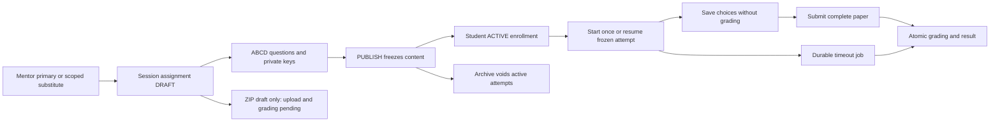

# Phase 5 — Assignment: QUIZ implemented locally, ZIP pending

## Restoration — 2026-10-23

Branch `codex/restore-phase5-assignments` starts from dev `569bfcb` and reverses
the removal in PR #21, restoring PR #20's QUIZ implementation. ZIP and A3-A5
remain pending. The API and business rules match the restored implementation.
The shared payment test fixture now derives scheduled dates in APP_TIME_ZONE
(Asia/Ho_Chi_Minh), with a leave migration regression at 00:15 Vietnam time;
this fixes the UTC/local calendar discrepancy without changing leave policy.
Validation and deployment evidence are recorded in Phase 5 progress.

CI follow-up: run 39898049364 stopped before dependency installation/tests while
apt downloaded FFmpeg on Ubuntu 26.04, exceeding the five-minute step limit.
The workflow now installs the lockfile-pinned ffprobe-static Linux binary at
/usr/bin/ffprobe after pnpm install. All validation/test gates remain enabled;
no assignment flow, API or production container behavior changes.

2026-10-22 · codex/phase5-assignments. QUIZ vertical slice implemented; A3-A5 pending.
[Plan](../implement_phase/phase%205/PHASE_5_ASSIGNMENTS.md) ·
[Current API](PHASE_5_flow-api-breakdown.md) · [Progress](../progress/phase%205/PHASE_5_PROGRESS.md).

Assignments belong to ClassSession, inherited class through session. Primary manages
whole class; substitute only current effective sessions. No createdBy permanent
grant. Current source removed legacy unit-release gates: ACTIVE enrollment grants
student content access, pending cash/guest makeup does not. Completed/cancelled
class blocks writes, cancelled session blocks new work. Revoke/archive/cancel is
rechecked under Class -> Session -> Assignment -> Submission locks.

QUIZ timer optional1..240 minutes, optional absolute dueAt. Expiry is the earlier
non-null limit; both null means untimed. Start/resume cannot reset clock or consume
a second attempt. Autosave replaces selected answers with expectedVersion and
UUID key; never returns correctness. Manual submit requires every question exactly
once; final payload is authoritative. BE computes score with integer cents and
commits immutable result/answers/audit/receipt in one transaction, then returns
correct answers immediately under result. 33/40 ->82.50 at max100.00.

At now>=expiresAt manual payload rejected, PostgreSQL durable worker grades only
saved answers; blanks wrong. GET only observes FINALIZING until commit, then result.
Worker starts at bootstrap when ASSIGNMENT_TIMEOUT_JOB_ENABLED=true (default),
polls2s with batch20 and capped retry. Archive voids active attempts atomically;
worker rechecks active attempts every30s (or at their earlier expiry), including
untimed attempts, and voids them after enrollment revoke/session/class cancel. Graded
own results survive terminal enrollment/archive; current active account required.
No notifications/certificates/automatic unit completion changes in this slice.

Implementation choice: module-owned typed SQL and JSONB quiz snapshot/answers/result
follow existing teaching-notes style; private keys normalized separately. Audits
append only; GRADED/VOIDED submissions immutable; migration down refuses populated
history. Separate ZIP file binding/grade-revision schema waits for A3/A4. Existing
assignmentSummary remains NOT_IMPLEMENTED until A5 aggregates are implemented.

New APIs: mentor create/list/detail/draft edit/question replace/publish/archive/delete;
student published list/instructions/start/resume/save/submit/result. Each route is
specified in current API breakdown; proposed ZIP endpoints are explicitly absent.
Postman collection contains only implemented routes and does not auto-run mutations.

Local verification includes isolated PostgreSQL, migration clean/down-up/guard,
40-question flow, concurrent idempotent start/submit/timeout, stale/foreign answers,
rollback on audit failure, cancellation/reassignment and real compiled HTTP guards,
DTO validation and OpenAPI. Final full-gate counts are recorded in progress.
No development/production migration applied, no VPS/deploy/browser/live payment
claim. FE repositories are unchanged. ZIP/reporting are remaining Phase5 work.
