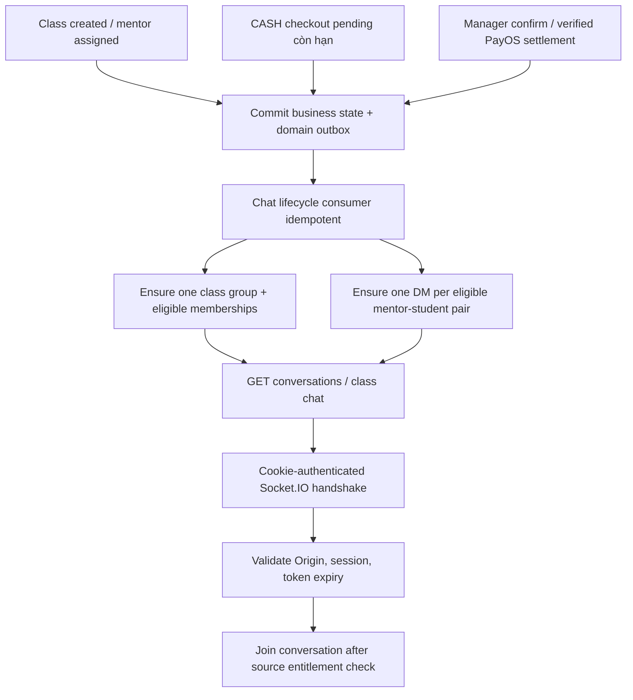
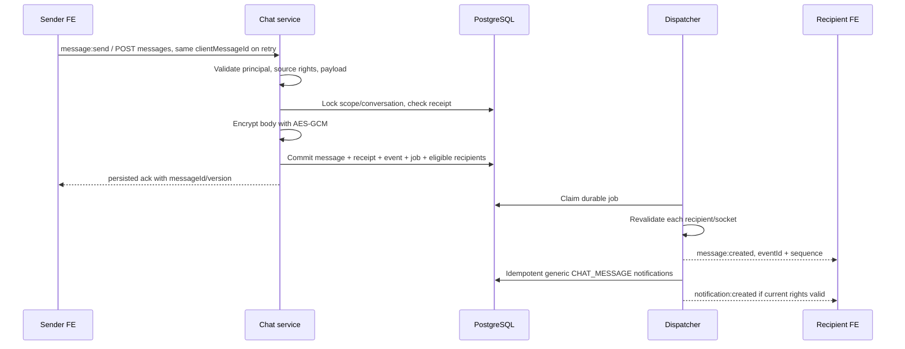

# Phase 6 — Flow chat realtime và notification

## Kiểm tra môi trường integration test — 2026-10-27

Đã tái hiện6 suites Files/Materials failed tại setup vì thiếu TEST_DATABASE_URL.
Sau khi start PostgreSQL/MinIO và dùng DB riêng mindy_center_test,6 suites PASS117
tests; full pnpm check PASS691/691,78 suites,0 skipped và lint/type-check/build
PASS32 migration artifacts; evidence tại Progress Phase6. README cập nhật
hướng dẫn dependency và skip/fail. Luồng nghiệp vụ/API/schema không đổi.

## Đồng bộ group chat local — 2026-10-27

Đã chạy backfill dry-run → apply → repeat (limit20) trên local:10 classes →10 groups, missing0; giữ1 DM,0 messages/0 notifications và original join/history/read state. Cờ local .env đã đặt CHAT_ENABLED=true/CHAT_JOB_ENABLED=true; key1 mới chỉ lưu .env ignored, DB chưa có message/receipt trước khi tạo key. Group DRAFT vẫn deny theo source. Không đổi API/quyền/schema hoặc bật attachments.

Cơ chế tự tạo đã có: class/enrollment/order/account trigger → lifecycle outbox → chat worker → reconcile group/DM/member. **Live worker còn chờ API restart** để đọc cờ mới. Automatic approval đã chặn stop/start tiến trình API port3000 (blocked by policy, không có lý do chi tiết); không thực hiện restart. User cần Ctrl+C rồi pnpm dev/pnpm start trong terminal API. Jobs chờ1 LIFECYCLE/9 REALTIME/9 NOTIFICATION; chưa tính là live auto-sync đã verify. Chi tiết/logs ở Progress Phase6; build/CLI/repeat và DB checks PASS, không chạy lại runtime suites cho thao tác vận hành này.

## Fixture SQL local — 2026-10-27

Đã thêm student Chi (`student.chi@gmail.com`, user UUID `1f9a0b9f-d88d-4ac9-940b-2821998b1d77`) vào lớp `HTML-CSS-101-ON1` / `0d92ff10-6a12-4571-b96f-719707221378` bằng SQL local. Tạo CASH pending48h + enrollment PENDING_PAYMENT, group/DM với primary mentor để test Phase6. Group conversation_id `98f91cca-b59e-4e74-aeb7-15c440ceddbd`; mentor peer_user_id `08939ff0-7497-421e-9b54-2765789981b4`. Không mở materials/quiz hoặc ghi nhận thanh toán thật. Chạy SQL lại no-op, xác nhận1 order/detail/enrollment và0 payment transactions; source eligibility true. Chi tiết/script local ở Progress Phase6; không đổi API/schema/flags hoặc chạy application suites trong lượt fixture này.

## Postman test login — 2026-10-27

Collection Phase6 chia5 nhóm C/M/R-E/N/F. Trong mỗi nhóm: chọn Login Student hoặc Login Mentor → GET auth/me để xác nhận actor → chạy API tương ứng. Login gọi POST /api/v1/auth/login, Postman giữ HttpOnly cookie jar; login sau thay actor của cùng host. Giữ actor khi send→edit/delete hoặc intent→complete/status/send; đổi actor để kiểm history/inbox/download của recipient cần quyền hiện tại. Không thêm route/quyền;19 requests nghiệp vụ giữ nguyên. JSON/body/script syntax, cấu trúc và exact-preservation đã kiểm; lint/type-check PASS. Chưa chạy request Postman tới backend trong lượt này.

## Docker migration và kiểm chứng tiếp — 2026-10-26

Đã chạy migration DB phát triển Docker16→32, repeat no-op, có backup trước migration. Tests isolated xác nhận Phase5 có dữ liệu nâng qua3 Chat migrations, giữ legacy READY material file và quan hệ cũ. Dev migration không thay trạng thái VPS/FE hoặc tự bật flags.

Đã kiểm chứng thêm PayOS verified activation→chat, CASH pending vẫn deny quiz; source reassign/suspend/current-role/expiry, reply/history windows; read/fanout/cutoff/multi-tab; scoped file signing và cleanup dưới lock barrier. H giữ ack sau commit hoặc dừng trước complete, kill/restart cùng DB/keyring và kiểm same-ID replay/event dedupe/current tombstone. Không thay runtime flow/API.

Ma trận hiện hành **39/39 AC PASS — backend local R4 complete**; full-check691/691, HTTP117/117 và gates restore/ops xem [Progress6](../progress/phase%206/PHASE_6_PROGRESS.md#docker-acceptance-2026-10-26). Đã đóng24 barrier cases tại per-socket authorization cho4 revoke causes ×6 packet types, ordered fence/disconnect và contract/log canary harness. Tài liệu event/ack/typing quota đã chỉnh đúng runtime; API/quyền không đổi. FE/VPS/production IAM/load acceptance vẫn cần evidence riêng.

## Nghiệm thu từng slice — 2026-10-26

Đã đối chiếu39 AC của8 slice6.0–6.7 với source/tests; kết quả chi tiết và lệnh tái hiện tại [Progress6](../progress/phase%206/PHASE_6_PROGRESS.md#nghiệm-thu-tự-động-theo-slice--2026-10-26). Bổ sung PG tests về rollback/outbox/backfill, mutation/read races và inbox snapshot/revoke; compiled HTTP đối chiếu đủ19 routes Swagger↔Postman. Chỉ tick13 AC đủ bằng chứng,26 AC còn PARTIAL; chưa đóng Phase6 acceptance hoặc FE/VPS.

Không thay runtime API/flow/schema/quyền. Luồng read-all được kiểm thêm bằng barrier sau snapshot IDs: notification fanout mới vẫn unread; đọc inbox không tự đọc conversation. Replay edit sau15 phút và sau delete giữ current tombstone. Kết quả full gates mới và phần chưa kiểm được ghi riêng trong Progress6, không suy từ source thành deployed.

## Implementation revision — 2026-10-24

Đã có runtime group/DM, text/reply/edit/delete/read, Socket.IO/catchup, inbox và scoped image/PDF. CASH entitlement dùng deadline DB clock, chỉ primary mentor; COMPLETED đọc, CANCELLED/revoked deny. Chat không mở Materials/Assignment hoặc đổi payment semantics.

Class/enrollment/order/account mutation → transactional trigger outbox → LIFECYCLE → reconcile current state → unique group/DM/member window. Gửi → source locks + receipt → encrypt + message/event + REALTIME/NOTIFICATION jobs cùng commit → ack persisted → authorize từng socket trước emit. GET không mark read; PUT read tăng cursor và đồng bộ inbox.

Upload: F1 receipt → signed PUT → F2 pin staging version + UPLOAD job → binary validation/immutable final version → READY → M2 IMAGE/FILE → F4 authorize message trước/sau signing. Xóa tin trả tombstone và mất download; CLEANUP claim/recheck live refs sau grace24h. URL đã phát còn sống tối đa60s.

Mặc định CHAT_ENABLED/CHAT_JOB_ENABLED/CHAT_ATTACHMENTS_ENABLED=false. [Contract runtime](PHASE_6_flow-api-breakdown.md), [runbook](../PHASE_6_CHAT_RUNBOOK.md), [evidence/gaps](../progress/phase%206/PHASE_6_PROGRESS.md). Chưa deploy, không sửa FE. Các ghi chép planning bên dưới giữ lịch sử; revision này thay trạng thái source.

## Baseline planning — lịch sử trước implementation

2026-10-24 · **PLANNED, chưa implement/chưa deploy** · Baseline `dev@cc8d843`.
[Plan](../implement_phase/phase%206/PHASE_6_CHAT_NOTIFICATIONS.md) ·
[API proposal](PHASE_6_flow-api-breakdown.md) ·
[Progress](../progress/phase%206/PHASE_6_PROGRESS.md).

## 1. Những gì thay đổi trong lượt này

2026-10-24 — Bổ sung kế hoạch chi tiết8 slices6.0–6.7 tại mục9 của plan: task IDs,
đầu vào/đầu ra, source/provider cần nối, acceptance IDs, tests và mốc bàn giao.
Chốt thứ tự sẵn sàng R1 REST text → R2 realtime/read/mutations → R3 inbox → R4
attachments/full gates. Contract không thêm route; read handler chỉ mở ở6.4,
notification ở6.5, file/image ở6.6. Vẫn PLANNED, chưa có runtime chat mới.

Tạo implement plan và API proposal Phase6 theo trao đổi: class group + DM mentor–
student, backend AES-GCM, client retry ID, quyền CASH pending và ACTIVE sau thu tiền.
Không thay code/schema/runtime API, không chạy migration hoặc deploy. Sơ đồ dưới
là flow mục tiêu; FE chưa thể gọi các API/event mới trong tài liệu này.

## 2. Khởi tạo và quyền

Group provisioning tự động sau commit, eventual; chưa sẵn sàng thì GET class chat
trả503 CHAT_PROVISIONING. FE backoff1/2/4/8s tối đa4 lần, sau đó hiển thị retry chủ
động; không tạo nhóm từ GET. Backfill/reconciliation chủ động cho lớp cũ trước enable.
POST direct ensure cặp hợp lệ có thể giúp khôi phục DM projection, không tự gửi tin.

| Điều kiện | Chat | Quyền học |
|---|---|---|
| CASH pending, Order PENDING còn hạn | Group/mentor DM đủ điều kiện | Chỉ preview hiện có |
| PayOS pending | Chưa cấp từ hold | Chưa mở nội dung |
| CASH manager nhận đủ tiền | Enrollment ACTIVE, chat giữ nguyên | Theo current learning access |
| PayOS verified activation | Cấp chat theo ACTIVE | Theo current learning access |
| COMPLETED | History read-only trong scope | Không sửa policy học hiện có |
| CANCELLED/expired/revoked | Deny theo policy; DM xét các lớp chung khác | Không mở quyền qua chat |

Status thu tiền hiện tại là Order PAID, Payment SUCCEEDED, Enrollment ACTIVE,
không có trạng thái APPROVED cho chat. Manager bất kỳ ACTIVE có thể xác nhận CASH
theo flow hiện hành; việc xác nhận không cấp quyền manager đọc nội dung chat.

## 3. Gửi, ack và notification

SenderId luôn lấy từ auth; client không truyền sender/receiver/key/ciphertext.
Một body cùng clientMessageId khác payload409; cùng payload trả current message
không tạo lại event. Ack không có nghĩa recipient đã nhận/đọc. UI pending đổi sang
persisted theo ack; read receipt là trạng thái riêng, không dùng socket online.

DM sender/receiver không giữ khóa riêng. Keyring chỉ backend, DB lưu ciphertext/
IV/tag/keyVersion. Backend giải mã sau authorize; transport WSS bảo vệ trên đường
truyền. Không E2EE, không plaintext preview trong notification/outbox/log.

## 4. Lịch sử, reconnect và thay đổi tin

1. FE GET conversation list, chọn conversation, GET history trang mới nhất.
2. Connect/join socket, dùng returned highWatermark để GET events từ mốc history.
   FE nên join trước snapshot hoặc buffer event trong khi tải history để không có
   khoảng trống. Dedupe theo messageId/version và eventId; sort sequence bigint.
3. Mất kết nối: retry transport với backoff; không tạo clientMessageId mới cho
   pending send. Hết token thì refresh HTTP một lần, reconnect;401 tiếp thì login.
4. GET events afterSequence phục hồi message create/edit/delete. Catchup chốt
   throughSequence từ trang đầu và giữ cùng giá trị cho mọi trang kế tiếp.
5. Cursor ngoài retention410 CHAT_RESYNC_REQUIRED: bỏ event cursor, refetch list/
   history, upsert theo IDs. Không auto đánh read chỉ vì tải history.
6. Edit cần own message, còn15 phút và expectedVersion. Delete soft, tombstone
   không body/file/quote. Concurrent version conflict409 thì refetch trước thao tác.
7. Conversation visible và nội dung đã hiển thị: FE gửi read tới sequence đã xem;
   backend chỉ nâng last_read_seq. Tabs khác nhận read update và refetch unread.

## 5. Thu hồi quyền và bảo vệ chiều nhận

Expiry CASH dựa DB clock/Order thực tế, không đợi cron đổi status. Reassignment,
cancel, suspension, logout làm source authority đổi; consumer cập nhật projection
và remove sockets khỏi room. Mọi request/delivery còn kiểm nguồn quyền hiện tại,
không dựa vào room hoặc membership cache để phát body.

Server disconnect lúc access token hết hạn, kể cả socket im lặng. Không bật
connection recovery bỏ qua auth. FE xử lý access revocation bằng xóa nội dung cache
trong màn hình và refetch list; không tự reconnect loop vào conversation đã mất quyền.
Server không thể thu hồi dữ liệu đã gửi trước thời điểm revoke.

## 6. Attachments, inbox và UI

- Attachment slice chưa sẵn sàng: canAttach=false, FE ẩn thao tác upload.
- Khi bật: create chat intent → PUT tới storage URL → complete → poll status bounded
  → READY → send FILE/IMAGE với fileObjectId. Không đẩy bytes/base64 lên socket.
- Access file là POST riêng sau authorize message, URL TTL<=60s; không lưu URL trong
  DB/message cache bền vững. URL hết hạn xin mới, không retry storage403 vô hạn.
- Inbox dùng API riêng, generic title/body không chứa tin nhắn. Click notification
  mở conversation và tải dữ liệu đã authorize; nếu quyền mất, bỏ item/refetch count.
- Conversation list/history/member/inbox đều có loading, empty, error, retry chủ
  động;403/404 dừng retry,429 chờ retryAfterMs,503 provisioning retry hữu hạn.
- COMPLETED hiển thị read-only; pending CASH có chat nhưng không hiển thị full
  materials. Không suy capability frontend từ role hoặc payment label đơn lẻ.

## 7. Kiểm chứng và phần còn thiếu

2026-10-24 — Planning chi tiết slice: đối chiếu thêm Auth verified exp/session revoke,
Files CourseUnit scope, neutral outbox gap, kho mutation_receipts dùng chung và
lock order của cash settlement/expiry. Receipt storage mapping và lock graph phải
đóng ở6.0 trước schema; task/AC ở plan không phải evidence runtime. Bổ sung test
fanout đến sau conversation-read và consumer job ownership để tránh unread quay
lại hoặc mất notification khi realtime dispatch đã complete. Không đổi nghiệp vụ
payment/materials/assignment; không tạo endpoint hoặc sửa FE trong lượt này.

2026-10-24 — Trình bày lại schema trong plan: mỗi bảng có từng cột/kiểu/ý nghĩa và
constraints riêng; tách mô tả domain_outbox với chat_dispatch_jobs. Chỉ làm rõ tài
liệu, không thay policy, runtime flow hoặc API contract; chưa có migration.

Lượt này chỉ đối chiếu source và kiểm tra tài liệu/link/consistency. Chưa có runtime
tests cho chat, Socket.IO client, DB migration, MinIO chat upload hoặc VPS smoke.
Các slice6.0–6.7 và acceptance matrix nằm trong plan; tiến độ theo progress riêng.

## 8. Thứ tự triển khai flow theo slice — tất cả còn planned

| Slice | Luồng bàn giao sau nghiệm thu | Phụ thuộc và phần chưa mở |
|---|---|---|
| [6.0](../implement_phase/phase%206/PHASE_6_0_CONTRACTS_ACCESS.md) | Policy/source providers/Auth expiry/event contracts/receipt mapping/lock graph | Chưa route chat. |
| [6.1](../implement_phase/phase%206/PHASE_6_1_SCHEMA_CRYPTO_FOUNDATION.md) | Schema + crypto + receipt/event/job transaction + worker foundation | 6.0; backfill dry-run, chưa member apply hoặc FE traffic. |
| [6.2](../implement_phase/phase%206/PHASE_6_2_MEMBERSHIP_REST.md) | Lifecycle outbox→group/DM/member→REST list/history/send/reply | 6.1; chỉ TEXT, canAttach=false. |
| [6.3](../implement_phase/phase%206/PHASE_6_3_REALTIME_RECOVERY.md) | Handshake→join/buffer→send/typing→dispatcher/catchup→passive revoke | 6.2; read event mới định nghĩa, chưa handler. |
| [6.4](../implement_phase/phase%206/PHASE_6_4_MUTATIONS_READ.md) | Edit/delete→current projection/tombstone; read→monotonic cursor/unread/own tabs | 6.3; inbox hook chuẩn bị, chưa notification rows. |
| [6.5](../implement_phase/phase%206/PHASE_6_5_NOTIFICATION_INBOX.md) | Durable fanout→generic inbox; conversation-read→notifications-read | 6.4; notification read không nâng conversation cursor. |
| [6.6](../implement_phase/phase%206/PHASE_6_6_CHAT_ATTACHMENTS.md) | Scoped intent→PUT→validate→READY→FILE/IMAGE send→authorized download/cleanup | 6.5 + Files; mở canAttach sau gates. |
| [6.7](../implement_phase/phase%206/PHASE_6_7_HANDOFF_OPERATIONS.md) | Full local gates→harness/Postman/runbook→gói handoff | Tất cả trên; VPS/FE browser evidence theo thực chạy, không suy từ local. |
