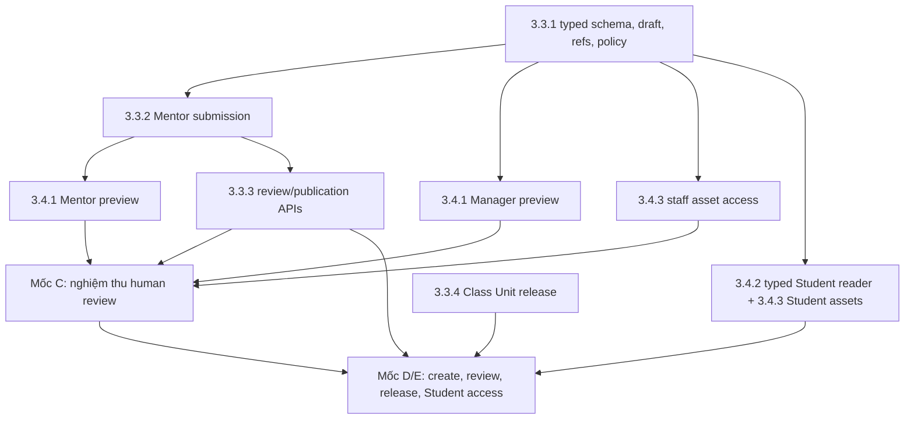

# Phase 3.4 — Material access và staff preview, phối hợp Phase 3.3

Cập nhật: **2026-10-13**. **Kế hoạch backend; phần bổ sung chưa implement/deploy.**
Ba Student FILE/VIDEO GET đã có và local verified ngày 2026-10-12;
evidence tại [progress 3.4](../../progress/phase%203/PHASE_3_4_PROGRESS.md).
Không dùng evidence đó để đánh dấu ARTICLE, staff preview hoặc toàn 3.4 hoàn tất.

Liên quan: [plan 3.3](PHASE_3_3_MATERIAL_MANAGEMENT.md),
[flow 3.4](../../api_flow/PHASE_3_4_FLOW.md),
[API breakdown 3.4](../../api_flow/PHASE_3_4_flow-api-breakdown.md),
[flow 3.3](../../api_flow/PHASE_3_3_FLOW.md).

## 1. Phân công và kết quả cần đạt

Theo user ngày 2026-10-13: **3.3–3.6 do người khác phụ trách triển khai**.
User nhận bàn giao để deploy/nghiệm thu server khi cần. Tài liệu này lập kế hoạch
cho người triển khai; lượt planning không sửa source, tạo migration hoặc deploy.
**FE do một nhóm riêng phụ trách. Repo FE local chỉ để tham khảo, không được sửa.**
Backend bàn giao Swagger/Postman, DTO, trạng thái/lỗi và hướng dẫn gọi API;
nhóm FE tự làm editor, PDF viewer, video player và màn hình học. Browser acceptance
cần phối hợp nhóm FE, được ghi riêng với BE local/API server acceptance.

| Nội dung | Vai trò sản phẩm | Backend cung cấp |
|---|---|---|
| ARTICLE | Bài kiến thức đọc trên trang, có thể kèm ảnh/PDF | Canonical HTML đã sanitize, metadata và scoped access cho references |
| FILE, ví dụ PDF | Giáo trình, slide, bài tập, tài liệu tham khảo để xem/tải | Metadata + signed GET cho viewer/download; PDF không tự chuyển thành HTML |
| VIDEO, MP4 | Video bài học phát trong trang | Metadata + signed GET đúng version, hỗ trợ Range/seek qua storage |

Upload 3.2 chỉ tạo file READY trong MinIO. Phải có Material của Course Unit,
current approval/publication, release của Class Unit và enrollment ACTIVE mới cấp
Student access. Staff preview dùng quyền staff riêng, phục vụ xem trước khi duyệt.
Course Unit vẫn sở hữu Material shared giữa các lớp; Session chỉ là usage association.

## 2. Baseline và phần còn thiếu

| Hạng mục | Hiện trạng | Việc tiếp theo |
|---|---|---|
| Student list/detail/download FILE/VIDEO | Ba GET + read migration/entities + local DB/HTTP/MinIO tests đã có | Giữ routes và FILE/VIDEO shapes; regression khi mở rộng typed content |
| Files signed GET | signReadReference/presignGet đúng verified version, TTL 1..60s | Tái dùng cho staff/asset access qua Material authorization |
| canPreview/canRead | Policy file-backed và current role/assignment/enrollment có sẵn | 3.3.1 mở rộng typed predicates; 3.4 thêm HTTP consumers/recheck |
| ARTICLE/refs/audits/writes/release | Planned trong 3.3 | Một chủ schema/migration mở rộng additive, không tạo lại materials |
| Staff preview và scoped assets | Chưa controller/API | Triển khai 3.4.1/3.4.3 theo contract đề xuất bên dưới |
| FE/VPS toàn journey | Chưa có evidence nghiệm thu 3.4 đầy đủ | Người triển khai bàn giao BE; user deploy, nhóm FE tích hợp riêng |

Student list hiện inner join primary READY file; canRead/canPreview hiện yêu cầu
material.file READY. Chỉ đổi nullable ở entity sẽ không đủ: ARTICLE text-only
phải được hỗ trợ trong SQL visibility/count, snapshot, policy và DTO cùng lúc.
Metadata extraction PENDING/FAILED không chặn access nếu binary vẫn READY.

## 3. Thứ tự phối hợp 3.3 và 3.4

Không yêu cầu hoàn thành toàn 3.3 mới bắt đầu 3.4. Chuẩn bị contract/tests có thể
bắt đầu ngay; code consumer của ARTICLE/refs chỉ tích hợp sau bàn giao 3.3.1.
Nếu cùng một người triển khai, đi theo từng mốc bên dưới. Nếu chia hai người,
chốt một người sở hữu schema/migration và các file policy chung trước khi sửa.

| Mốc | Phần 3.3 | Phần 3.4 cùng mốc | Điều kiện bàn giao/nghiệm thu |
|---|---|---|---|
| A: typed draft | 3.3.1 sanitizer/schema/refs/audit, Manager CRUD, typed policy + Files batch providers | Chuẩn bị staff contract; sau draft persistence có thể triển khai Manager primary preview | Typed DTO/snapshot/ref mapping chốt; additive migration, FILE/VIDEO regression; ARTICLE text-only hợp lệ |
| B: submission/preview | 3.3.2 Mentor context/draft/submit | 3.4.1 Manager/Mentor PDF/MP4 preview; 3.4.3 staff inline/attachment access khi refs sẵn sàng | Manager xem draft/pending; Mentor xem own eligible submission; cross-material/other draft/revoke bị chặn |
| C: review dùng được | 3.3.3 approve/reject/publish/unpublish | Preview và staff assets nghiệm thu cùng review; ARTICLE canonical detail đã ở 3.3 | Human review PDF/MP4/ARTICLE có refs yêu cầu viewer/asset access tương ứng; preview revision khớp expectedRevision của quyết định |
| D: Student content | 3.3.3 publication + 3.3.4 release | 3.4.2 typed Student list/detail; 3.4.3 Student assets, tái dùng FILE/VIDEO download | Có thể code bằng fixtures sau A; server happy path phải dùng workflow create/approve/release thật |
| E: bàn giao | 3.3.5 regression/acceptance | 3.4.4 BE checks, API/server handoff và phối hợp browser acceptance | Evidence từng slice; 3.6 nhận full integration, không thay checks của 3.3/3.4 |

Review API có thể develop/test độc lập với preview. Nghiệm thu human review
FILE/VIDEO cần preview chạy được; ARTICLE có ảnh/attachments cần staff asset access.
Text-only ARTICLE dùng canonical HTML của detail, không cần signed primary file.

## 4. Ranh giới module và schema

- **3.3 sở hữu** MaterialEntity, typed content/references/audits, migrations,
  sanitizer, review/revision/publication và Classes release. Dùng migration mới
  mở rộng `1791763200000-student-material-reads.ts`, không sửa migration đã chạy.
- **3.4 sở hữu** read/preview/access controllers/services/DTOs, typed visibility
  SQL, signed GET consumers và read tests. Policy typed là contract chung do
  chủ 3.3 điều phối, một người sửa file tại một thời điểm.
- **Files** sở hữu storage/signing/batch summaries. Materials authorize Material
  và membership trước khi gọi public Files provider; không repository xuyên module,
  không cấp generic Student/staff GET theo fileId để bỏ qua Material gates.
- Batch summaries/projection phải làm được khi MinIO disabled; không N+1 cho list.
  Mutation lock protocol Material → files → Classes của 3.3 giữ nguyên.
- 3.5 nhận primary/ref table/soft-delete contract để cleanup. Temporary preview URL
  không tạo reference/audit hay thay workflow retention; 3.6 nhận acceptance matrix.

Không cần một bộ bảng Material riêng cho 3.4. Chủ schema quyết định mọi migration
bổ sung; người còn lại review SQL theo repo rules trước merge.

## 5. Contract đọc và cấp URL dự kiến

API chi tiết, examples/errors/FE handoff ở [breakdown 3.4](../../api_flow/PHASE_3_4_flow-api-breakdown.md).
Routes mới trong bảng là **đề xuất chưa implement**, dưới prefix `/api/v1`.

| API | Actor | Target |
|---|---|---|
| GET `/manager/materials/:materialId/preview?expectedRevision=1` | MANAGER active | Primary FILE/VIDEO, mọi review state còn sống nếu content/file hợp lệ |
| GET `/mentor/classes/:classId/materials/:materialId/preview?expectedRevision=1` | MENTOR active/assigned | Own submission chưa từng approved trong lớp, hoặc current APPROVED/published shared Material |
| GET `/manager/materials/:materialId/assets/:fileId/access?expectedRevision=1` | MANAGER active | INLINE_IMAGE/ATTACHMENT reference của current Material |
| GET `/mentor/classes/:classId/materials/:materialId/assets/:fileId/access?expectedRevision=1` | MENTOR active/assigned | Reference của Material được canPreview cho phép |
| GET `/me/classes/:classId/materials/:materialId/assets/:fileId/access?expectedRevision=1` | STUDENT active/ACTIVE enrollment | Reference của current approved/published/released Material |

Staff không dùng Student download để preview draft. Manager không chịu Student
release/time/enrollment gates; Mentor phải còn assignment và đúng ancestry,
không xem draft người khác. ADMIN không tự được quyền Materials preview.
canPreview phải validate typed content/READY refs; ARTICLE-only không yêu cầu primary.

New routes: UUID v4 paths; required expectedRevision integer 1..2.147.483.647,
không body hoặc query chọn bucket/key/version/URL. 200 JSON trực tiếp:
`{materialId,fileId,revision,url,expiresAt}`, no redirect, private/no-store.
Primary preview cho ARTICLE trả 422 MATERIAL_CONTENT_INVALID; FE đọc detail và
assets. Asset fileId phải nằm trong reference table của chính Material hiện tại,
không chỉ cùng Course Unit; INLINE_IMAGE phải là READY IMAGE.
Missing/hidden/deleted/foreign asset trả 404 MATERIAL_NOT_FOUND sau kiểm quyền.
Revision khác trả 409 MATERIAL_REVIEW_CONFLICT sau authorization, không tự ký bản mới.

Student ba routes hiện có giữ nguyên path/query và FILE/VIDEO response. ARTICLE
thêm contentType mới, file nullable; list bỏ HTML, detail thêm contentHtml,
contentSchemaVersion, inlineImages[]/attachments[] safe summaries. FILE/VIDEO
detail có thể thêm attachments[]; không embed signed URLs. Primary download hiện
có chỉ dùng FILE/VIDEO, ARTICLE dùng detail/assets và không có primary download.
Phối hợp typed schemas với nhóm FE trước publish ARTICLE; không đổi FILE/VIDEO
shape cũ hoặc coi API đề xuất đã có trong production.

## 6. Authorization, revision và vòng đời URL

1. Snapshot actor từ DB, Material/current revision, class/assignment hoặc ACTIVE
   enrollment, typed content và reference membership; Student thêm approval,
   publication/availableAt/unit release/unlockAt. Lọc visibility trước count/page.
2. Từ snapshot được phép, resolve READY file + owner Course Unit + verified
   immutable object version bằng Files provider; không tin file summary client.
3. Ký GET ngoài DB transaction. Pin verified version, TTL hiện hành 1..60s,
   filename UTF-8/inline, no-store; không latest/staging hoặc public bucket.
4. Re-read quyền/state/revision/reference/file verified version trước trả URL.
   Role/assignment/enrollment/release/ref thay đổi phải từ chối response theo
   error mapping; snapshot đã ẩn không được lộ bằng revision conflict.
5. URL đã cấp có thể còn dùng đến expiry. Refresh phải authorize lại. Backend
   không cam kết thu hồi byte đã tải tức thì sau unpublish/lock/revoke.

Preview trả revision để Manager biết đang xem bản nào; approve/reject gửi chính
expectedRevision đó. Nếu EDIT xảy ra lúc ký hoặc trước review command, refetch
detail và xem lại bản mới theo quyết định người dùng, không auto approve/rebase.
Hợp đồng không lưu snapshot nội dung cũ hoặc đánh dấu tải file là học hoàn thành.

Backend giữ JSON metadata/HTML khi storage disabled; access/signing trả lỗi storage
phù hợp. URL chỉ dùng trong memory của client; GET bytes/Range đi trực tiếp storage,
không chuyển BE cookie/token sang storage, không lưu URL trong HTML/DB/log.
File download hiện inline; cách cưỡng chế save/download phụ thuộc browser/CORS,
không thêm disposition query hoặc endpoint attachment trong lượt plan này.

## 7. Triển khai, test và nghiệm thu

| Slice | Code backend cần làm | Local gate | Server acceptance bàn giao user |
|---|---|---|---|
| 3.4.1 Staff primary preview | Staff controllers, canPreview consumer, expectedRevision, signer/recheck | Manager DRAFT/PENDING/REJECTED/APPROVED; own Mentor pending/rejected; other draft denied; stale revision/role/assignment/file race; ARTICLE primary422 | Tạo PDF/MP4 Material qua3.3, Manager xem trước approve; Mentor preview own submission; revoked/cross-material denied |
| 3.4.2 Typed Student reader | Typed query/snapshot/DTO, nullable primary, canonical detail, batching | ARTICLE text-only visible; list omit HTML; invalid/missing ref hidden before total; FILE/VIDEO regression; disabled MinIO metadata | ARTICLE text-only/with refs và FILE/VIDEO xuất hiện sau approve+release; draft/pending/LOCKED/future/unpublished không lộ |
| 3.4.3 Scoped assets | Staff/Student asset access, ref membership/revision, READY version signing | Same-unit foreign ref404; detached ref/revision race; shared classes release independent; inline IMAGE; revoked403/hidden404; no signed URL in metadata | ARTICLE ảnh/PDF attachment truy cập đúng actor/Material; wrong class/asset denied; URL expiry và refresh quyền |
| 3.4.4 BE handoff | Swagger/Postman/flow/progress, runbook/test fixture, acceptance records | pnpm check + test:http + test:files; real MinIO pinned version/GET200/Range206/expiry; migration regression của3.3 | User deploy release đã bàn giao, smoke auth/storage và workflow API; nhóm FE phối hợp PDF/MP4 browser/CORS/seek/refresh |

Critical cases thêm: Manager EDIT approved → DRAFT chặn Student HTML/assets/URL
mới; approve/reject chỉ quyết định revision đang xem; deleted/FAILED/wrong scope
file; metadata FAILED với READY vẫn đọc; suspension/role change; CASH pending không
có content, CASH confirm/verified PayOS mới ACTIVE; enrollment COMPLETED vẫn denied.

Người triển khai chạy dedicated PostgreSQL *_test và private MinIO fixture bucket,
không reset/migrate DB dev/VPS trong tests. Reviewer xác minh clean/up/down/up của
migration mới3.3, không chạy thêm một migration3.4 tạo trùng bảng.
Browser checklist gửi nhóm FE: PDF xem/tải, MP4 GET/Range206/seek, URL expiry403 →
refresh hữu hạn giữ vị trí, revoke dừng player, canonical ARTICLE/inline images/
attachments. BE API/storage checks pass không tự chứng minh browser đã pass.

## 8. Bàn giao deploy và Definition of Done

Mỗi slice đủ code/tests/docs có thể bàn giao user deploy; không đợi 3.6 mới rollout.
Gói bàn giao gồm release SHA/branch, migration IDs và thứ tự, env/config thay đổi
nếu có, kết quả local tests/skips, Postman cases/sample IDs an toàn, prerequisites
MinIO/worker, smoke steps và rollback. Không gửi secrets hoặc signed URL thật.
User ghi server cases/status/evidence sau deploy; không ghi server pass từ local pass.
Rollback app phải đọc được schema đã expand; giữ refs/binary/data, không down schema
production có nội dung thật. Typed writer/reader deploy tương thích trước publish ARTICLE.

- [ ] Chủ schema/migration và shared typed contract3.3.1 được chốt, SQL được review.
- [ ] Staff preview/asset access nghiệm thu cùng review3.3.3; human review có evidence riêng.
- [ ] Student ARTICLE/FILE/VIDEO/refs qua đúng ACTIVE/release/approval/time gates.
- [ ] Existing FILE/VIDEO contract, checkout/payment/auth/classes regression pass.
- [ ] Real MinIO pinned version/Range/expiry và mutation/signing race tests pass.
- [ ] Swagger/Postman/flow/API/progress phản ánh code thực tế; API planned được cập nhật trạng thái.
- [ ] User nhận handoff, server API acceptance ghi riêng; browser cases ghi theo evidence nhóm FE.
- [ ] 3.5 nhận reference/lifecycle contract; 3.6 nhận full-journey backlog còn mở.

Lượt 2026-10-13 chỉ lập/sửa tài liệu. Không source/FE changes, migration, BE runtime
tests hoặc deploy; kiểm diff, local links/anchors, JSON examples và consistency.
Kết quả planning checks: git diff --check pass; 14 tài liệu, 152 local links,
1 anchor và 14 JSON examples hợp lệ; code fences cân bằng. Không chạy BE tests.
