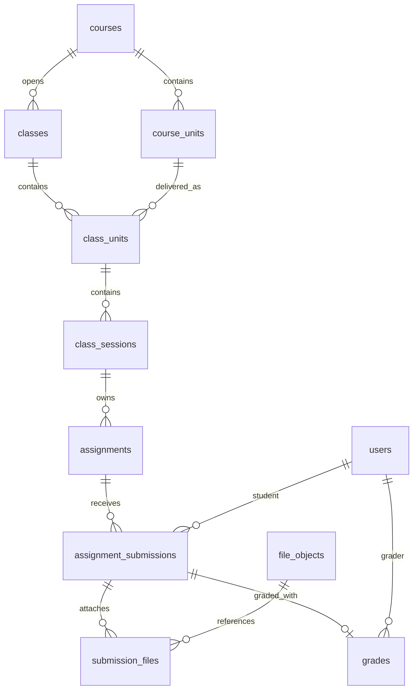

# Phase 5 — Assignment: bài kiểm tra/BTVN, QUIZ ABCD hoặc ZIP

2026-10-22 · Base `1e89579` · PLANNED, chưa implementation/migration/runtime test.
Phase 5 là tên feature assignment mới, khác milestone 5 checkout của core plan cũ.
[Flow](../../api_flow/PHASE_5_FLOW.md) · [API proposal](../../api_flow/PHASE_5_flow-api-breakdown.md) ·
[Progress](../../progress/phase%205/PHASE_5_PROGRESS.md).

## 1. Quan hệ hiện tại trong tài liệu, chưa có trong runtime

`document/mindy_center_full.dbml` thiết kế:

Một session có nhiều assignment; mỗi assignment có `class_session_id NOT NULL`.
ClassUnit/Class suy qua session, không gắn CourseUnit trực tiếp như Materials.
Submission thuộc assignment+student, unique `(assignment_id,student_id,attempt_number)`;
submission có nhiều file và tối đa một grade. DBML type cũ TEXT/FILE/CODE;
**chưa có migration/entity/service/controller BTVN trong source**. Enum/type cũ trong
DBML chưa phải runtime và chưa phản ánh yêu cầu mới QUIZ/ZIP của user,
purpose TEST/HOMEWORK và timer tùy chọn. Assignment không đồng nghĩa chỉ BTVN.
`TeachingAssignmentService` hiện là phân công mentor, không phải BTVN.

## 2. Yêu cầu đã xác nhận và mặc định đề xuất

**User xác nhận:** assignment có thể là bài kiểm tra hoặc BTVN; v1 có hai hình thức:
trắc nghiệm ABCD và nộp ZIP/folder đã nén. QUIZ bật/tắt timer theo số phút;
ZIP dùng deadline ngày/giờ, không có timer phút. Với quiz,
ví dụ có 40 câu, học sinh chọn toàn bộ rồi bấm Nộp một lần; BE lúc đó mới chấm và
trả đáp án. Không chấm khi chọn câu hoặc lưu draft, không submit từng câu.

**Mặc định đề xuất để implementation:** mỗi câu có đúng 4 option A/B/C/D và một
đáp án đúng; mọi câu bắt buộc trả lời. 40 là ví dụ, số câu cấu hình 1..200.
Quiz chỉ có một lần nộp chính thức mặc định vì nộp xong đã thấy đáp án. Nếu muốn
thi lại sau này cần explicit new attempt policy/reset có audit hoặc đề mới; không
tự áp default3 lần như bản draft planning trước. ZIP cũng default1 lần, có thể
cho maxAttempts1..10 do mentor đặt trước publish. Tách `purpose=TEST|HOMEWORK`
khỏi `type=QUIZ|ZIP`. V1 ZIP deadline absolute bắt buộc, không nhận late submission;
không proctoring/random-bank trong v1. QUIZ có timer tùy chọn như mục 4a.

Giữ owner là session, không đổi sang CourseUnit. Tái dùng đề giữa lớp nếu cần sau
này là template→instance, không dùng chung submissions/điểm. Không compiler/judge,
TEXT tổng quát, PDF/doc upload thay bài ZIP hay câu hỏi đa lựa chọn trong v1.

## 3. Schema đề xuất (migration additive mới, không sửa deployed migrations)

| Table | Fields/constraints chính |
|---|---|
| assignments | session_id FK, purpose TEST/HOMEWORK, type QUIZ/ZIP, title≤250, description plain text≤20000, due_at (bắt buộc ZIP, optional QUIZ), time_limit_minutes nullable (chỉ QUIZ; null=tắt, 1..240 khi bật), max_score numeric(8,2), max_attempts, status DRAFT/PUBLISHED/ARCHIVED, revision, published_at, creator/timestamps/deleted_at. QUIZ max_attempts=1 v1. |
| assignment_questions | assignment_id FK, position unique trong đề, prompt≤5000, question ID UUID; v1 câu hỏi plain text, 1..200 câu; không sửa published revision. |
| assignment_question_options | question_id FK, label enum A/B/C/D, text≤2000, unique(question_id,label). Publish bắt buộc đủ4, text không trắng. |
| assignment_answer_keys | question_id UNIQUE FK, correct_option label; composite FK đảm bảo option thuộc chính question. Không join/serialize bảng này trong Student detail/draft. |
| assignment_submissions | assignment_id, student_id, enrollment_id FK, attempt_number, assignment_revision, status IN_PROGRESS/SUBMITTED/GRADED/VOIDED cho quiz hoặc DRAFT/SUBMITTED/GRADED cho ZIP, started_at, expires_at nullable, submitted_at, submission_source MANUAL/TIMEOUT, version, assignment_snapshot (không chứa answer key), timestamps. Unique assignment/student/attempt; một active attempt/student/assignment. Timer snapshot lưu lúc start, không reset qua reload. |
| submission_answers | submission_id + question_id PK, selected_option A/B/C/D; câu/options phải thuộc snapshot đề của submission; không nhận correct/isCorrect/score từ client. |
| submission_quiz_results | submission_id UNIQUE, total/correct/wrong, score, private grading snapshot gồm correct/selected answer và explanation nếu có; chỉ authorizing own submitted result hoặc mentor scoped đọc. |
| submission_files | submission_id + file_object_id PK; ZIP v1 đúng1 file READY, own student, đúng intent/submission/enrollment/purpose. |
| grades | unique submission FK, grader_id nullable cho QUIZ auto grade, grading_source AUTO_QUIZ/MENTOR, current_version, released_version nullable. Không giả user mentor cho system. |
| grade_revisions | grade_id/version UNIQUE, score, feedback≤10000, actor/system source, reason, graded_at,released_at. Old released revision giữ visible đến khi release bản mới. |
| assignment_audits / grade_audits | append-only actor/action/version/reason/time; không raw file/bài làm/answer key trong app logs. |
| mutation receipts | unique actor+route+UUID key, payload hash và outcome reference/version; quiz result giữ durable trong DB, receipt không chứa signed URL. |
| attempt finalization jobs | durable outbox/job theo submission UNIQUE, expires_at/run_after/retry state; quiz timer expiry worker gọi cùng finalizer với manual submit, không phụ thuộc tab browser. |

Question IDs/option labels opaque hoặc A/B/C/D không thể thay quyền; ancestry kiểm
server. Snapshot đề publish immutable; muốn sửa câu/đáp án sau publish thì archive
và tạo đề mới (explicit clone draft sau v1 nếu cần). Không chấm học sinh theo đề đã
bị sửa. Quiz result giữ correct answer tại lúc submit, không đọc key mới để hiển
thị kết quả lịch sử. FK RESTRICT bảo toàn history. Enrollment composite guard đảm
bảo student/class đúng buổi; không chỉ kiểm tồn tại UUID.

Decimal scores response/request dùng chuỗi tối đa2 chữ số lẻ; maxScore0.01..999999.99.
Quiz câu đồng trọng số v1; `score = round(correctCount / totalQuestions * maxScore,2)`
với decimal arithmetic; chỉ round sau tổng. wrongCount=total-correct, không partial
credit/negative marking. `graderId=null`, `gradingSource=AUTO_QUIZ` cho quiz.

## 4. Quiz — luồng 40 câu theo yêu cầu

1. Mentor soạn assignment QUIZ, đủ40 câu hoặc N configured, mỗi câu4 option và key.
   GET mentor authoring có key đúng scope; Student projection không key/isCorrect.
2. Publish khóa revision; student ACTIVE + unit released mới đọc đề. Student GET
   trả `questions:[{id,position,prompt,options:[{label,text}]}]`, totalQuestions,
   dueAt/revision/capabilities. Không key, feedback, correct flags hoặc giải thích
   chứa đáp án. Dữ liệu đáp án không nằm trong HTML/hidden fields/source map.
3. Student bấm Bắt đầu → BE tạo/resume attempt và chốt startedAt/expiresAt; GET đề
   trước start chỉ metadata, không full questions. PUT answers lưu tập lựa chọn với
   expectedVersion (debounced/batch), chỉ trả answeredCount/answers/version;
   BE không tính score hoặc đánh dấu đúng/sai khi lưu.
4. Khi thiếu câu: FE hiển thị số đã chọn ví dụ39/40; button submit disabled nhưng
   BE vẫn validate. POST submit nhận **toàn bộ** mảng40 answers và expectedVersion,
   không bắt buộc mọi lựa chọn đã autosave xong; final payload là nguồn có thẩm quyền.
   Chờ/dừng autosave in-flight;409 yêu cầu refetch draft rồi xác nhận nộp lại.
5. BE transaction kiểm role/enrollment/unit/publish/revision/deadline/timer/one-attempt;
   validate đúng40 question IDs distinct, không thiếu/thừa/cross-assignment IDs,
   mỗi selectedOption A/B/C/D. Client-supplied score/correct fields bị reject DTO.
6. BE mới load private answer keys và chấm, ghi immutable answers + assignment
   snapshot + graded result + auto grade released + audits/receipt cùng commit.
   Quiz chuyển thẳng GRADED atomically, không queued/202 hay worker chấm ngoài tx.
7. HTTP200 trả correctCount/wrongCount/total/score/maxScore và **đáp án từng câu
   ngay sau nộp** `{questionId,selectedOption,correctOption,isCorrect}`. UI đánh dấu
   đúng/sai, hiển thị key; đây là user requirement, không trì hoãn đến deadline.
8. Reload/lost response: GET own result trả cùng durable result; retry POST cùng
   key/body không chấm lại/ăn lượt. Key khác sau submitted trả409 có resultId để
   FE mở result. Student khác/mentor ngoài scope không truy cập.

Không đưa đáp án vào draft errors/validation messages/metrics/logs. SUBMISSION_INCOMPLETE
chỉ trả missingQuestionIds/count, không gợi ý đúng. Submit fail không persist grade
và không tạo thêm lượt ngoài attempt đã start. BE check đủ câu cả khi FE bị bypass.
Quiz autosave không phải submit, không có endpoint check-answer từng câu.

## 4a. Timer tùy chọn cho QUIZ, deadline ngày giờ cho ZIP

**QUIZ:** `timeLimitMinutes=null` là tắt; số nguyên1..240 là bật. FE hiển thị toggle
và ô phút, không gắn timer bắt buộc chỉ vì purpose=TEST. QUIZ có thể có dueAt tùy
chọn để đóng đề; nếu cả timer/dueAt đều null thì làm đến khi nộp/archive. Start
response trả serverNow/startedAt/expiresAt: expiresAt=min(startedAt+minutes,dueAt)
với các giá trị không null; null nếu không có cả hai. Timer dùng clock DB, không
client elapsed/timezone. Reload/mở tab khác/network failure không reset/pauses timer.
Snapshot time limit lúc start, thay đề/config sau start không kéo dài lượt đã mở.

Manual submit trước expiresAt phải đủ N câu. Tại `now >= expiresAt`, BE từ chối
ghi lựa chọn mới và timeout finalizer chấm các answers **đã lưu server trước hạn**;
unanswered tính sai, total luôn N. Đây là ngoại lệ có chủ đích cho yêu cầu manual
submit đủ câu. Finalizer ghi GRADED + TIMEOUT + grade/result/audit atomically, trả
đáp án qua GET result sau finalization, không yêu cầu học sinh còn mở tab. UI
countdown gọi refetch/result khi hết giờ nhưng không là nguồn quyết định hết giờ.

Chấm timeout do worker bền vững; restart phục hồi pending jobs, poll fallback từ DB;
GET không có side effects. Khi expired chưa finalize, trả200 state
`FINALIZING`, result=null,retryAfterSeconds=2; UI poll bounded60s rồi cho refresh,
worker tiếp tục độc lập. Không trả key trước grade commit. Manual submit vs timeout
khóa cùng attempt; một winner duy nhất, receipt retry giữ result đã commit. Late
POST submit không nhận final payload thay answers đã lưu;409 ATTEMPT_EXPIRED kèm
resultUrl, worker/finalizer không bỏ qua deadline dù client đổi clock. Role/suspend
thu hồi read/write ngay; system chỉ finalize attempt hợp lệ đã start, không cấp lại
quyền vào nội dung. Archive/cancel trước khi nộp chuyển active attempts sang VOIDED,
không chấm như bài sai; worker kiểm state dưới cùng locks. Revoke enrollment trước
timeout cũng VOIDED, giữ nháp/private history, không auto cấp grade.

Start tiêu hao một quiz official attempt; retry/resume trả cùng attempt, không cho
abandon rồi start lại để reset đồng hồ. Quiz đã nộp không cho bắt đầu lại vì đã xem
đáp án. ZIP không dùng endpoint quiz start, không startedAt timer/expiresAt duration.

**ZIP:** dueAt ISO8601 có offset bắt buộc, hiển thị date/time picker theo APP_TIME_ZONE.
Nộp hợp lệ chỉ khi DB now<dueAt; upload/READY trước hạn không giữ quyền submit sau
hạn. Không timer phút. Gia hạn dueAt có reason/audit cho ZIP, không hồi tố deadline
của bài đã nộp. V1 không allowLate; gia hạn là thao tác rõ ràng của mentor.

## 5. ZIP — upload riêng, submit và mentor chấm

Student tạo submission draft → POST scoped upload intent → PUT bytes lên private
storage → POST complete → poll READY/FAILED → attach file ID → POST submit.
ZIP v1 đúng1 file, đề xuất max20MiB compressed và max100MiB uncompressed, ≤1000
entries, max ratio100, không encrypted/nested archives/symlink/absolute path/`..`.
Giới hạn áp cả server/worker, không tin extension/MIME của client; kiểm magic,
archive structure, stream/cancel/time limits; không execute code. Retention/scan
và quota reused Files baseline, file FAILED/quarantine không submit được.

**Files hiện chỉ Manager/Mentor Course Unit scope.** Cần capability
`ASSIGNMENT_SUBMISSION` với assignment/submission/enrollment/student do server
resolve. Không chỉ thêm STUDENT vào guard material. Giữ course_unit_id derive từ
session ancestry, bổ sung purpose/binding FK/mapping additive; material references/
projections phải loại submission-purpose. Student file không trở thành tài liệu
chung cho CourseUnit. Không cho client tự chọn studentId/courseUnitId hay storage key.

Complete/attach/submit kiểm lại quyền và READY/owner/scope. READY không tự nộp.
Download ngắn hạn chỉ own submission history hoặc mentor được chấm assignment đó,
file phải attached + version match; kiểm lại sau sign, không lộ bucket/key/version.
Không unzip lên filesystem phục vụ web hoặc tải mọi source về application logs.

ZIP SUBMITTED immutable. Mentor tải ZIP → soạn grade draft → release. Student
chỉ thấy released score/feedback; correction grade có reason/version/audit, giữ
bản released trước đến khi công bố mới. Score0..maxScore snapshot. Nếu cho nộp
lại, attempt mới không ghi đè file cũ; latest submitted attempt là kết quả hiệu
lực, latest chưa grade thì status pending, history điểm cũ vẫn riêng.

## 6. Quyền và vòng đời chung

- Primary quản lý BTVN toàn lớp; substitute chỉ session mình được phân công
  (provider4.6 scheduled override/historical teaching snapshot). CreatedBy không
  là quyền vĩnh viễn. Không cấp cả material authoring khi mở assignment scope.
- Student ACTIVE, class writable, unit released mới draft/upload/submit. CASH_PENDING
  chỉ preview hiện có; guest makeup không tự có BTVN của lớp đích.
- Completed/cancelled enrollment chỉ đọc own submitted snapshot/result/files theo
  retention; không mở lại đề mới hoặc class content. Đề source archive/cancel vẫn
  giữ result/history; account active và ownership luôn kiểm lại.
- Assignment DRAFT→PUBLISHED→ARCHIVED. Soft delete draft chưa có submissions;
  published content/key/type/maxScore frozen. Chỉ gia hạn ZIP deadline và ZIP
  maxAttempts tăng có reason/audit; QUIZ timer/config đóng băng sau publish. Archive chặn
  submit/draft mutations, result lịch sử vẫn đọc được. Không unpublish rồi sửa lén.
- Clock DB: submit/answers yêu cầu now<effective deadline nếu có. Tạo draft trước hạn không
  giữ quyền nộp. Mutation version/UUID key, tx locks chống publish/archive/deadline/
  assignment revoke races. Network/storage calls ngoài DB tx.
- Reschedule giữ session ID: assignment giữ nguyên, deadline không tự đổi. Cancel
  giữ bài/điểm/history, chặn new submit. Makeup replacement không auto copy/rebind
  bài; source enrollment không được nhân đôi nghĩa vụ. Rebind/clone explicit v2.
- Reports tách attendance/quiz/ZIP/learningProgress. Không tự biến submit/quiz score
  thành hoàn thành unit/certificate. Missing chỉ tính published eligible assignment
  sau deadline, không draft/guest/hold chưa thanh toán. Weighted gradebook/pass
  threshold/certificate/notifications/proctoring là backlog riêng; timer QUIZ thuộc v1.

## 7. Delivery slices và nghiệm thu

| Slice | Việc | Điều kiện hoàn tất |
|---|---|---|
| A0 scope/schema | Typed access4.6, migrations additive, DTO/domain/state/rules | Quiz/ZIP đúng2 types, private key projection và constraints/retention rõ. |
| A1 đề QUIZ | Mentor CRUD draft/questions/options/key, publish/archive, student get | Publish chỉ đủ câu/options/key; student response/error không key; frozen revision. |
| A2 làm/nộp QUIZ | Start/resume, timer optional, batch autosave, whole-paper submit, timeout worker, server grading/result | Case40/40, expiry unanswered sai, clock/reload/race, missing/foreign answer, atomic grade/retry/one-attempt; key chỉ sau finalization. |
| A3 ZIP storage | Safe ZIP pipeline + scoped intent/complete/status/access | MinIO/worker/zip limits/purpose isolation tests, failed ZIP không usable. |
| A4 ZIP grading | Submit immutable ZIP, mentor queue/read/grade/release/history | Ownership, deadline/attempts, grade correction/release race/no draft grade leak. |
| A5 reports/handoff | Class/session list, missing/ungraded metrics, contract/tests | Full DTO/Swagger/Postman; pnpm check/compiled HTTP/PG/MinIO; docs consistent. |

Thứ tự A0→A1→A2 để giao quiz trước; A3→A4→A5 đóng ZIP. Có thể nghiệm thu quiz
độc lập, nhưng không tuyên bố ZIP usable trước A3. Không compiler CODE v1.

## 8. Test matrix bắt buộc

1. 40 câu chọn đủ: submit200, BE đúng count/score/answer list;33/40 sai7 score82.50
   nếu max100; missing1 trả422, không grade/tạo thêm lượt; FE disabled không thay BE check.
2. GET đề/draft/autosave/network errors không answer keys/isCorrect/score/giải thích
   lộ key; mentor ngoài scope không đọc answer-key API.
3. Duplicate IDs, foreign question, optionE/missing/extra answers, injected score/key.
4. Lost response/retry cùng key, key mismatch, concurrent submit/same student/key mới:
   chỉ một official attempt/result, immutable result GET reload khớp submit.
5. Autosave vs submit/expiry/version race; timer off/on, optional dueAt ceiling,
   reload/resume nhiều tab, worker restart/timeout, exact boundary, archive→VOIDED,
   deadline edit/revocation khi submit, no client-clock trust.
6. Pending payment/LOCKED unit/expired hold/completed/cancelled; guest không quyền.
7. ZIP rename giả/encrypted/traversal/symlink/bomb/nested/oversize/quota/timeouts;
   READY/wrong owner/purpose/scope/stale/deleted file; file access revoke sau sign.
8. Submit ZIP đúng1 file READY; draft không graded; grade negative/overmax/precision.
9. Student không thấy grade draft; sửa điểm giữ bản released trước; concurrent grader.
10. Enrollment/history bảo toàn sau course/session cancel/reassign, không cross-class
    result, không regenerate current answer keys cho old result.
11. Reporting counts/pagination scoped, missing after due only, no denominator null.
12. Migration clean/upgrade/rollback guard + material pipeline regression; compiled
    guards/Origin/body/DTO checks; zip processing async idempotency/retry bounded.

## 9. Handoff và rollback

Mỗi slice cập nhật flow/API/progress/Postman; deploy/browser evidence tách local.
Schema đã có history không destructive down; rollback app giữ submissions/results.
Student correct-answer immediate sau submit đã được user yêu cầu, không đổi thành
delayed-release policy. Các mặc định khác (single correct,1..200,max20MiB,one attempt,
ZIP resubmit/grading release, timeout auto-submit unanswered sai) là proposal cần
ghi nhận nếu thay đổi khi code. Optional quiz timer và ZIP date/time deadline đã
được user yêu cầu; không biến assignment thành chỉ BTVN.
Không sửa FE, không migration production, không chạy code trong ZIP trong phase này.
